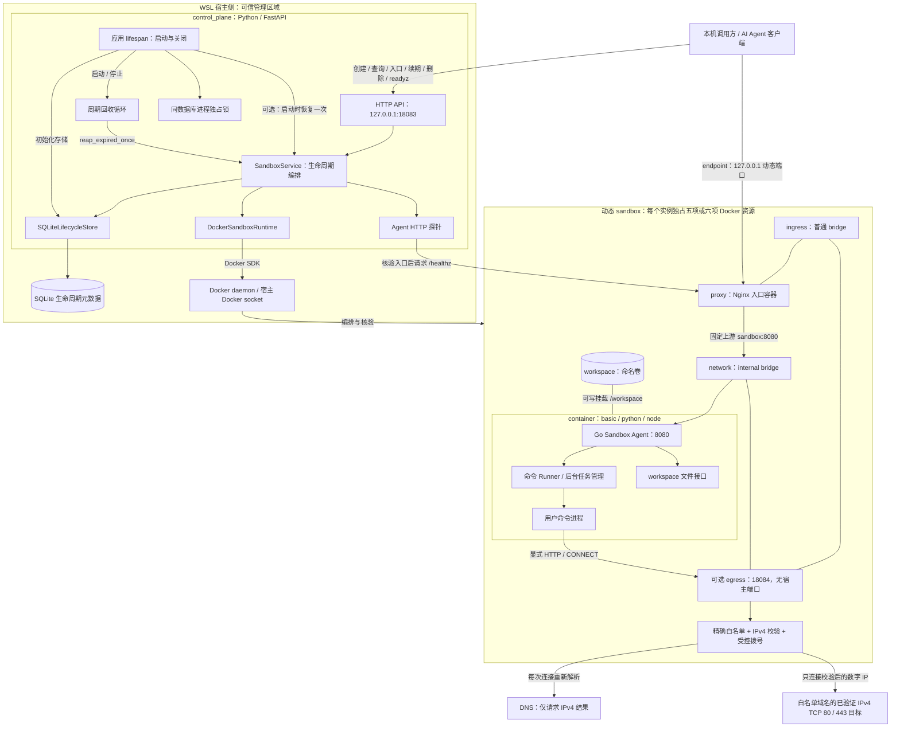

# Agent Sandbox 系统架构设计

本文描述当前代码已经实现的组件关系、请求路径和信任边界。项目采用宿主侧控制面与容器内数据面分离的设计，当前以 WSL、本机 Docker、单进程和单 worker 为运行前提。出口代理通过可选精确域名白名单接入新建动态实例的生命周期；默认和既有实例保持原禁网链路。

组件细节分别见 [Control Plane 设计](control_plane/DESIGN.md)、[Docker Runtime 设计](control_plane/docker/DESIGN.md)、[Sandbox Agent 设计](sandbox_agent/DESIGN.md)和 [Egress Proxy 设计](egress_proxy/DESIGN.md)。源码位置见[仓库目录](REPOSITORY_LAYOUT.md)，开发状态及历史验证结果见[开发进度](PROJECT_PROGRESS.md)。

## 设计目标

- 控制面负责实例生命周期、规格约束、资源编排与元数据，数据面负责命令和文件，不让用户命令经过生命周期服务转发。
- 运行时事实来自 Docker，可更新的期限和管理状态来自 SQLite；身份匹配后才合并，保留部分失败的诊断与重试依据。
- 容器、命令、请求和代理传输均设置有限额度，取消和清理属于完整操作的一部分。
- 按当前单机链路逐步演进；未实现的能力不作为组件之间的隐含依赖。

## 当前系统架构

图中的箭头表示调用或数据方向，连线表示网络连接或挂载关系。Docker daemon 的资源编排线包括实例内全部受管资源；不表示数据面流量经 Docker SDK 转发。图展示一套动态实例拓扑，多实例各自拥有网络、容器和 workspace。

入口 Nginx 和 Egress Proxy 是两个组件：前者把本机 endpoint 请求转发到指定 Agent，已经用于动态实例；后者仅在创建时配置非空 `network.allow_domains` 才连接本实例两网，对显式 HTTP/CONNECT 执行出口策略；不会发布另一个本机入口。

## 组件职责与边界

| 组件              | 当前职责                                                 | 状态与依赖                                                     |
| ----------------- | -------------------------------------------------------- | -------------------------------------------------------------- |
| Control Plane API | HTTP 输入、响应、超时及领域错误映射                      | 通过 SandboxService 调用后端                                   |
| SandboxService    | 创建、查询、续期、删除、到期回收、pending 核验及受控确认 | 依赖 Runtime、Store 和可注入探针，不依赖 Docker SDK 或 FastAPI |
| Lifecycle Store   | 生命周期记录、状态迁移、版本保护与有界候选查询           | 标准库 SQLite；不调用 Docker                                   |
| Docker Runtime    | 五项或六项资源编排、运行状态、入口及归属核验、删除             | 仅操作后端，不访问 SQLite                                      |
| Nginx 入口代理    | 将本机动态端口转发到本实例 Agent，支持文件和 SSE         | 连接 ingress 与 internal；不挂载 workspace 或 Docker socket    |
| Sandbox Agent     | 同步、SSE、后台命令及文件接口                            | 与用户进程同容器、同用户；不管理 sandbox 生命周期              |
| Workspace         | 保存实例工作文件                                         | 默认删除实例时保留，尚无自动清理或磁盘配额                     |
| Egress Proxy      | 独立 HTTP 转发、CONNECT 和受控 IPv4 TCP 拨号             | 非空白名单时由 Runtime 管理，不依赖 Agent                  |

Control Plane 默认数据库为 `control_plane/.local/lifecycle.sqlite3`，路径以项目文件位置为基准。SQLite 使用整数 UTC 时间表示保留微秒，可更新期限只保存在数据库中。Docker 初始时间标签保留创建时的时间；Agent 后台命令记录仅保存在内存，Agent 重启后不可恢复。

## 主要请求路径

### 创建与交付

调用方通过创建 API 选择 basic、python 或 node，并可指定受约束的 CPU、内存、初始 TTL 和精确域名出口白名单；空请求保持默认。Service 校验规格、生成身份并只取一次 UTC 创建时间，先写入 pending，再将同一规格交给 Runtime。Runtime 预检所选主镜像、固定入口镜像及仅启用出口时的固定出口镜像，按依赖顺序创建资源，保存完整归属和初始时间标签。

Runtime 创建成功后，Service 按原事务、版本和 pending 状态确认 active，才能返回创建成功。创建成功不等待 Agent ready；活动管理状态与运行健康是不同维度。失败或取消进入现有精确资源记录和逆序回滚路径，结果不明确时保留 pending，不根据数据库记录推断资源已完整创建。

### 查询、就绪与执行

查询先从 Runtime 确认实际实例，再核对 SQLite 的实例 ID、事务 ID 和创建时间，使用数据库中的当前 expires_at。无记录的旧资源仍可按现有规则查询和删除，不自动接管；数据库有记录而实例已不存在时仍返回 404。

三种观察范围分别是：

| 观察               | 能说明什么                                       |
| ------------------ | ------------------------------------------------ |
| 状态为 ready       | Docker 观察到 Agent 健康，启用时还要求出口健康及拓扑正确                   |
| endpoint 查询成功  | 实例、入口代理、网络、归属及实际本机端口满足入口规则；不保证出口可达 |
| 实例级 readyz 成功 | 本次控制面经已核验入口访问 Agent /healthz 成功   |

调用方拿到 endpoint 后直接向入口代理发送命令和文件请求。同步与 SSE 请求断开会取消执行；后台命令登记后独立于提交连接，可按 ID 查询、取消及按字节偏移读取有界输出。它们共用 Agent 的命令执行额度，均复用同一 Runner，不隐式通过 shell 执行 argv。

### 续期、回收与删除

续期先核验实际实例及元数据身份，只允许尚未到期的 active 记录。新期限为 `max(current_expires_at, now + ttl_seconds)`，通过事务和预期版本保护更新；不更换环境、不改变容器资源和 Docker 初始时间标签。

手动删除与回收先受保护地认领 deleting，再调用 Runtime 核验所有存留资源的归属并删除，完成后按认领的事务和版本清理记录。进入 deleting 后不能续期。周期回收默认每轮结束后等待 60 秒，每轮最多处理 100 项，到期判断与 active 认领在数据库中原子完成；pending 不作为回收候选，失败的 deleting 留待重试。

默认正式删除保留 workspace，但移除已结束实例的生命周期记录。创建回滚清理本次确认创建的 workspace，与正式删除的默认留卷策略不同。到期回收存在扫描、处理和重试延迟，不保证到期瞬间删除。

## 启动、恢复与跨系统失败

控制面启动顺序为：获取实际数据库对应的系统文件锁、显式初始化存储、可选执行一批 pending 确认恢复、启动周期回收，再提供 HTTP 服务。导入和应用装配不创建数据库、不获取运行锁、不连接 Docker。关闭时等待回收及关键收尾，再释放锁；同库锁只约束遵守协议的本机控制面，不是分布式 fencing。

pending 只读核验与确认恢复均为有界单轮操作。启动恢复默认关闭；开启时仅对策略决定的五或六角色完整、身份匹配、Agent ready、启用出口健康及拓扑正确、入口核验通过且提交时尚未到期的原记录确认 active。它不修补资源、不删除失败实例、不重置 TTL；跳过项不会自动周期重试。

SQLite 与 Docker 没有跨系统原子事务。异步调用被取消也不代表 SQLite 或 Docker 工作线程已经停止，Service 必须等待已开始的关键任务收尾并读取最终结果。失败响应不能一概解释为“没有提交”或“没有创建资源”；不盲目刷新版本、补写记录或接管其他事务。具体补偿与重试语义由各组件设计文档维护。

## 部署与安全边界

- 宿主侧控制面和 Docker daemon 拥有资源管理权限，Docker socket 只由控制面访问，不挂载给入口代理、sandbox 或出口代理任务。
- 动态 sandbox 只接入专属 internal 网络，不发布宿主端口；Nginx 通过双网连接提供 loopback 动态入口。入口代理不承担出口白名单策略。
- Sandbox 采用非 root、只读根文件系统、有限 CPU/内存/PID、受限 tmpfs、drop ALL capabilities 和 no-new-privileges；workspace 是显式可写挂载。资源上限不代表全局容量预留。
- Agent 与用户进程同用户运行，文件 API 的 workspace 路径约束不限制命令本身。现有进程组取消不覆盖逃离原组的后代，也不保证持有管道的后代全部被回收。
- 当前服务没有认证、授权和审计，只用于可信本机开发。域名标签、Docker 标签和进程锁分别服务于策略、归属和运行互斥，不能替代认证或完整隔离。

固定 Compose 是另一条独立开发链路，入口为 `127.0.0.1:18081`，沿用固定网络和 workspace。控制面不接管这套已有资源；它与动态实例共享 Agent 协议，但资源装配和所有权独立，不能将动态实例配置直接套作 Compose 配置清单。

## 当前限制与后续方向

当前尚无全协议网络策略、pending 缺失资源修补或清理、周期恢复、暂停恢复、任务持久化、整机预算、workspace 自动清理及多 worker 协调。任意镜像、其他隔离运行时、认证和审计仍属后续方向。

独立 Docker smoke 已覆盖 sandbox 经出口代理的 HTTP/HTTPS、可达性对照和直连拒绝，但不接管既有实例。Egress Proxy 已实现的 HTTP/CONNECT 能力只约束它自身建立的 IPv4 TCP 80/443 连接，不支持 IPv6、UDP 或 QUIC，不做 TLS MITM，也不能阻止允许站点自身二次转发。动态出口配置通过版本化不可变标签恢复，异常策略不降级放行；删除仍按完整归属回收合法残留。架构图展示当前关系，不代表生产级安全隔离。
