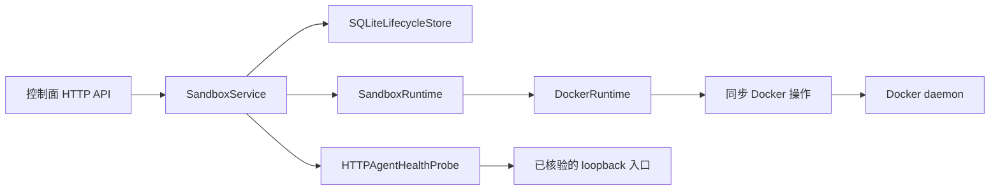

# Docker Runtime 设计与实现

`DockerRuntime` 是控制面的 Docker 后端，面向可信本机 Linux/WSL 开发。它把领域规格转换为 Docker 资源，管理创建、查询、暂停、恢复、删除和工作区卷，并把 Docker 观测结果转换成领域模型。控制面的完整生命周期和 SQLite 状态见 [控制面设计](DESIGN.md)，环境配置、镜像构建和真实 Docker 验收见 [运行手册](RUNBOOK.md)。

## 职责与调用关系

`create_app()` 读取 `ControlPlaneSettings`，构造 `DockerRuntime` 并将其装配进 `SandboxService`。当前运行时配置只接受 `docker`。服务依赖 `SandboxRuntime` 异步契约，并协调实例操作锁、SQLite 生命周期、凭据和工作区占用。Docker 后端负责 daemon 上的资源操作，Store 负责持久化元数据。[应用装配](../../control_plane/app.py) · [运行时契约](../../control_plane/runtime/base.py) · [服务编排](../../control_plane/services/sandbox_service.py)



| 模块 | 实现职责 |
| --- | --- |
| [`adapter.py`](../../control_plane/runtime/docker/adapter.py) | 实现异步契约，将同步 SDK 调用交给工作线程，协调取消和收尾。 |
| [`client.py`](../../control_plane/runtime/docker/client.py) | 定义两类客户端协议和惰性工厂。 |
| [`creation.py`](../../control_plane/runtime/docker/creation.py) | 按阶段创建资源，记录精确身份，失败时逆序回滚。 |
| [`images.py`](../../control_plane/runtime/docker/images.py) | 校验可信环境映射、解析镜像 ID、检查镜像声明的挂载。 |
| [`inspection.py`](../../control_plane/runtime/docker/inspection.py) | 编排运行状态、实例入口和 pending 资源的只读查询。 |
| [`endpoint.py`](../../control_plane/runtime/docker/endpoint.py)、[`egress.py`](../../control_plane/runtime/docker/egress.py) | 分别检查入口代理和出站代理，查询与暂停流程共用这些校验。 |
| [`resources.py`](../../control_plane/runtime/docker/resources.py) | 按角色发现资源，核验精确身份和标签，执行移除并验证结果。 |
| [`lifecycle.py`](../../control_plane/runtime/docker/lifecycle.py) | 暂停、恢复和删除已核验的实例资源。 |
| [`workspaces.py`](../../control_plane/runtime/docker/workspaces.py) | 创建、初始化和删除独立卷，核验工作区身份、容器引用与挂载。 |

### 客户端与超时

- 构造 Runtime 时只保存客户端工厂与只读镜像映射。适配层通过 `asyncio.to_thread()` 调用同步操作，每次操作在需要时打开客户端，并在结束时关闭。[适配层](../../control_plane/runtime/docker/adapter.py)
- `/readyz` 经 Service 调用只读 `ping()`，探测客户端的 transport timeout 为 **0.5 秒**。生命周期与查询客户端为 **5 秒**。这两个值用于 Docker SDK 传输，HTTP 等待预算由控制面独立设置，多阶段操作的总耗时取决于各阶段及其收尾。[客户端工厂](../../control_plane/runtime/docker/client.py) · [健康路由](../../control_plane/api/health.py) · [配置定义](../../control_plane/config/settings.py)
- 测试可分别注入两类客户端工厂，用替身记录调用及模拟超时、取消、资源冲突和移除后检查。[运行时测试](../../control_plane/tests/runtime)

## 资源、网络和归属

每个动态实例有五个基础资源角色，配置了非空精确域名白名单时增加 `egress`。独立工作区可以提供 `workspace` 这一角色，其卷归属独立于当前实例。

| 角色 | 资源及连接 |
| --- | --- |
| `network` | 专用 internal bridge，连接主容器与所需代理。 |
| `ingress` | 专用普通 bridge，连接入口代理与可选出站代理。 |
| `workspace` | 实例持有的命名卷，或显式绑定的独立卷，挂载到主容器的可写 `/workspace`。 |
| `container` | 主容器，只加入 internal，使用固定别名 `sandbox`，无宿主端口映射。 |
| `proxy` | 入口代理，同时连接两张网络，由 Docker 动态分配 `127.0.0.1` 端口来发布容器的 8080。 |
| `egress` | 可选出站代理，同时连接两张网络，在 internal 上使用别名 `egress`，无宿主端口映射。 |

主容器和代理采用各自的固定配置，包含非 root 用户、只读根文件系统、capability 限制、`no-new-privileges` 和资源上限。主容器 CPU 和内存来自受约束的领域规格，在创建阶段映射为 Docker 的 `nano_cpus`、`mem_limit` 和 `memswap_limit`。镜像和网络由控制面按可信配置装配。完整参数和拓扑见 [控制面资源设计](DESIGN.md#topology)。

普通实例资源用 `io.agent-sandbox.` 前缀下的 `managed`、`project`、`sandbox-id`、`transaction-id`、`resource` 标记归属。网络配置、入口能力、初始生命周期时间和独立工作区绑定另有标签。发现时按角色列举，再按精确 Docker ID 重新读取；Docker volume 的标识使用卷名。重复角色、混合事务、归属不一致都会使核验失败。删除前还会核对发现时记录的身份和预期归属，资源名称用于定位与诊断。[领域规格](../../control_plane/domain/models.py) · [资源发现](../../control_plane/runtime/docker/resources.py)

## 创建、回滚与取消

1. **预写元数据。** Service 生成实例 ID、事务 ID 和入口 Token，在 SQLite 事务中保存 `pending` 记录、凭据及可选的独立工作区占用。独立卷绑定在预写前解析所选环境镜像并检查身份，随后随规格传给 Runtime。[创建编排](../../control_plane/services/sandbox_service.py) · [工作区服务](../../control_plane/services/workspace_service.py)
2. **预检镜像。** Docker 创建事务确认所选 Agent、固定入口代理及所需出站代理镜像已经存在于本地。校验 Agent 镜像声明的卷和入口镜像的能力标记，解析为镜像 ID 后按 ID 创建。额外的镜像卷声明会被拒绝，以避免产生无法纳入回滚清单的匿名卷。[镜像预检](../../control_plane/runtime/docker/images.py) · [创建事务](../../control_plane/runtime/docker/creation.py)
3. **按顺序创建。** 依次创建 internal bridge、ingress bridge、实例专用卷或核验已有独立卷、主容器、入口代理、可选出站代理。代理先建在 ingress 上，再按网络 ID 接入 internal 后启动。每次创建获得有效身份后，尽早记录资源角色、ID 和预期标签，供后续失败回滚。[创建事务](../../control_plane/runtime/docker/creation.py)
4. **确认管理状态。** Runtime 成功返回后，Service 确认原事务的 `active` 状态。创建响应的 `started` 表示创建和启动步骤已完成，Agent 健康另由查询或主动就绪检查给出。若元数据确认失败，Service 根据读取到的原事务状态决定补偿或保留恢复信息。[创建编排](../../control_plane/services/sandbox_service.py)

SDK 调用可能已在 daemon 提交，但响应丢失。回滚仅处理已记录且仍匹配精确身份和归属的资源，按创建顺序逆序移除，并重新检查相同 ID 的缺失。创建失败通过 `CreationFailureInfo` 向 Service 传递失败阶段、资源状态和清理问题。[回滚实现](../../control_plane/runtime/docker/creation.py) · [领域错误](../../control_plane/domain/errors.py)

| 创建失败证据 | Service 的元数据处理 |
| --- | --- |
| `UNCHANGED`，确认未改变资源 | 可以按原事务和版本清除创建元数据。 |
| `ROLLED_BACK`，确认本次创建资源已回滚 | 可以按原事务和版本清除创建元数据，并随之释放占用。 |
| `REMAINING` 或 `UNKNOWN`，存在残留或结果无法确认 | 保留生命周期记录、凭据与占用，供核验和恢复。 |

异步取消通过事件通知创建线程在 Docker 阶段之间停止。适配层等待工作线程收尾。如果创建已抢先成功，则用该次创建返回的精确资源清单补偿。遇到响应丢失、回滚失败或无法核验的结果时，保留相应的失败证据。[取消与补偿](../../control_plane/runtime/docker/adapter.py) · [失败收尾](../../control_plane/services/sandbox_service.py)

## 查询、入口与 pending 恢复

| 运行时方法 | 观测结果及用途 |
| --- | --- |
| `get()` | 核验主容器身份、Docker 状态和健康检查结果。启用出站时一并核验所需代理的拓扑、暂停和健康状态。Service 在匹配事务、创建时间及工作区后，用数据库中的到期时间覆盖标签里的初始值。 |
| `get_endpoint()` | 检查主容器和入口代理的事务一致性、代理健康、网络连接和实际发布端口，返回核验后的 loopback 地址、入口认证信息及支持的服务协议版本。 |
| `inspect_resources()` | 分别核验各资源角色并返回 `all_present`、`partial`、`not_found`、`conflict` 或 `unavailable`，供维护流程区分完整、缺失、冲突与观测失败。 |

入口认证的凭据核验跨越两层。Runtime 从已核验代理配置取得配置 Token 的摘要，Service 将其与原事务、创建时间和 SQLite 凭据对照，匹配后才交付访问凭据。实例主动就绪由 Service 先检查状态，再对已核验的入口执行固定匿名 `GET /healthz`。[入口核验](../../control_plane/runtime/docker/endpoint.py) · [查询实现](../../control_plane/runtime/docker/inspection.py) · [凭据比对](../../control_plane/services/endpoint_access.py)

开启 pending 恢复时，维护流程先要求资源完整，再检查原实例身份、`ready` 状态、工作区绑定和入口。提交激活前重新读取 pending 记录并检查版本及期限。Runtime 提供这些观测，维护流程负责是否确认原记录。[维护实现](../../control_plane/services/maintenance.py) · [控制面恢复设计](DESIGN.md)

## 暂停、恢复与删除

- **暂停和恢复。** 每次操作先核验完整资源集合、事务、工作区和网络拓扑，并在每个目标变更前复查。暂停先主容器后可选出站代理，恢复顺序相反。入口代理保留运行。已到目标状态的容器跳过，SDK 响应异常时重新读取实际状态，最终再次确认所有目标。部分完成可用同一操作重试。[暂停与恢复实现](../../control_plane/runtime/docker/lifecycle.py)
- **实例删除。** 有生命周期记录时，Service 先把原版本认领为 `deleting`。Runtime 支持从残留资源中发现目标，按出站代理、入口代理、主容器、ingress、internal、可选实例卷的顺序删除。每项操作核对精确 ID 和归属，移除后检查缺失，最后重新扫描。暂停中的容器直接强制移除，以免为删除而恢复用户进程。确认运行时删除后，Service 再移除原生命周期记录并释放占用。[删除实现](../../control_plane/runtime/docker/lifecycle.py) · [精确资源移除](../../control_plane/runtime/docker/resources.py) · [删除编排](../../control_plane/services/sandbox_service.py)

## 独立工作区

独立卷使用工作区 ID、`creation_token`、镜像 ID 等标签标识，创建时要求新卷，使用固定镜像 ID 的禁网初始化容器填充镜像内的工作区内容，再核验并移除初始化容器。复用时以 `no_copy=True` 挂载，并检查卷身份、所有容器引用与主容器的实际挂载。实例资源记录的绑定标签使控制面重启后仍能核对 Docker 与 SQLite 的绑定身份。[工作区实现](../../control_plane/runtime/docker/workspaces.py)

排他占用由 SQLite 中唯一的 `lifecycle_records.workspace_id` 表达。Runtime 的实例删除跳过绑定的独立卷，Service 在元数据事务中释放占用。独立卷通过单独的工作区删除流程处理，Runtime 在实际删除前核验归属并确认无容器引用。普通实例专用卷默认保留，只有显式要求时随实例删除。[工作区服务](../../control_plane/services/workspace_service.py) · [占用约束](../../control_plane/storage/schema.py)

## 扩展与验证

新增后端时，接入点是 `SandboxRuntime` 和 `app.py` 的应用装配。后端负责把资源状态、身份、失败和取消结果转换为契约中的领域信息。接入独立工作区功能还需实现镜像解析与工作区创建、核验、删除。服务通过契约调用后端，依赖边界测试递归检查运行时子包的导入关系。[运行时契约](../../control_plane/runtime/base.py) · [依赖边界测试](../../control_plane/tests/api/test_layer_boundaries.py)

在 `control_plane/` 执行运行时和依赖边界测试，覆盖客户端调用、资源创建与回滚、入口、出站、暂停、删除和独立卷。跨 SQLite 的创建补偿及恢复由服务层测试覆盖。[运行时测试](../../control_plane/tests/runtime) · [创建补偿测试](../../control_plane/tests/services/test_creation_recovery.py)

```bash
uv run --locked pytest -q tests/runtime tests/api/test_layer_boundaries.py
```

真实 Docker 验证使用独立临时数据库，按本次创建的精确 ID 与完整归属校验清理资源。镜像准备、Docker 和 SDK 的集成命令见 [运行手册](RUNBOOK.md)。
