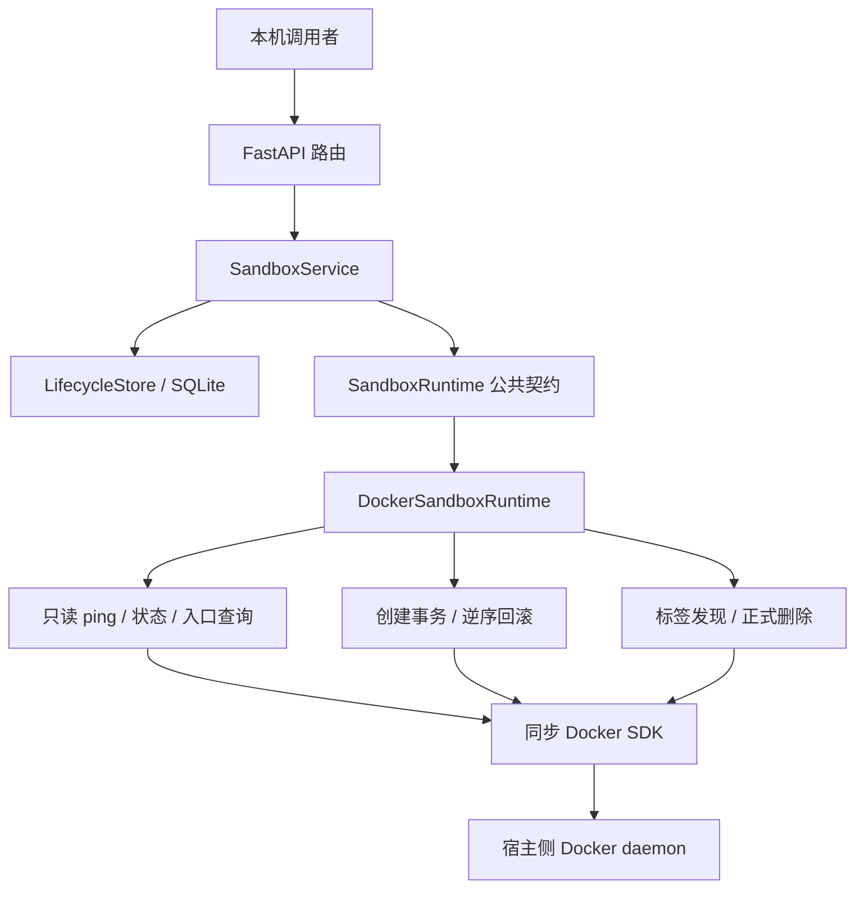
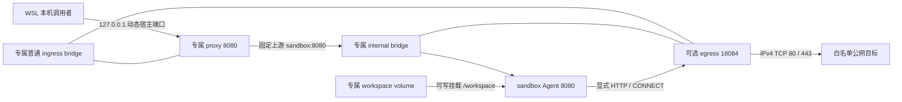

# Docker Runtime 设计

Docker Runtime 将控制面的运行时契约转换为固定策略的 Docker 操作，负责 sandbox 创建、内部状态查询、本机入口查询和资源删除。本文说明当前职责、信任边界和取舍；同步事务、取消处理、查询核验及验收步骤见 [实现说明](IMPLEMENTATION.md)。完整 HTTP 契约由[控制面 API](../API.md)维护。

<a id="responsibilities"></a>

## 职责与信任边界



HTTP 层通过 core 协议注入依赖，Service 组织规格、时间、生命周期记录和跨系统收尾，只有应用装配层选择 Docker 后端。Runtime 不访问 SQLite，不增加续期方法；续期只更新控制面元数据。后台回收循环调用 Service 的单轮回收方法，资源删除仍经过同一个 Runtime。控制面整体设计见 [DESIGN.md](../DESIGN.md)。

Agent 的命令、文件和 SSE 属于数据面，调用者通过专属代理 endpoint 直接访问，控制面不执行或转发用户命令。宿主机与 Docker daemon 拥有资源管理权限；sandbox 内 Agent 和用户进程处于容器资源边界内；proxy 是连接本机入口与内部 Agent 的受限转发组件。Docker socket 只供宿主侧控制面使用，不挂载给 sandbox 或 proxy，proxy 也不挂载 workspace、额外宿主目录或高权限凭证。

当前控制面与 Agent 均无认证，只适用于本机开发。控制面绑定 `127.0.0.1:18083`，动态代理只发布 IPv4 loopback。标签减少误识别和误删风险，但不构成认证或防篡改边界；有 Docker 管理权限的外部主体仍能修改资源，并在核验和操作之间制造竞争。

<a id="topology"></a>

## 独占资源与两网拓扑

默认动态 sandbox 独占下列五项资源，启用非空出口白名单时增加第六项 `egress` 容器。实例 ID 为 `sbx_` 加 32 位小写十六进制字符；名称用于固定拓扑和诊断，资源归属须由完整标签确认。

| 角色标签 | Docker 类型 | 名称 |
| --- | --- | --- |
| `network` | internal bridge | `agent-sandbox-<sandbox_id>-internal` |
| `ingress` | 普通 bridge | `agent-sandbox-<sandbox_id>-ingress` |
| `workspace` | 命名 volume | `agent-sandbox-<sandbox_id>-workspace` |
| `container` | sandbox 容器 | `agent-sandbox-<sandbox_id>` |
| `proxy` | 入口代理容器 | `agent-sandbox-<sandbox_id>-proxy` |
| `egress`（可选） | 出口代理容器 | `agent-sandbox-<sandbox_id>-egress` |

`container/network/workspace` 保留原角色含义，以兼容旧实例；`proxy/ingress` 用于专属动态入口。



sandbox 只连接专属 internal 网络，DNS 别名固定为 `sandbox`，不发布宿主端口。proxy 创建时连接专属 ingress，随后按精确网络 ID 接入 internal，两网连接完成后才启动。实例之间不共享 ingress；workspace 只挂载给本实例 sandbox。

proxy 通过 `port_bindings={8080: ("127.0.0.1", None)}` 请求 Docker 分配动态端口，避免应用先探测再绑定的竞争。创建时不预占本机端口；入口查询从启动后的实际发布结果恢复地址。该地址是本机 WSL 开发地址，不承诺远程访问或任意用户服务端口暴露。

### 资源上限与固定安全配置

创建 API 只允许 basic/python/node 预制环境、受约束的 CPU、内存、初始 TTL 和精确域名出口白名单，不允许指定任意镜像、命令、环境变量、挂载、网络或其他 Docker 参数。要求所选环境的主镜像和固定入口镜像预先存在，仅非空白名单额外要求出口镜像，Runtime 不自动 pull/build 或回退；预检后使用主镜像 ID 创建，避免标签变化。

| 配置 | sandbox | proxy |
| --- | --- | --- |
| 镜像 | basic: `agent-sandbox:dev`；python: `agent-sandbox-python:dev`；node: `agent-sandbox-node:dev` | `agent-sandbox-proxy:dev` |
| 用户 | `sandbox` | `nginx` |
| CPU 上限 | 默认 1 CPU，允许 0.1～2 CPU | 固定 0.5 CPU |
| 内存及内存加 swap 上限 | 默认均为 256 MiB，允许 128～2048 MiB | 固定均为 64 MiB |
| PID 上限 | 64 | 32 |
| 根文件系统 | 只读 | 只读 |
| `/tmp` tmpfs | 32 MiB | 16 MiB |
| capabilities | drop ALL | drop ALL |
| security option | `no-new-privileges:true` | `no-new-privileges:true` |
| init | 开启 | 开启 |
| workspace | 可写挂载到 `/workspace` | 无挂载 |
| 宿主端口 | 不发布 | loopback 动态发布 8080 |

`memswap_limit` 与 `mem_limit` 相同，表示不提供额外 swap 额度。两容器 `/tmp` 都使用 `rw,nosuid,nodev,mode=1777`，并设置上述大小上限。

领域模型使用整数 `cpu_millis` 和 `memory_mib`，仅在 Docker 后端映射为 `nano_cpus = cpu_millis × 1_000_000` 及 `mem_limit = memswap_limit = memory_mib × 1024 × 1024` 字节。默认实际限制保持 1 CPU、256 MiB、无额外 swap。资源上限不表示预留或全局容量保证；不提供整机预算、容量准入或运行中资源调整。SQLite 不新增资源字段，查询响应不返回资源配置。

[Agent Dockerfile](../../../sandbox_agent/Dockerfile) 仅从 `sandbox_agent/` 构建上下文复制 Go 服务，使用非 root 用户和镜像 HEALTHCHECK。[Dockerfile.proxy](../../../deploy/local/Dockerfile.proxy) 打包 [proxy.conf](../../../deploy/local/proxy.conf)，直接以 nginx 用户启动 Nginx，避免启动脚本修改只读根文件系统。健康检查经代理访问内部 Agent。

维护者通过 `RUNTIME_BASE_IMAGE` 构建三个独立镜像，默认 basic 使用 Alpine 3.22，Python 与 Node 使用固定版本的 Alpine 3.23 语言基础镜像；共用同一 Agent 构建和运行配置，覆盖继承的 ENTRYPOINT/CMD。此参数不能从 API 传入。标准库、内置模块及自带 pip/npm 经过现有执行接口使用，不在启动时联网安装包；Alpine/musl 不保证任意 glibc 二进制或第三方依赖兼容。任意镜像、动态 Agent 注入及其他发行版仍为后续方向，具体构建版本见[预制镜像说明](IMPLEMENTATION.md#preset-images)。

代理上游固定为 `sandbox:8080`，请求不能指定上游。`/v1/files` 关闭请求与响应缓冲，并将代理并发连接限制为 2；代理容量拒绝返回固定的 429 JSON。`/v1/commands:stream` 关闭响应缓冲，保留实时 SSE；代理读写超时为 40 秒，请求体上限为 11 MiB，临时目录和 PID 文件位于 `/tmp`。Agent 自身的命令、文件限制和协议见 [Agent API](../../sandbox_agent/API.md)。

### 与固定 Compose 开发链路的关系

[compose.yml](../../../deploy/local/compose.yml) 是已有的固定开发链路：入口为 `127.0.0.1:18081`，使用固定容器名、外部 internal 网络与外部 workspace，proxy 从 `nginx:alpine` 运行并只读挂载配置。动态 Runtime 使用独立五资源或六资源、打包的代理镜像和动态端口；不接管或重建这些固定开发资源。Compose proxy 未设置与 Runtime 相同的 `memswap_limit`，不能将上表直接当作 Compose 配置清单。开发脚本从自身位置定位 Compose 文件，不依赖调用者当前目录。

<a id="network-policy"></a>

## 可选出口与不可变策略标签

`network.allow_domains` 省略或为空时不创建出口、不预检出口镜像、不注入代理环境变量。非空时固定使用 `agent-sandbox-egress:dev`，预检后保存镜像 ID，不 pull/build、不接受任意镜像或代理地址。策略和规范化规则见 [API](../API.md#4-创建-sandbox) 与 [出口设计](../../egress_proxy/DESIGN.md)。

出口配置固定为用户 `10001:10001`、0.5 CPU、128 MiB 内存及同值 memory+swap、32 PID、只读根文件系统、drop ALL、`no-new-privileges:true`、无挂载和宿主端口。它只接本实例已有的 ingress 与 internal，internal 别名固定 `egress`；启动参数为逐项重复的 `-allow-domain`。仅 sandbox 注入大小写两组 HTTP(S)_PROXY=`http://egress:18084` 及 NO_PROXY=`localhost,127.0.0.1,::1`；入口和出口代理自身不注入这些变量。sandbox 的单 internal 连接、资源上限、workspace 及入口发布规则不变；本地健康检查显式禁用环境代理，兼容说明见[实现文档](IMPLEMENTATION.md)。

所有新资源，包括禁用出口的实例，都保存以下相同策略标签：

```text
io.agent-sandbox.network-version=1
io.agent-sandbox.allow-domains=["example.com","iana.org"]
```

数组必须是无空白的紧凑 JSON，内容为已规范化、去重、排序的域名；禁用时为 `[]`。这些标签不属于五项归属标签，不在续期或恢复时修改。两项均不存在是旧五资源实例；仅缺一项、未知版本、非法或非规范 JSON、跨资源不一致、旧实例出现 egress 或空策略出现 egress 均不能降级为禁用出口。状态和只读资源核验遇到异常闭合失败，完整 pending 只在预期角色齐全时才可确认。

启用策略的状态 ready 还要求唯一且完整归属的 egress 运行、Docker health 为 healthy，并连接本实例精确两网及内部别名；缺失、停止、不健康分别返回 `failed` 和 `egress_missing`、`egress_stopped`、`egress_unhealthy`；health 正在启动返回 `starting/egress_starting`，策略、归属或拓扑异常则查询失败。检查不访问 DNS 或公网，healthy 不保证白名单目标可达。endpoint 同样核验已发现资源的策略一致性，但缺失或停止的 egress 不单独阻止入口可用；readyz 先核验状态，因此出口故障时返回未就绪。没有自动重建、网络切换或直连回退。

正式删除发现全部六个可能角色，回收授权仍只依据精确 ID 和完整归属。策略标签缺失或损坏不会阻止回收合法残留，跨事务、重复角色和归属变化继续拒绝；默认保留 workspace，显式删卷和重复删除保持原语义。出口策略仅约束代理自身发起的 IPv4 TCP 80/443，不覆盖 DNS、UDP、IPv6、宿主机访问或允许站点的二次转发，不能据此宣称完整安全隔离。

<a id="ownership"></a>

## 归属、时间与生命周期协作

所有受管资源都必须具有五项完整归属标签：

```text
io.agent-sandbox.managed=true
io.agent-sandbox.project=agent-sandbox
io.agent-sandbox.sandbox-id=<sandbox_id>
io.agent-sandbox.transaction-id=<transaction_id>
io.agent-sandbox.resource=<resource_role>
```

实例 ID 标识逻辑实例，独立的 `txn_[0-9a-f]{32}` 标识一次创建尝试。核验要求所有预期键值匹配，允许其他附加标签；不能仅凭名称前缀或 managed 标签授权删除。

Service 创建时只读取一次带时区的 UTC 时钟，按经校验的初始 TTL（默认 1800 秒，范围 1～86400）计算期限，通过 `SandboxSpec` 传入。本次全部新资源写入相同的初始时间标签，例如：

```text
io.agent-sandbox.created-at=2026-10-19T08:00:00Z
io.agent-sandbox.expires-at=2026-10-19T08:30:00Z
```

时间以 RFC 3339 UTC 序列化，可保留微秒。这些标签不替代归属标签；续期后的当前期限保存在 SQLite，Docker 标签始终保留初始值，不通过 `container.update` 修改标签。

Service 在 Runtime 创建前先写入 `pending`，Runtime 成功后原子确认 `active` 才返回创建成功；只有明确未改变资源或确认回滚的失败，才补偿预写元数据。删除先按事务和版本认领为 `deleting`，再向 Runtime 传入 `expected_transaction_id`；所有存留角色，包括默认保留的卷，必须匹配。Runtime 完成后再按认领版本清理元数据。SQLite 与 Docker 不具备跨系统原子事务，逐项 Docker 资源记录只存在于当前调用内。

正式删除默认先回收运行资源并保留 workspace；只有显式 `delete_workspace=true` 最后删除卷。创建失败或取消的事务回滚则删除本次确认创建的 workspace。这两种策略分别对应“结束一个实例”和“撤销未交付的创建”，顺序和留卷规则见[实现说明](IMPLEMENTATION.md#deletion)。

<a id="endpoint-contract"></a>

## Runtime 契约与结果语义

`DockerSandboxRuntime` 实现五个异步入口，具体抽象定义见 [sandbox_runtime.py](../../../control_plane/runtime/sandbox_runtime.py)：

| 方法 | 运行时职责 |
| --- | --- |
| `ping() -> None` | 只读调用 Docker `ping()` 并关闭 client |
| `create(spec: SandboxSpec) -> None` | 按依赖顺序创建并启动两容器，失败或取消时补偿 |
| `get(sandbox_id) -> SandboxQueryResult` | 重新读取主容器、健康状态和初始时间，返回内部事务标识供 Service 核验 |
| `get_endpoint(sandbox_id) -> SandboxEndpoint` | 核验 sandbox、proxy、两网和实际发布端口，返回 `sandbox_id` 与 `url` |
| `delete(sandbox_id, *, delete_workspace=False, expected_transaction_id=None) -> None` | 从 Docker 恢复完整清单、核验归属并回收请求指定的资源 |

Service 在查询、入口查询和删除访问 Runtime 前校验实例 ID，无效 ID 按未知实例处理。完整 HTTP 路径、请求验证和错误响应见[控制面 API](../API.md)，此处保留与 Docker 事实直接相关的语义：

- 创建响应 `started`：两容器的 Docker 启动调用已完成，不等待健康检查通过；Service 还须完成 `active` 确认。
- 状态响应 `ready`：内部 Agent 的 Docker health 为 `healthy`，不检查入口。
- endpoint 成功：proxy 当前 running 且 healthy，完整归属、事务、专属网络及实际 loopback 端口满足入口规则。

内部 Agent ready 不保证入口已经可用。没有 proxy 的旧实例仍可查询内部状态，入口查询返回不可用，不自动补建。endpoint 仅反映当前 inspect 事实，不向宿主发布地址再发一次 HTTP 请求，也不能保证后续请求期间持续可用。

入口返回示例：

```json
{"sandbox_id":"sbx_0123456789abcdef0123456789abcdef","url":"http://127.0.0.1:49153"}
```

只有唯一的 `NetworkSettings.Ports["8080/tcp"]` 绑定、精确的 `HostIp=127.0.0.1` 和 1～65535 的数字端口可生成 URL。`HostConfig.PortBindings` 只是配置请求，不能证明动态端口已经生效。已有 sandbox 的 proxy、拓扑、健康或映射无法核验时，入口不可用；sandbox 未找到或归属不完整时按未知实例处理。

<a id="tradeoffs"></a>

## 设计取舍与当前限制

同步 Docker SDK 在线程中运行，避免阻塞 HTTP 事件循环。client 延迟创建并有有限 transport timeout；只读 ping 为 0.5 秒，生命周期与查询为 5 秒。transport timeout 不是整条创建或删除的总期限；异步取消也不能停止已经进入 SDK 的调用，必须等待关键收尾。这一选择减少异步适配层复杂度，同时要求明确保留 worker 并读取最终结果。

状态、入口和正式删除从 Docker 标签及 inspect 恢复，不依赖创建进程内存；SQLite 保存可变期限和管理状态。重启后可以恢复查询和删除，但不能自动恢复或回滚中断的创建事务。`pending`、无记录实例及未返回有效资源 ID 的创建结果仍需核验或显式删除；归属不完整或冲突时需要人工处理。

查询保持只读，不启动、修复、接管、补写或迁移资源。超过计划期限不会产生 `expired` 状态或立即改变命令与入口语义；应用默认后台串行回收到期 `active` 与可重试 `deleting`，每轮完成后等待 60 秒，最多处理 100 条，存在扫描及失败重试延迟。未到期、身份匹配的 `active` 可续期；删除先认领后禁止续期，续期成功也不阻止随后显式删除。

当前仅支持单进程、单 worker，不保证分布式互斥或到期瞬间删除。没有公开回收 API、自动续期客户端、暂停恢复、资源池或其他运行时。默认保留卷持续占用磁盘，尚无磁盘配额或后台卷回收。

internal 网络、非 root 和固定资源限制构成当前配置边界，尚无正式威胁模型和完整隔离验证，不能据此宣称具备完整安全隔离能力。已记录的测试环境与验收结果见[开发进度](../../PROJECT_PROGRESS.md)；当前测试、构建和手动操作方法见[实现说明](IMPLEMENTATION.md#verification)。
