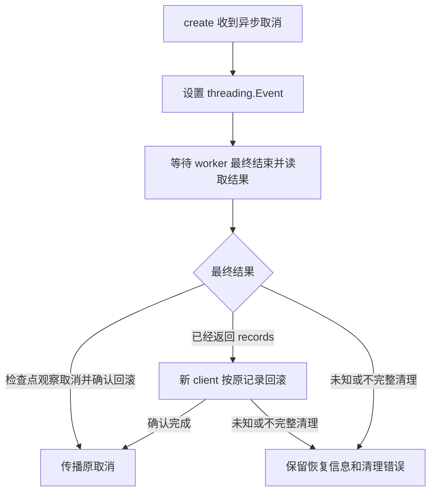

# Docker Runtime 实现

本文对应当前已实现的 Docker 垂直链路，覆盖创建事务、恢复信息、取消、查询、pending 只读核验与确认恢复、原容器暂停/恢复、正式删除和验收方法。职责、资源策略及取舍见[设计说明](DESIGN.md)，HTTP 契约见[控制面 API](../API.md)。原动态入口与手动删除实施计划已经完成，以下描述当前行为，不作为未来功能承诺。

## 代码边界

| 位置 | 当前职责 |
| --- | --- |
| [docker_runtime.py](../../../control_plane/runtime/docker/docker_runtime.py) | 异步运行时入口、线程调度、取消等待、状态映射、入口恢复与只读资源核验 |
| [transaction.py](../../../control_plane/runtime/docker/transaction.py) | client 工厂、归属工具、同步创建、创建失败逆序回滚、正式删除发现与回收 |
| [models.py](../../../control_plane/core/models.py) | 受约束创建选项、资源上限、规格、角色、归属标签、时间及结果模型 |
| [errors.py](../../../control_plane/core/errors.py) | 领域错误与不可变创建恢复信息 |
| [tasks.py](../../../control_plane/core/tasks.py) | 不向 worker 转发取消的等待、重复取消收尾和最终结果读取 |
| [service.py](../../../control_plane/core/service.py) | Store 与 Runtime 的创建确认、查询合并、删除认领、续期、回收与 pending 核验协调 |
| [api/errors.py](../../../control_plane/api/errors.py) | 统一 HTTP 错误映射、已知子类解析与 endpoint 错误归并 |

Runtime 不访问数据库，Service 和 HTTP 层不导入具体 Docker 实现。生命周期 Store、schema 初始化、后台循环和跨系统流程见[控制面设计](../DESIGN.md)。

<a id="clients"></a>

## Client、线程与超时

`DockerClient` 和 `ProbeDockerClient` 是 `Protocol`，前者描述容器、网络、volume、镜像、低层 API 和关闭能力，后者只要求 `ping()` 与 `close()`。Runtime 构造时只保存可注入工厂；应用导入与装配不连接 Docker。每次操作延迟打开 client，并在 `finally` 关闭，不保留常驻 client。

| 工厂 | SDK transport timeout | 使用范围 |
| --- | --- | --- |
| `create_probe_client()` | 0.5 秒 | 只读 Docker ping |
| `create_runtime_client()` | 5 秒 | 创建、状态、入口、只读资源核验、暂停/恢复、正式删除、提交后回滚 |

同步 SDK 经 `asyncio.to_thread()` 执行。5 秒约束单次 transport 调用，不是多步骤创建、删除或清理的总期限。只读 API 另以 `asyncio.wait_for()` 限制整体等待：默认 readiness 为 1 秒，状态与入口每次请求各用 1 秒查询期限；创建和删除不套用该查询超时。

只读等待超时不能终止已经进入 SDK 的线程，线程最终仍需关闭 client。创建和删除则保留 worker，取消后等待事务或回收收尾，详细语义见[取消处理](#cancellation)。

<a id="creation"></a>

## 同步创建与精确资源记录

`DockerCreationTransaction.create_sync(spec, cancelled)` 成功返回本次 `_ResourceRecord` 的 tuple。记录包含 `kind`、`resource_id`、预期 `labels`；网络与容器使用 Docker 返回的 ID，volume 使用返回的 `Name` 作为精确加载标识。

| 顺序 | 操作 | 确认后的记录与检查 |
| --- | --- | --- |
| 1 | 打开 client，按环境映射检查所选主镜像、`agent-sandbox-proxy:dev` 及仅非空策略要求的 `agent-sandbox-egress:dev` | 立即保存主镜像 ID，不检查其他环境、不 pull/build；检查取消 |
| 2 | 低层 `create_network()` 创建 internal bridge | 立即记录 network ID 与预期标签；检查取消 |
| 3 | 创建普通 ingress bridge | 立即记录 ingress ID 与预期标签；检查取消 |
| 4 | 低层 `create_volume()` 创建 workspace | 核验返回 Name 与全部预期标签后记录；检查取消 |
| 5 | 创建 sandbox，设置固定安全配置、workspace 和 DNS 别名 | 立即记录 container ID 与预期标签；检查取消 |
| 6 | 按 container ID 加载并调用 `start()` | 使用已有记录；检查取消 |
| 7 | 创建 proxy，连接 ingress，配置动态 loopback 8080 | 立即记录 proxy ID 与预期标签；检查取消 |
| 8 | `connect_container_to_network(proxy_id, internal_network_id)` | 使用精确 ID；检查取消 |
| 9 | 按 proxy ID 加载并调用 `start()` | 检查取消 |
| 可选 | 创建 egress、记录精确 ID、连接本实例两网、启动 | 使用预检出口镜像 ID；每步检查取消；失败纳入逆序回滚 |

两网使用 bridge 和 `check_duplicate=True`，internal 标志分别为 true 与 false。sandbox 创建的 `networking_config["EndpointsConfig"]` 将唯一 internal 连接设为别名 `sandbox`。proxy 创建时只连 ingress，完成 internal 连接后才启动。具体权限与资源配置见[设计中的固定运行配置](DESIGN.md#独占资源与两网拓扑)。

创建调用使用低层 `client.api.create_*()`，确认 ID 后先记录，再进行可能失败的模型 inspect、连接或 start。高层 SDK 的 create 可能在 daemon 已创建对象后自动 inspect；若 inspect 失败而未记录低层 ID，会失去可靠回滚目标。响应缺失有效标识时抛出 `SandboxCleanupFailed`，不凭名称猜测资源或宣称已清理。

volume 创建具有同名幂等语义，可能返回已有卷。代码核验响应的全部预期标签，含本次事务及已提供的初始时间；只有匹配后才加入 records 并允许挂载。标签不符抛出 `SandboxResourceConflict`，该卷不进入回滚清单，此前创建的两网仍要回收。

proxy 使用 `port_bindings={8080: ("127.0.0.1", None)}`，由 Docker 分配端口，不做探测后预占。入口地址只在后续查询中从实际端口映射恢复。

### 创建环境与资源参数

后端的简单映射为 basic → `agent-sandbox:dev`、python → `agent-sandbox-python:dev`、node → `agent-sandbox-node:dev`。core 只校验环境名，不导入镜像地址。主容器的 `create_container(image=...)` 使用预检返回的 ID，标签在两步之间变化不会改变镜像选择。缺失镜像沿用 `SandboxImageUnavailable` 和原 pending 补偿证据，不回退到 basic；旧实例查询、删除和恢复只核验实际资源，不使用当前映射推断环境。

Service 校验 `SandboxCreateOptions` 后，将 `SandboxResources` 传入原有 `SandboxSpec`；Runtime 接口不变。只有 sandbox 主容器使用请求中的资源上限，Docker 后端按以下规则传给 `create_host_config()`：

| 参数 | 转换 | 默认实际值 |
| --- | --- | --- |
| `nano_cpus` | `cpu_millis × 1_000_000` | 1,000,000,000 |
| `mem_limit` | `memory_mib × 1024 × 1024`，整数字节 | 268,435,456 |
| `memswap_limit` | 与 `mem_limit` 相同 | 268,435,456 |

proxy 仍固定 0.5 CPU、64 MiB 内存及内存加 swap 上限。镜像、用户、工作目录、workspace 挂载、PID、只读根、capabilities、security option、tmpfs 和网络拓扑保持原配置；不调用 container.update 或修改既有实例。初始 TTL 由 Service 一次取时计算，SQLite 预写、全部资源标签和响应共享该时间，不由 Docker 重算；续期与 pending 确认恢复保持原语义。

<a id="rollback"></a>

启用出口时，Runtime 同时将本实例 Agent 的本地 Docker 健康检查固定为 `wget -Y off`，保留原有探测间隔和本地 `/healthz` 路径。实测现有 BusyBox wget 忽略 NO_PROXY，单靠代理变量中的 loopback 排除项不足以保证本地探测；此覆盖不修改 Agent 镜像或命令协议，未启用出口的健康检查保持不变。

## 创建失败的逆序回滚

`resource_manager()` 将 container/proxy/egress 映射到 `client.containers`，workspace 映射到 `client.volumes`，两网映射到 `client.networks`。`resource_labels()` 从容器 `Config.Labels`、网络与卷的顶层 `Labels` 读取标签；`labels_match()` 要求每个预期键值匹配，允许其他附加标签。

`_rollback()` 对已确认 records 逐项逆序处理，完整顺序为：

```text
proxy → sandbox → workspace → ingress → internal
```

每项先按记录标识加载并 reload，确认返回标识与全部预期标签仍匹配后再删除。容器使用 `remove(force=True)`，网络和卷使用非强制 `remove()`。按精确标识加载或复查得到 `NotFound` 表示该项已消失；标识或归属变化时保留该项并继续清理其他记录，不追踪同名替代对象。

无论 remove 响应成功或失败，都再次按原精确标识 inspect。删除响应丢失但确认资源已消失可以收敛；成功响应后仍存在也必须报告残留；无法检查则为未知。回滚不按名称前缀扫描删除，不因一项失败而放弃其他可处理记录。

例如 proxy 接入 internal 失败时，proxy ID 已记录，此前资源都可逆序处理；egress 的 create、双网连接与 start 同样先记 ID 再进行后续步骤；proxy create 尚未确认 ID 就失败时，只能清理此前记录，未确认的资源不能假定不存在。创建回滚删除本次记录的 workspace，区别于正式删除的默认留卷策略。

<a id="recovery"></a>

## 结构化恢复信息与错误优先级

领域错误可携带不可变 `CreationFailureInfo(phase, resource_state, cleanup_issues)`。`CleanupIssue` 只保留资源角色、阶段和稳定错误类别，不保存原始 Docker 消息、凭证或路径；原始异常通过内部异常链保留。

| `resource_state` | 当前证据 | Service 对预写记录的处理 |
| --- | --- | --- |
| `unchanged` | 未登记任何资源，且未出现未知创建结果 | 按原事务、版本补偿记录 |
| `rolled_back` | 本次已知记录全部确认不存在，且没有未确认创建结果 | 按原事务、版本补偿记录 |
| `remaining` | 已确认资源仍存在或标识/归属核验不符 | 保留记录供核验和重试 |
| `unknown` | inspect 无法确认、创建响应丢失、标识无效或关键 client 收尾无法确认 | 保留记录，不推断创建结果 |

回滚报告的未知检查结果优先于已知残留或已确认消失。创建 transport 失败可能意味着 daemon 已执行 create、client 却没取得 ID；即使已登记资源全部删除，也不能排除未登记资源。因此 `DockerUnavailable` 和无法确认创建 ID 的 `SandboxCleanupFailed` 保留 `unknown`。

创建错误分类分两层，不能把 Runtime 内部类别直接列成最终 HTTP 响应：

| Runtime 原因 | Runtime 领域类别 |
| --- | --- |
| 所选主镜像、固定入口镜像或已启用的出口镜像不存在 | `SandboxImageUnavailable` |
| Docker API 409 或已有 volume 归属不符 | `SandboxResourceConflict` |
| 其他 Docker API 错误、一般创建异常 | `SandboxCreateFailed` |
| client 工厂失败、Docker/HTTP transport 失败 | `DockerUnavailable` |
| 无有效创建标识或回滚未能确认完成 | `SandboxCleanupFailed`，含 sandbox ID |

Service 根据恢复信息而非错误类型名单决定元数据补偿。`unchanged/rolled_back` 清理元数据后保留主错误；`remaining/unknown` 保留记录，其中 `SandboxCleanupFailed` 继续返回自身，其他错误转换为含 sandbox ID 的 `SandboxCreateUncertain`。因此创建的 Runtime `DockerUnavailable` 在当前 Service 链路通常最终为 **500 `sandbox_create_uncertain`**，不能误记成创建最终必然返回 503。完整公共映射和元数据失败处理见[控制面 API](../API.md)。

client 关闭位于 `finally`。已有创建主错误时，关闭错误只追加脱敏 `CleanupIssue("client", "close", ...)`，不覆盖原错误或恢复状态；创建已成功但关闭失败时报告 `SandboxCleanupFailed`、`unknown`，不能交付成功。`rollback_committed()` 使用新 client 对原始 records 回滚，新 client 打开或无主错误时关闭失败也保留未知状态。

<a id="cancellation"></a>

## 创建和重复取消

异步取消不能终止同步 Docker SDK。`create()` 建立 `threading.Event` 并保留 worker task，通过 `core/tasks.py` 的 `asyncio.wait()` 等待；该等待不取消输入任务，也避免 Python 3.14 中 shield 的迟到异常报告回调。`wait_for_completion()` 记住首次取消并循环等待，`settle_task()` 显式读取最终结果，重复取消不能跳过清理。



正在运行的 SDK 调用先返回，再由检查点观察 Event 并抛出内部 `CreationCancelled`，进入统一逆序回滚。清理确认后 Runtime 才传播原 `asyncio.CancelledError`。取消时 worker 若因其他领域错误退出，清理已确认且无未知结果时取消优先；`SandboxCleanupFailed` 则优先保留。取消期间的 transport 失败或已分类的 `DockerUnavailable` 不能改写成“取消且确认回滚”，Runtime 将其包装为保留原恢复信息的 `SandboxCleanupFailed`。

worker 也可能先通过最后检查并返回 records，调用方随后才收到取消。Runtime 此时启动 `rollback_committed(spec, records)`，新开 client 按原精确标识和标签补偿，再等待关闭。这里的 committed 只表示同步创建完成，不代表 SQLite 提交或逐项资源持久化日志。

Service 同样保留其 Runtime task，取消后等待结果；Runtime 成功赢得竞争时，Service 通过受保护删除补偿该事务，不能假定已回滚。数据库写入期间也必须等待最终提交或失败，再决定补偿。该保证只覆盖当前进程仍存活时的请求取消；进程崩溃后不会自动继续当前创建事务。

<a id="query"></a>

## 内部状态与时间查询

启用实例的网络策略与出口状态核验见 [网络策略](DESIGN.md#network-policy)；入口仍只表达入口可用性。

`get_sandbox_sync()` 以 managed、project、sandbox-id、`resource=container` 四标签筛选所有状态容器，要求唯一候选。按候选精确 ID 重新 get/reload，核验完整五项归属标签与 `txn_[0-9a-f]{32}` 格式；不凭名称选取，也不要求 proxy 存在。

| Docker/health 事实 | 公共 status | reason |
| --- | --- | --- |
| created | starting | `container_created` |
| restarting | starting | `container_restarting` |
| running，无 health | running | `health_check_not_configured` |
| running，health starting | starting | `health_check_starting` |
| running，health healthy | ready | `health_check_passed` |
| running，health unhealthy | failed | `health_check_failed` |
| paused | paused | `container_paused` |
| exited，OOMKilled | failed | `container_oom_killed` |
| exited，退出码 0 | stopped | `container_exited` |
| exited，其他退出码 | failed | `container_exited_with_error` |
| dead | failed | `container_dead` |

每项结果带稳定 message；OOM 分支先于普通退出码分支。未知或错误结构抛出 `SandboxQueryFailed`，不猜测 ready。没有候选、候选消失、ID 或归属不符为未知实例；多候选为查询失败。

`_lifecycle_times()` 恢复初始时间：两项均不存在时兼容旧实例，返回两个 `null`；其余情况必须为完整 UTC RFC 3339（`Z` 或 `+00:00`，最多六位小数）且 `expires_at >= created_at`。仅缺一项、无时区、非 UTC、非法日期或逆序均为稳定查询失败，不泄露解析异常，也不补写标签。

Runtime 返回经核验的内部 transaction_id；Service 核对 SQLite 的 sandbox ID、事务 ID 和 created_at 后采用数据库当前 expires_at，状态仍取 Docker，transaction_id 不公开。无数据库记录时保留标签初始时间，不自动接管；存储不可用或身份不符时报告稳定错误，不回退到旧期限。重启后不重新取时或滑动 TTL，数据库记录也不能证明主容器存在。

查询不触发删除，期限已经过去仍按 Docker/health 映射，实际后台回收前入口和命令保持原语义，没有 `expired` 状态。查询不启动、停止、重建或修复资源，Agent 健康由镜像 HEALTHCHECK 产生。

<a id="endpoint"></a>

## 本机入口恢复与只读收尾

`get_endpoint_sync()` 从当前 Docker 事实恢复入口，不读取创建 records，也不自动补建旧实例的 proxy：

1. `_owned_container()` 分别筛选主容器和 proxy，要求角色唯一，按精确 ID reload 并核验完整归属、事务格式。
2. 两容器事务 ID 必须一致；proxy 必须 `State.Status=running`、`State.Health.Status=healthy`。
3. `_verify_entry_networks()` 要求 sandbox 恰好只连预期 internal，proxy 恰好只连预期 internal 与 ingress；sandbox internal 连接含 `sandbox` 别名，sandbox 没有实际发布的宿主端口，两容器 internal `NetworkID` 相同。
4. 按连接中的实际 NetworkID get/reload 两网，核对精确 ID、派生名称、`Driver=bridge`、正确的布尔 Internal 属性和完整事务归属。
5. `_published_loopback_url()` 只从实际 `NetworkSettings.Ports["8080/tcp"]` 取一项绑定；HostIp 精确为 `127.0.0.1`，HostPort 是 1～5 位数字字符串且数值为 1～65535，生成 `http://127.0.0.1:<port>`。

网络名称相同不能代替 NetworkID 核验；HostConfig 中的端口意图不能代替已生效的 NetworkSettings。映射缺失、多重绑定、通配地址、错误端口、额外网络、错误 driver 或事务不一致都拒绝入口。查询还发现全部角色核验策略一致性，workspace 的策略标签也不能与其他角色冲突，但不检查卷内容；缺失或停止 egress 不独立阻止入口返回。这里不向宿主 URL 再发送 HTTP 请求；代理健康检查已经经代理访问上游 Agent，但后续实际调用仍可能失败。

主容器不存在、消失或归属不完整为 404；已有主容器但 proxy 缺失、歧义、未就绪或其他入口事实不符为 503 `sandbox_endpoint_unavailable`，主容器多候选也不可任意选择。endpoint 的 `TimeoutError` 和 requests transport Timeout 转为稳定超时，由 HTTP 返回 504；状态查询当前将 SDK requests transport 异常归为 `DockerUnavailable`，两条查询不能混为同一种底层超时分类。

两种查询都在 `finally` 调用 `_close_query_client()`，记录仅含操作和异常类型的脱敏日志。已有读取主错误时关闭错误不替换结果；读取本已成功、关闭单独失败时，Timeout 转为稳定超时，其他错误按状态/入口分别转为 `SandboxQueryFailed` / `SandboxEndpointUnavailable`。HTTP 整体超时与公共错误汇总见[控制面 API](../API.md)。

## Pending 资源只读核验

`Runtime.inspect_resources(sandbox_id, expected_transaction_id=...)` 独立发现六类可能资源并按策略核验预期角色，复用正式删除的只读发现与完整归属规则，不执行任何 stop、start、remove、网络连接或标签更新。主容器不存在时仍检查 proxy、两网和 workspace；同一 sandbox 的其他事务不能因预期事务过滤而被隐藏。

每个已发现候选都核对精确 ID、受管标记、项目、sandbox ID、事务 ID 和资源类型。禁用策略的五角色或启用策略的六角色齐全、策略一致时返回 `all_present`，部分存在返回 `partial`，未发现匹配资源返回 `not_found`；重复角色、事务或归属不符返回 `conflict`，后端无法读取返回 `unavailable`。发现后已经消失的精确候选按缺失处理；无法可靠确认的角色不凭空归入已发现或缺失。

结果只包含后端无关分类、稳定原因和能够确认的资源角色，不向 Service 返回 SDK 对象，也不核验 Agent 健康或完整网络拓扑。`all_present` 不表示创建成功；`not_found` 不排除没有完整标签的遗留资源。Service 读取检查后的候选记录，变化时返回 `changed`；该过程不提供跨系统原子快照。

该只读核验仍仅供显式 `SandboxService.inspect_pending_once()` 调用，不接入启动、后台回收或 HTTP，不自动修改管理状态。正常创建仍可能正在进行，不能按 pending 记录或年龄推断任务已退出。

## 完整 pending 实例确认恢复

`SandboxService.recover_pending_once()` 是独立的受控确认流程：资源核验必须为 all_present，随后复用 `Runtime.get()` 核对原实例、事务、创建时间及 ready，再复用 `get_endpoint()` 的现有入口检查。Service 重读原记录，提交前按 UTC 时钟确认尚未到期，最后通过原版本的 `Store.activate()` 确认。Runtime 不新增恢复或写入接口，五类或六类资源、不可变策略与初始时间标签及 workspace 均保持原状。

启动恢复由 `create_app(pending_recovery_enabled=True, pending_recovery_batch_limit=100)` 显式开启，默认关闭；在取得运行锁并初始化 SQLite 后执行一次，在后台回收和 HTTP 服务之前完成。没有运行所有权的注入 Store 不能开启。单轮不等待 ready、不修补资源、不删除失败项；非完整、身份不符、入口不可验证、已到期或记录变化均保留。取消等待当前候选收尾，已提交的 active 不撤销；也不进入新建失败的资源补偿路径。

后端整体不可用时告警并允许启动，存储整体失败阻止启动。开启会增加启动耗时，跳过项无周期重试。完整准入、结果和配置见[控制面设计](../DESIGN.md#完整-pending-实例确认恢复)。运行锁不是分布式 fencing，获得锁和资源齐全都不证明旧 Docker 请求已结束；partial/缺失资源清理及更完整故障协调仍待后续实现。

## 暂停与恢复：精确身份及 freezer 确认

暂停/恢复由 Runtime 的异步入口调度同步 Docker 操作，不执行用户命令、不使用 Docker exec。复用完整资源发现、事务和不可变策略核验，先拒绝缺失、歧义、归属或状态冲突。每个目标通过精确 ID 重新 get/reload，调用容器 model 的 pause/unpause，并再 inspect 确认目标状态；五角色只处理主容器，六角色 pause 顺序为 container → egress，unpause 为 egress → container，proxy 不冻结。

已达到目标的成员不重复写入。失败不会重建资源或反向撤销已完成步骤，允许同目标重试；部分暂停不得报告 ready。只读查询从 Docker 观察 paused，进程内存和资源身份保留，TTL 继续按 SQLite 当前期限计算。Service 的每实例协调锁覆盖暂停、恢复、删除、回收认领及创建补偿，取消等待关键操作和关闭收尾，不能以重复取消提前放锁。

恢复 204 只确认解冻，不等待健康检查。原 TCP/SSE/CONNECT 可能失效，任务 wall-clock timeout 和终态保留不保证停止。该实现没有 checkpoint、宿主重启恢复、资源释放、Agent 修改或镜像构建要求。公共错误及失败重试语义见[HTTP API](../API.md#10-暂停与恢复)。

<a id="deletion"></a>

## 正式删除：发现、预检、逐项回收

正式删除的同步实现为 `delete_sandbox_sync()`，与创建失败逆序回滚使用不同策略。它不依赖原创建内存记录，不要求容器存在、健康或 endpoint 可用；部分拓扑、仅网络或仅卷均能重新发现。调用参数为 `delete_workspace=False` 和可选 `expected_transaction_id`。

### 完整清单先于破坏性操作

`_discover_resources()` 按 managed/project/sandbox-id/resource 四标签分别查询六个可能角色，容器查询包含 `all=True`。每角色至多一个候选；候选 ID 必须为非空字符串，再按该 ID get/reload，核验精确标识、完整归属、有效事务格式以及跨资源事务一致性。有 expected_transaction_id 时每个存留角色必须匹配，包括默认保留的 workspace。

全部角色清单通过后才执行任何 stop/remove。重复角色、无效或不一致事务、预期事务不符、归属变化都拒绝，不任意选择对象。发现后精确读取已消失的候选可跳过。过滤条件不匹配的资源不属于目标，不按名称推断归属，也不接管固定 Compose 或共享资源。

清单记录容器/网络精确 ID、经核验的卷 Name 和五项归属标签。每次 stop/remove 前 `_inspect_owned()` 重新 get/reload 并核验，标识或归属变化立即停止后续破坏性操作。外部 Docker 管理者仍可能在核验和操作间竞争，标签不能消除该信任边界。

### 顺序、停止和 absence 确认

```text
egress / proxy → sandbox → ingress → internal → workspace（仅显式请求）
```

先回收出口及入口容器，再处理 sandbox 和两网；默认保留 workspace，显式删卷最后执行，卷内数据不可恢复。每个容器先 `stop(timeout=2)`，由 Docker 在宽限期后终止；stop 失败则重新核验同一精确容器后使用 `remove(force=True, v=False)`，正常停止后使用 `remove(force=False, v=False)`。不附带删除卷；网络和卷使用普通 `remove()`，不强制断开其他容器或删除使用中的卷。

按原标识 inspect 得到 `NotFound` 才能确认该项 absent。remove 成功仍要复查；remove 异常也复查，确认已消失则接受，仍存在或不能确认则计为失败。一般失败继续尝试清单中可安全处理的后续项；归属变化立即拒绝。已删除项不补偿重建，重试重新发现实际残留。

收尾先对失败项按原精确标识再次确认，允许并发请求完成该项后收敛；不能仅因标签筛选不再命中就宣称已消失。随后重新发现完整清单，确认请求要删除的角色无残留；默认只剩保留卷可完成，保留卷的归属仍需通过最终核验。并发删除依赖当前 Docker 事实和 NotFound 收敛，没有 Runtime 进程锁或墓碑。

达到目标后返回 204 空体，含格式合法的未知 ID、重复删除和默认仅剩 workspace；格式无效 ID 在 Service 访问后端前返回 404。完整清单冲突为 409 `sandbox_delete_conflict`；打开 client 或发现阶段后端失败为 503 `docker_unavailable`；回收、最终确认或成功后的 client 关闭失败为含 sandbox ID 的 500 `sandbox_delete_failed`。已有主错误时 finally 关闭失败不覆盖主错误。

### 元数据与取消收尾

Service 先将 pending/active 按事务和版本认领为 deleting，已有 deleting 可重试；读取或认领失败不开始 Docker 删除。Runtime 仅在该事务的所有存留资源通过核验后回收，完成后 Service 才按认领事务和版本删除元数据，不盲目刷新版本。默认留卷同样结束实例记录，残卷继续由 Docker 完整标签和显式删卷管理。Docker 失败保留 deleting；Docker 完成但元数据清理失败或版本冲突为含 sandbox ID 的 `sandbox_metadata_cleanup_failed`，可重试。

`delete()` 一旦启动工作线程，首次及重复取消都通过 `wait_for_completion()` 等待回收和 client 关闭，显式读取 worker 结果后传播原取消；删除层在取消分支消费 worker 异常，取消优先，不重建已删项。Service 另等待 Runtime 与元数据关键收尾，读取后台异常。SQL 回滚不能撤销已发生的 Docker 删除，请求取消也不表示资源仍存在。

单轮及后台过期回收复用受保护删除，默认留卷，跳过 pending 与无记录实例；具体调度、续期版本竞争和当前限制见[控制面设计](../DESIGN.md)。

<a id="verification"></a>

## 测试矩阵与验证方法

默认测试使用注入 FakeRuntime、Docker 测试替身与临时 SQLite，不修改真实 Docker 资源。

| 测试 | 覆盖范围 |
| --- | --- |
| [test_docker_runtime.py](../../../control_plane/tests/test_docker_runtime.py) | ping 延迟 client、0.5 秒 timeout、只读调用与关闭 |
| [test_sandbox_runtime.py](../../../control_plane/tests/test_sandbox_runtime.py) | 双镜像检查、同步顺序、五项安全配置、低层 ID 先记录、volume 幂等归属、各阶段失败、逆序回滚、各阶段取消及重复取消 |
| [test_sandbox_environments.py](../../../control_plane/tests/test_sandbox_environments.py) | 三种环境、严格输入、与资源/TTL 组合、仅预检所选镜像、镜像 ID 固定及缺失镜像的稳定响应与补偿 |
| [test_creation_outcomes.py](../../../control_plane/tests/test_creation_outcomes.py) 与 [test_creation_recovery.py](../../../control_plane/tests/test_creation_recovery.py) | 精确 ID absence、丢失 create/remove 响应、remaining/unknown、脱敏恢复信息、主错误优先、Service 按状态保留或补偿元数据 |
| [test_sandbox_query.py](../../../control_plane/tests/test_sandbox_query.py) | 状态映射、完整归属、歧义、重启恢复、UTC 标签、旧实例与非法时间、只读与关闭错误 |
| [test_sandbox_endpoint.py](../../../control_plane/tests/test_sandbox_endpoint.py) | 角色唯一、健康、跨资源事务、网络/别名/端口核验、旧实例、404/503/504、transport timeout 与关闭错误 |
| [test_sandbox_deletion.py](../../../control_plane/tests/test_sandbox_deletion.py) | 默认/显式卷策略、未知及部分残留、预期事务全角色预检、逐次精确重读、并发幂等、停止失败与 force、占用失败、重试、失败项复查、取消/重复取消与关闭 |
| [test_sandbox_service.py](../../../control_plane/tests/test_sandbox_service.py)、[test_app.py](../../../control_plane/tests/test_app.py)、[test_api_errors.py](../../../control_plane/tests/test_api_errors.py) | 公共契约、ID 校验、Service 委托、统一稳定 HTTP 错误和查询期限 |
| [test_service_lifecycle.py](../../../control_plane/tests/test_service_lifecycle.py)、[test_app_lifecycle.py](../../../control_plane/tests/test_app_lifecycle.py) 与 [test_service_reaping.py](../../../control_plane/tests/test_service_reaping.py) | 临时 SQLite 跨系统编排、身份合并、删除认领、取消收尾、重启与 lifespan |
| [test_sandbox_docker_integration.py](../../../control_plane/tests/test_sandbox_docker_integration.py) | 显式真实 Docker 配置、双实例入口与 workspace 独立、命令/二进制文件/SSE、重启恢复、出口对照、手动与周期回收、HTTP 续期、pending 只读核验和启动确认恢复 |

<a id="preset-images"></a>

### 预制镜像构建与边界

复用同一份 Agent Dockerfile 和 Go 构建阶段，`RUNTIME_BASE_IMAGE` 仅供维护者构建选择最终基础镜像，不是创建 API 参数。basic 的默认构建命令和 Compose 镜像名称保持不变。三种环境分别构建，不将全部解释器合入默认镜像：

| 环境 | 最终基础镜像 | 提供的语言与包管理器 |
| --- | --- | --- |
| basic | `alpine:3.22`（默认） | 原有基础命令与 Agent；不承诺缺少某种解释器 |
| python | `python:3.12.15-alpine3.23` | python3、pip |
| node | `node:24.22.0-alpine3.23` | node、npm |

Dockerfile 在构建阶段显式使用 root 创建专属 sandbox 用户和工作区，最终切回非 root sandbox，统一 `/usr/local/bin/agent`、`/workspace`、8080 监听和健康检查。语言基础镜像自带的用户保留但不用于运行 Agent；覆盖其 ENTRYPOINT 并以 `CMD []` 清除继承参数，防止启动 Node 入口脚本或解释器。只读根、CPU/内存/PID、tmpfs、capabilities 和两网策略继续由现有 Runtime 设置。

三种运行阶段都基于 Alpine/musl，不能据此保证 glibc 二进制、Python 原生扩展或 Node 原生模块兼容。只验收标准库、内置模块和自带包管理器的可执行性，不在实例启动时安装软件，不联网安装第三方包，不提供完整开发工具链或包缓存管理。任意镜像、动态 Agent 注入和其他发行版仍属后续方向。

在仓库根构建所需预制镜像和代理、检查已有 Compose 配置：

```bash
docker build -t agent-sandbox:dev ./sandbox_agent
docker build --build-arg RUNTIME_BASE_IMAGE=python:3.12.15-alpine3.23 -t agent-sandbox-python:dev ./sandbox_agent
docker build --build-arg RUNTIME_BASE_IMAGE=node:24.22.0-alpine3.23 -t agent-sandbox-node:dev ./sandbox_agent
docker build -t agent-sandbox-proxy:dev -f deploy/local/Dockerfile.proxy deploy/local
docker compose -f deploy/local/compose.yml config --quiet
git diff --check
```

在 `control_plane/` 执行默认验证，另开终端启动控制面：

```bash
uv sync --locked
uv run --locked pytest
uv run python -m compileall -q app.py api core runtime storage tests
uv run uvicorn control_plane.app:app --app-dir .. --host 127.0.0.1 --port 18083
```

在 Linux/WSL 的 `control_plane/` 显式运行真实集成：

```bash
RUN_DOCKER_INTEGRATION=1 uv run --locked pytest -m docker_integration -v
```

真实测试创建唯一实例并使用临时数据库。低层 create 响应立即写入本次 ledger；finally 只清理已记录精确 ID/卷 Name 且完整归属复核通过的资源，NotFound 视为完成，不按名称前缀扫描删除，也不使用 `docker prune`。

自定义创建用例通过 HTTP 请求 750 毫核、384 MiB、600 秒 TTL，以实际 Docker inspect 核对 NanoCPUs、Memory、MemorySwap、安全配置和代理固定额度；对比 SQLite、五项初始标签与创建响应，再检查 Agent 健康及一条简单命令。无需压力测试、OOM、长时间等待或镜像重建，不修改 schema 或已有开发实例。

预制环境用例参数化覆盖 basic/python/node，检查实际镜像 ID、统一入口参数、非 root、只读根和资源限制。经相同 Agent 命令和文件接口执行「上传输入 → 标准库/内置模块处理及临时文件 → 下载输出」，检查退出码、stdout、stderr；用同时运行的独立 basic 实例对照 workspace，验证 pip/npm 的本地版本命令，再重新装配控制面确认原 TTL、资源 ID 和 endpoint 不变。构建与真实测试须显式运行，默认测试不访问 daemon。

双实例用返回 URL 检查 `/healthz`、同步命令、二进制文件往返和 SSE 首帧早于命令完成；新 Store/app/runtime 从同一数据库恢复时间和两个入口，同名文件内容须不同。删除集成用新 app/runtime 删除 A，确认四项运行资源、入口与元数据消失、查询 404；额外记录的短命容器以非 root、无网络、只读根文件系统和只读卷挂载检查保留二进制文件，随后显式删卷，并确认 B 继续可用。

单轮回收使用固定时钟和临时元数据，让 A 恰好到期、B 未到期；不等待真实 TTL。后台回收显式启用 lifespan 和短扫描间隔，只观察自动回收；非周期相关用例关闭后台任务。HTTP 续期集成续期后重启，在原期限扫描时仍可调用且初始五资源标签不变，在新期限由后台回收运行资源与元数据并保留 workspace，不手动调用单轮方法。

pending 核验集成仅使用专属临时记录，准备五类齐全和缺少主容器的资源，再显式检查。对比前后的存留资源精确 ID、容器状态、完整标签及记录版本，确认没有修改；资源准备和最终清理同样受本次 ledger 的完整归属保护。

pending 确认恢复集成直接准备资源完整、记录仍为 pending 的专属实例，等待测试准备阶段的 ready 后开启一轮启动恢复。核对原资源 ID、状态、标签、workspace 和初始 TTL 不变，再经 HTTP 查询、续期和受控时钟下的后台到期回收验证既有链路，默认保留 workspace。仅清理本次 ledger 中经精确 ID 和完整标签核验的资源；实际执行情况另见开发进度，不把默认跳过视为真实 Docker 验收通过。

出口测试先要求普通 bridge 对照能连同一 IP/端口，再检查 internal sandbox 拒绝。默认目标 `1.1.1.1:80`，可用 `AGENT_SANDBOX_EGRESS_IP` 指定对照 IP；对照不可达时测试失败，不把环境整体断网当作隔离成功。

验收环境与结果保留在[开发进度](../../PROJECT_PROGRESS.md)。2026-10-20 pending 核验验收使用 WSL/Python 3.12.3，默认测试 877 通过、7 跳过，显式真实 Docker 集成 7 通过；测试后既有容器、网络和卷的 ID 快照保持一致。此前 Windows/Python 3.14.3 默认回归与 WSL 历史验证分别记录，不互相替代。

<a id="manual-renewal"></a>

## 动态实例续期手动验收

以下 shell 示例在 WSL/Bash 中运行。仅对本次创建且尚未到期的受管实例，将创建返回的 ID 保存为 `SANDBOX_ID`，然后调用：

```bash
CONTROL_URL=http://127.0.0.1:18083
curl -i -H 'Content-Type: application/json' \
  -d '{"ttl_seconds":1800}' \
  "$CONTROL_URL/v1/sandboxes/$SANDBOX_ID/renew"
curl -i "$CONTROL_URL/v1/sandboxes/$SANDBOX_ID"
```

预期续期返回 200 和实际 expires_at，随后查询为同一期限。TTL 必须为 1～86400 的整数，表示从本次校验时刻起至少保留的秒数，不在原期限上累加、不缩短期限。无记录、未确认创建、已到期、正在删除或并发版本冲突为 409；请求取消可能已经提交，需查询确认。续期不重建容器、不改变入口或初始 Docker 标签，详细契约见[控制面 API](../API.md)。

<a id="manual-deletion"></a>

## 双实例删除与数据保留手动验收

先准备两个固定镜像并按[控制面设计](../DESIGN.md)启动 `127.0.0.1:18083`。以下命令只操作本次创建并记录的 A/B 两个动态实例，不将其他开发实例 ID 代入。默认删除保留 workspace；显式删卷不可恢复。

```bash
CONTROL_URL='http://127.0.0.1:18083'
CREATED_A=$(curl -fsS -X POST "$CONTROL_URL/v1/sandboxes")
SANDBOX_A=$(printf '%s' "$CREATED_A" | python3 -c 'import json,sys; print(json.load(sys.stdin)["sandbox_id"])')
CREATED_B=$(curl -fsS -X POST "$CONTROL_URL/v1/sandboxes")
SANDBOX_B=$(printf '%s' "$CREATED_B" | python3 -c 'import json,sys; print(json.load(sys.stdin)["sandbox_id"])')
printf 'A=%s\nB=%s\n' "$SANDBOX_A" "$SANDBOX_B"
```

分别在有限时间内等待入口。Agent 内部 ready 和代理入口分别查询；入口尚未就绪返回 503。任何步骤失败时保留已创建 ID，仅按这些 ID 通过受保护 DELETE 重试清理，不继续代入空变量。

```bash
ENDPOINT_A=''
ENDPOINT_B=''
for attempt in $(seq 1 30); do
  if ENDPOINT_A=$(curl -fsS --max-time 3 "$CONTROL_URL/v1/sandboxes/$SANDBOX_A/endpoint" | python3 -c 'import json,sys; print(json.load(sys.stdin)["url"])'); then
    break
  fi
  sleep 1
done
for attempt in $(seq 1 30); do
  if ENDPOINT_B=$(curl -fsS --max-time 3 "$CONTROL_URL/v1/sandboxes/$SANDBOX_B/endpoint" | python3 -c 'import json,sys; print(json.load(sys.stdin)["url"])'); then
    break
  fi
  sleep 1
done
printf 'A endpoint=%s\nB endpoint=%s\n' "$ENDPOINT_A" "$ENDPOINT_B"
test -n "$ENDPOINT_A" && test -n "$ENDPOINT_B"
```

最后的非空检查必须成功（退出码为 0）后，才执行下面的上传验证；检查失败时停止，不继续复制后续代码块。保留创建 ID，排查入口或按本次 ID 请求受保护删除。

```bash
printf 'retained-data-A' | curl -fsS --data-binary @- "$ENDPOINT_A/v1/files?path=delete-demo.txt"
printf 'independent-data-B' | curl -fsS --data-binary @- "$ENDPOINT_B/v1/files?path=delete-demo.txt"
curl -fsS "$ENDPOINT_A/v1/files?path=delete-demo.txt"
curl -fsS "$ENDPOINT_B/v1/files?path=delete-demo.txt"
```

确认两入口变量有效后再调用 Agent。可在控制面终端 Ctrl+C 并使用原命令重启，保留当前终端变量后继续。删除不依赖原进程内存，会从 Docker 完整标签重新发现清单。默认删除 A：

```bash
curl -i -X DELETE "$CONTROL_URL/v1/sandboxes/$SANDBOX_A"
curl -i "$CONTROL_URL/v1/sandboxes/$SANDBOX_A"
curl -i "$CONTROL_URL/v1/sandboxes/$SANDBOX_A/endpoint"
curl -i --max-time 3 "$ENDPOINT_A/healthz"
docker volume inspect --format '{{json .Labels}}' "agent-sandbox-$SANDBOX_A-workspace"
curl -i -X DELETE "$CONTROL_URL/v1/sandboxes/$SANDBOX_A"
```

两次 DELETE 均预期 204 空体；A 状态与入口查询为 404，旧入口连接失败，workspace 仍存在。卷标签须与本次 A 匹配。数据保留的完整验证由上述显式集成测试通过临时受限容器只读挂载完成，并核对精确标识与完整归属。

保留卷持续占用磁盘，单轮和周期过期回收也默认留卷，尚无后台卷清理。默认后台每轮结束后等待 60 秒，扫描与重试可能延迟关闭到期入口；本手动验收应在实例期限内完成，需要时先续期。确认 B 仍可访问：

```bash
curl -i "$CONTROL_URL/v1/sandboxes/$SANDBOX_B"
curl -fsS "$ENDPOINT_B/healthz"
curl -fsS "$ENDPOINT_B/v1/files?path=delete-demo.txt"
curl -fsS -H 'Content-Type: application/json' \
  -d '{"argv":["printf","B-still-running"]}' "$ENDPOINT_B/v1/commands:run"
```

预期 B 为 ready，同名文件为 `independent-data-B`，命令 exit_code=0、stdout 为 `B-still-running`。确定 A 数据不再需要后，显式删除其保留卷，再删除本次 B 全部资源：

```bash
curl -i -X DELETE "$CONTROL_URL/v1/sandboxes/$SANDBOX_A?delete_workspace=true"
curl -i -X DELETE "$CONTROL_URL/v1/sandboxes/$SANDBOX_A?delete_workspace=true"
docker volume inspect "agent-sandbox-$SANDBOX_A-workspace"
curl -i -X DELETE "$CONTROL_URL/v1/sandboxes/$SANDBOX_B?delete_workspace=true"
```

三个 DELETE 均预期 204 空体，A 卷 inspect 应报告不存在。网络仍有其他容器连接、卷被使用或部分清理失败时，返回含 sandbox ID 的稳定错误，排查后对同一 ID 重试；已删除项不重建，不强制断开或删除其他资源。禁止以名称前缀批量删除或 `docker prune` 替代清理，固定 Compose、共享及归属不匹配资源不属于目标。完整自动验收命令与安全 ledger 清理约束见[测试矩阵](#verification)。

## 动态出口集成验证

新增显式 [出口 Docker 集成](../../../control_plane/tests/test_sandbox_egress_integration.py)，仅使用预先存在的 Python、入口和出口镜像，不重建既有 Agent。默认测试全部跳过，不连接 Docker 或公网。所有应用使用临时 SQLite、真实 FastAPI lifespan 及显式恢复/回收开关；资源记录精确 ID 与完整归属，任何清理均先核验本次归属，无前缀批量删除。

```bash
# 仅本地生命周期：创建、真实配置、重启恢复、部分出口残留、删除和回收。
RUN_DOCKER_INTEGRATION=1 uv run pytest tests/test_sandbox_egress_integration.py -v

# 另行明确允许公网：两个不同白名单，HTTP、CA 校验的 HTTPS、交叉拒绝、直连对照及停止出口后失败。
RUN_DOCKER_INTEGRATION=1 RUN_EGRESS_PUBLIC_INTEGRATION=1 \
  uv run pytest tests/test_sandbox_egress_integration.py -v
```

公网测试先确认普通 bridge 到指定 IPv4:443 可达，再通过 Agent endpoint 执行 internal 直连拒绝；客户端显式配置代理，不关闭 CA 校验、不自动跟随重定向或回退。公网或证书问题令该检查失败，不能当作隔离已验证。可选 `AGENT_SANDBOX_EGRESS_IP` 默认为 `1.1.1.1`。本轮实际运行结果见[开发进度](../../PROJECT_PROGRESS.md)，测试存在不代表已执行真实 Docker 或公网验收。
## 暂停与恢复集成验证

[暂停 Docker 集成](../../../control_plane/tests/test_sandbox_pause_integration.py) 默认全部跳过，只使用已存在的 Python、入口及可选出口镜像，不发起公网流量，不 pull/build。测试使用临时 SQLite 与已有创建 ledger，任何 inspect 后清理只针对本次精确 ID 和完整归属标签；不发现或操作既有开发资源。

```bash
cd control_plane
RUN_DOCKER_INTEGRATION=1 uv run --locked pytest tests/test_sandbox_pause_integration.py -v
```

五/六角色分别经 HTTP 创建并等待 ready，通过 Agent 后台命令启动持有内存随机 token、PID、启动时间和递增计数器的 Python 进程。暂停后直接检查 Docker Paused 标志，用只读 archive 连续读取工作文件确认计数冻结，不依靠暂停后的命令执行；关闭 Control lifespan，再以同一临时库重新装配应用，确认 paused 及原期限、原发布端口和资源 ID；入口健康可能在冻结期间失效，此时只接受既有 503，不承诺暂停期间 endpoint 一直可用。恢复后经原入口验证同进程、token 和计数继续，文件及新命令可用，并记录 model.pause/unpause 的实际顺序。

后台任务明确使用 30000 ms 期限，冻结、重装及恢复在短窗口内完成；测试不把成功视为 timeout 时钟随暂停冻结的保证。另有五/六角色的暂停续期、手动删除及受控时钟到期回收，均确认运行资源消失、元数据清理、workspace 保留。真实执行结果以开发进度记录为准，默认跳过不能作为 Docker 验收证据。
