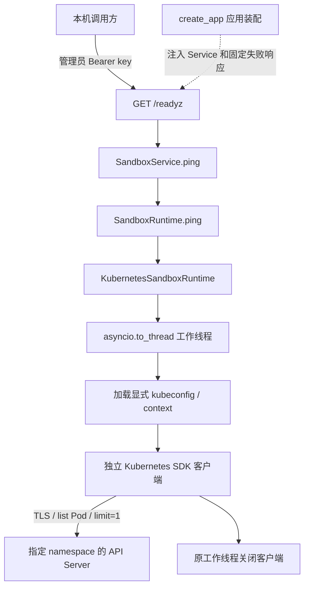

# Kubernetes Runtime 设计

Kubernetes Runtime 复用控制面的 `SandboxRuntime` 契约，当前仅实现只读 `ping()`，并通过依赖注入接入根 HTTP 就绪检查。本文说明职责、配置、安全边界和失败语义；代码流程、调用方式、测试与排查见[实现说明](IMPLEMENTATION.md)，公开响应以[控制面 API](../API.md#3-后端就绪检查默认-docker)为准。

## 当前能力与范围

| 能力 | 当前行为 |
| --- | --- |
| 构造 Runtime | 保存显式配置和工厂，不读取 kubeconfig 或创建客户端 |
| `ping()` | 在指定 namespace 只读列举至多一个 Pod，成功返回 `None` |
| `/readyz` | 经 API → Service → Runtime 探测，保留管理员认证 |
| `/healthz` | 只表示控制面进程存活，不访问任何 Runtime |
| 其他 Runtime 方法 | 明确抛出 `KubernetesOperationUnsupported`，不伪造成功 |

默认应用仍使用 Docker，没有新增环境变量或完整的生产后端切换配置。注入 Kubernetes Runtime 只用于验证健康链路，不表示实例创建、查询、删除、执行入口、工作区、暂停/恢复或 pending 核验已经可用。

## 分层与调用链



API 只调用共享的 `SandboxService`，不判断具体 Runtime 类型、不导入 Kubernetes SDK。应用装配层识别注入的 Runtime，向健康路由提供固定失败响应。Runtime 不访问 SQLite，Store 不调用集群；Kubernetes SDK 类型保留在后端实现内。

测试装配关闭 reaper 与 pending recovery，使用 Fake Store 或独立临时存储，不运行默认 Docker 生命周期任务，也不打开开发数据库。整体装配、认证和存储规则见[控制面设计](../DESIGN.md)。

## 显式配置与认证

构造时必须提供以下配置，不从当前 kubectl context 自动选择目标：

| 配置 | 含义与约束 |
| --- | --- |
| `kubeconfig_path` | 单个明确的配置文件路径，不合并其他文件，不自动读取 `KUBECONFIG` |
| `context` | 指定 context 名称；非空 ASCII、最多 253 字符，无空白或控制字符 |
| `namespace` | 明确指定的 namespace；最多 63 字符，使用小写 DNS label 格式 |
| `client_factory` | 可选的可信测试工厂，延迟到工作线程中调用 |

构造仅执行值校验，不检查文件是否存在。每次 ping 都在工作线程加载指定文件与 context，配置缺失或错误直接失败，不退回 `current-context`、其他集群或 Docker。

首版针对本机 Minikube 的静态客户端证书及 CA，支持文件引用和 kubeconfig 内嵌证书数据。配置加载前拒绝 token、认证插件及其他非证书用户字段；不执行 exec/auth-provider，不尝试集群内认证。保留 TLS 证书校验，拒绝跳过验证、URL 中的凭据和 kubeconfig 的上游代理。

每次探测构建独立的 SDK Configuration，不修改 SDK 全局默认配置；显式禁用环境 HTTP 代理、urllib3 重试及 SDK 额外重试。探测不修改全局环境、不写回 kubeconfig，不把敏感配置或 SDK 原始响应用于公开文案。

## 探测与期限

每次探测只执行以下调用，不 watch、不自动分页、不读取 Secret，也不执行命令或创建资源：

```python
api.list_namespaced_pod(
    namespace,
    limit=1,
    watch=False,
    _request_timeout=(0.5, 0.5),
)
```

空列表同样成功，响应中的 continuation token 不会触发下一次请求。成功只表示 API 可达且具有指定 namespace 的 Pod 列表读取权限，不证明有创建/删除权限、所有节点健康、Agent 就绪或任何 sandbox 资源存在。

| 限制 | 当前值 | 边界 |
| --- | --- | --- |
| 连接阶段 | 0.5 秒 | SDK transport timeout |
| 读取阶段 | 0.5 秒 | SDK transport timeout，不等于所有响应读取的硬总期限 |
| HTTP 就绪等待预算 | 默认 1 秒 | 触发 asyncio 取消，仍需等待 Kubernetes 线程收尾 |

文件加载、DNS、SDK 请求和关闭不构成一个严格的总 deadline。不能把各阶段 timeout 相加后宣称操作必然在该时刻结束，也不保证 `/readyz` 精确在 1 秒内响应。

## 取消、关闭与错误

同步 SDK 操作完全由工作线程持有。异步等待被取消时，复用 `core/tasks.py` 等待当前线程完成；首次和重复取消都不能从另一个线程提前关闭客户端。收尾读取最终结果和异常，再传播取消或线程失败，避免遗留未读取的后台异常。

成功和失败路径均关闭已取得的客户端。主操作与关闭同时失败时保留主操作错误；只有关闭失败时也不能报告成功。Runtime 使用下列固定领域错误，HTTP 根就绪接口将失败统一为当前后端不可用：

| Runtime 错误 | 分类 |
| --- | --- |
| `KubernetesConfigurationError` | 配置、context、证书或认证方式不符合要求 |
| `KubernetesPermissionDenied` | API 返回 401 或 403 |
| `KubernetesTimeout` | 连接/读取超时，或 API 返回 408、504 |
| `KubernetesConnectionFailed` | 其他连接、API 或客户端关闭失败 |
| `KubernetesOperationUnsupported` | 当前未实现的 Runtime 能力 |

根就绪成功为 HTTP 200 `{"status":"ready"}`；Kubernetes 失败为 503 `kubernetes_unavailable` / `Kubernetes runtime is unavailable`。Docker 仍使用原有 `docker_unavailable` 响应。仅精确 GET `/healthz` 匿名，未认证请求不会进入 Service 或创建客户端；完整响应见[API](../API.md#3-后端就绪检查默认-docker)。

未实现的 `create()` 提供 `CreationResourceState.UNCHANGED` 证据，因为没有执行资源操作；它不表示已经创建或回滚任何 Kubernetes 资源。

## 信任边界与后续方向

kubeconfig 与静态证书属于可信宿主配置，不传给 Agent 或用户任务，不写入数据库、日志或响应。当前实现不提供 Kubernetes sandbox 隔离策略，不会因为 ping 成功而证明工作负载权限、网络或存储隔离已经配置正确。

后续需要分别设计资源归属、创建与失败清理、查询与入口、工作区、到期回收及故障恢复，再接入完整生命周期。Pod、Service、网络策略与存储拓扑目前均未形成已实现契约，不预先承诺具体方案。
