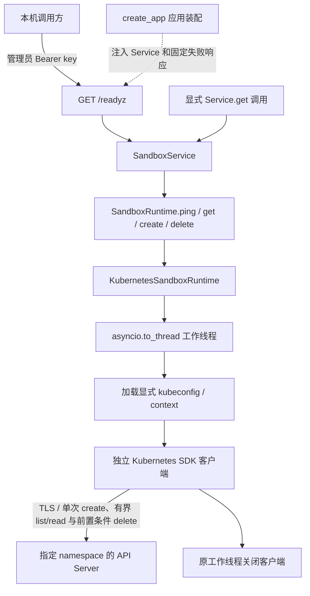

# Kubernetes Runtime 设计

Kubernetes Runtime 复用控制面的 `SandboxRuntime` 契约，当前实现只读 `ping()`、主 Pod 查询 `get(sandbox_id)` 和单主 Pod 安全删除 `delete()`，就绪探测通过依赖注入接入根 HTTP 链路。另有纯函数构建受约束的主 Pod 规格，并由 Runtime.create 完成默认拒绝 NetworkPolicy、Agent ClusterIP Service、主 Pod 提交、启动等待及三资源失败回滚。本文说明职责、配置、安全边界和失败语义；代码流程、调用方式、测试与排查见[实现说明](IMPLEMENTATION.md)，公开响应以[控制面 API](../API.md#3-后端就绪检查默认-docker)为准。

## 当前能力与范围

| 能力 | 当前行为 |
| --- | --- |
| 构造 Runtime | 保存显式配置和工厂，不读取 kubeconfig 或创建客户端 |
| `ping()` | 在指定 namespace 只读列举至多一个 Pod，成功返回 `None` |
| `get(sandbox_id)` | 有界读取主 Pod，按布局核验原策略/Service，返回现有 `SandboxQueryResult` |
| `create(spec)` | basic 单 Agent Pod 的策略 → Service → Pod 单次提交、running 等待及原 UID 回滚；不等待 ready |
| `delete(sandbox_id)` | 核验单主 Pod 身份，按 Pod → Service → NetworkPolicy 顺序，以原 UID/resourceVersion 前置条件删除并确认消失 |
| `build_pod_spec()` | 无外部 I/O 的 basic 主 Pod 规格构建；不是 Runtime.create，也不提交集群请求 |
| `/readyz` | 经 API → Service → Runtime 探测，保留管理员认证 |
| `/healthz` | 只表示控制面进程存活，不访问任何 Runtime |
| 其他 Runtime 方法 | 明确抛出 `KubernetesOperationUnsupported`，不伪造成功 |

默认应用仍使用 Docker，没有新增环境变量或完整的生产后端切换配置。当前只提供 Runtime 单 Pod 闭环，不表示完整 Kubernetes Service/API 创建接入可用；执行入口、DNS/出口放行、持久工作区、暂停/恢复和 pending 核验仍未实现。

## 分层与调用链



API 只调用共享的 `SandboxService`，不判断具体 Runtime 类型、不导入 Kubernetes SDK。应用装配层识别注入的 Runtime，向健康路由提供固定失败响应。Runtime 不访问 SQLite，Store 不调用集群；Kubernetes SDK 类型保留在后端实现内。

测试装配关闭 reaper 与 pending recovery，使用 Fake Store 或独立临时存储，不运行默认 Docker 生命周期任务，也不打开开发数据库。整体装配、认证和存储规则见[控制面设计](../DESIGN.md)。

## 显式配置与认证

构造时必须提供以下配置，不从当前 kubectl context 自动选择目标：

| 配置 | 含义与约束 |
| --- | --- |
| `kubeconfig_path` | 单个明确的配置文件路径，不合并其他文件，不自动读取 `KUBECONFIG` |
| `context` | 指定 context 名称；非空 ASCII、最多 253 字符，无空白或控制字符 |
| `namespace` | 明确指定的 namespace；最多 63 字符，使用小写 DNS label 格式 |
| `agent_image` | 可信后端镜像引用，默认 `agent-sandbox-basic:dev`；构造时只校验值，不查镜像 |
| `client_factory` | 可选的可信测试工厂，延迟到工作线程中调用 |

构造仅执行值校验，不检查文件是否存在。每次 ping 都在工作线程加载指定文件与 context，配置缺失或错误直接失败，不退回 `current-context`、其他集群或 Docker。

首版针对本机 Minikube 的静态客户端证书及 CA，支持文件引用和 kubeconfig 内嵌证书数据。配置加载前拒绝 token、认证插件及其他非证书用户字段；不执行 exec/auth-provider，不尝试集群内认证。保留 TLS 证书校验，拒绝跳过验证、URL 中的凭据和 kubeconfig 的上游代理。

每次操作构建独立的 SDK Configuration，不修改 SDK 全局默认配置；显式禁用环境 HTTP 代理、urllib3 重试及 SDK 额外重试。不修改全局环境、不写回 kubeconfig，不把敏感配置或 SDK 原始响应用于公开文案。

## 主 Pod 规格构建

`pod_spec.build_pod_spec(spec, *, namespace, agent_image)` 接收现有 `SandboxSpec`、显式 namespace 和可信后端传入的 Agent 镜像，返回官方 SDK 的 `V1Pod`。镜像不是公共请求字段；构建不解析镜像 ID、不检查缓存或运行契约，不读取 kubeconfig、环境或存储，不创建客户端，也不访问 Kubernetes、Docker、SQLite。

先用现有模型重新校验资源、网络和 UTC 时间，再校验 sandbox/事务格式。必要身份及时间不得缺失，业务时间不由 Pod 创建时间或当前时钟替代。仅支持 basic；其他环境、独立工作区绑定及非空出口白名单返回 `KubernetesOperationUnsupported`，不静默忽略。非法规格返回固定 `ValueError` 或既有非法 ID 错误，namespace/镜像配置错误使用 `KubernetesConfigurationError`。

| 项目 | 当前固定规格 |
| --- | --- |
| 身份 | 复用确定性 Pod 名、Agent 容器名和完整 `resource=container` 归属标签 |
| 业务时间 | 既有 created-at/expires-at annotations，UTC `Z`，保留微秒；不生成时间或事务 |
| 启动 | `/usr/local/bin/agent -listen 0.0.0.0:8080`，workingDir `/workspace`，容器 TCP 8080；无 hostPort |
| 镜像 | 显式后端参数，`imagePullPolicy=Never`；以后真实运行前须另行准备节点缓存 |
| 重启与健康 | `restartPolicy=Never`；HTTP `/healthz:8080` readiness，1 秒周期/超时；不配置 liveness 或自动重启 |
| 资源 | CPU `<cpu_millis>m`，内存 `<memory_mib>Mi`，requests 与 limits 相同；沿用现有严格范围 |
| 进程身份 | `runAsNonRoot=true`，固定 UID/GID 1000，Pod fsGroup 1000 |
| 容器权限 | 禁止 privileged 和提权、只读根、drop ALL capabilities、Pod `RuntimeDefault` seccomp |
| 宿主与凭据 | hostNetwork/hostPID/hostIPC 均 false，不自动挂载 ServiceAccount token，不注入 Service 环境变量 |
| `/workspace` | 磁盘 emptyDir，sizeLimit 1 GiB；临时且随 Pod 删除，不是持久工作区 |
| `/tmp` | 内存 emptyDir，sizeLimit 64 MiB；使用量计入容器内存约束 |

fsGroup 用于 emptyDir 的组写权限配置，不添加 root initContainer，不由用户进程递归 chown。`fsGroupChangePolicy` 对 emptyDir 不生效，本轮不配置它。本机 Minikube 创建集成已验证 basic 镜像下两个目录实际可写；其他镜像和发行版不因此获得兼容保证，容量配置也不是独立磁盘配额或节点空间预留。卷和权限语义见 [emptyDir](https://kubernetes.io/docs/concepts/storage/volumes/#emptydir) 与[安全上下文](https://kubernetes.io/docs/tasks/configure-pod-container/security-context/)。

输出只含一个 Agent 容器和两个 emptyDir，没有 sidecar、initContainer、PVC、hostPath、Docker socket、外部挂载或环境变量继承。实例 access_token 即使存在于输入中也不会写入 Pod；管理员 key、kubeconfig 和代理凭据均没有交付路径。Docker 专用 container/network/volume 名不作为 Kubernetes 名称。每次构建新建 labels、annotations、资源字典、列表和 SDK 对象，不修改输入或共享可变结果。

规格遵循 get/delete 的名称、归属、单 Agent 和 emptyDir 约定。UID、resourceVersion、调度及运行状态留给 API/节点提供；构建时不伪造这些事实。离线兼容测试仅模拟这些外部观察。

新建 Pod 使用下述默认拒绝策略；单有 Pod 安全上下文或策略对象不等于完整网络隔离，也不将其与 Docker internal bridge 的实现机制等同。Docker 的 PID 和 swap 约束不直接照搬为虚构 Pod 字段，节点级进程/资源部署限制仍待设计。正式控制面创建接入前仍需持久工作区、入口及明确的放行能力。

规格构建、server-side dry-run、真实创建和完整 sandbox 是不同阶段。`dry_run="All"` 只验证 API admission/默认化，不持久化 Pod，不证明镜像可运行、卷可写或 Agent ready。`KubernetesSandboxRuntime.create()` 现在只实现下述 Runtime 单 Pod 创建闭环；后续仍需入口、持久存储、受控网络放行及正式 Service/API 接入。

## Pod、Agent Service 与默认拒绝策略创建闭环

`Runtime.create(spec)` 复用 `build_pod_spec()`，Agent 镜像仅来自可信 Runtime 的 `agent_image` 配置。首版支持 basic、单 Agent 和两个临时 emptyDir，其他环境、独立工作区和出口策略在客户端获取之前拒绝。保持 Never 拉取，不构建/加载镜像、不执行 apply、不重试 POST。

创建线程先确认显式 namespace，按 managed/project/sandbox-id 三标签有界发现所有 Pod 角色，再精确读取确定名称。存在候选、同名外来对象、重复/分页或布局歧义均拒绝，不能接管或删除创建前对象。三类资源均通过预检后，先提交并核验 NetworkPolicy，再提交并核验 Agent Service，最后提交 Pod；各自仅一次 POST，分别保存原 UID。验证响应名称、namespace、UID、完整归属、事务、业务时间与构建器指定字段；只容许 API 默认值和资源数量规范化，不放宽显式安全设置。

API 接受、Agent running 和 Agent ready 是三个阶段。创建在同一 UID 的 Agent 实际 running、Pod 不在删除或失败状态时返回 None，不强制等待 readiness。正常退出、明确等待错误、失败/删除状态、身份变化及超时均转入失败处理；后续 get 继续区分 running 与 ready。Runtime 不读写 SQLite，不激活生命周期记录。

| 预算 | 当前值 | 用途 |
| --- | --- | --- |
| 预检、POST 与启动等待 | 30 秒 | 单调时钟，0.1 秒轮询；请求各阶段至多 0.5 秒，随剩余预算缩小 |
| 丢失响应后的身份确认 | 5 秒 | 不重发 POST，只寻找同时匹配的完整事务、原始业务时间与唯一 UID 证据 |
| 原 UID 回滚 | 独立 45 秒删除预算 | 不受启动预算耗尽影响；复用优雅删除、UID/resourceVersion 前置条件和消失确认 |

这些是工作线程操作/轮询预算，不是能强行打断 SDK、配置加载或关闭的硬总期限。POST 响应丢失时，即使发现匹配 Pod 也只用于失败补偿，不把结果不明的请求重新解释为创建成功。一次或反复 404 都不能证明未知 POST 从未提交；观察到身份/布局冲突后结束确认，不遗忘冲突再接管后来的对象。

回滚先确认 Pod 消失，再删除原 Service，最后删除原策略；Pod 未确认清理时保留 Service 和策略，Service 未确认清理时保留策略。回滚从不只凭 sandbox ID/事务重新取得删除权：已确认 UID 后始终固定原 UID。若响应丢失，只有空预检、单次 POST 和完整唯一匹配的正面观察才能确认本次对象；不能取得该证据则保留 UNKNOWN。PodDeletion 在任何 DELETE 前复核原 UID；替代对象、冲突对象或不支持布局不得被误删。409 创建拒绝不进入对象接管或清理。

| `CreationFailureInfo.resource_state` | 本轮证据 |
| --- | --- |
| UNCHANGED | 三类资源均未变更；若策略或 Service 已创建，即使 Pod POST 被拒绝也不能返回此状态 |
| ROLLED_BACK | 全部本次资源的原 UID 已确认清理，按 Pod → Service → 策略顺序完成消失核验 |
| REMAINING | 清理未完成，仍正面观察到原 UID/事务；或刚确认创建成功后客户端关闭失败 |
| UNKNOWN | 无法确认 POST 是否提交、身份/UID 变化、后端不可达或清理结果不明 |

普通失败使用固定创建领域错误；有残留或不确定证据时使用 `SandboxCleanupFailed`，保留 sandbox ID 和结构化证据。共同转换器不会把这些错误变成普通连接错误。主失败优先于关闭失败；成功后的单独关闭失败也不能抹去已创建资源。

异步取消会设置线程事件，在途请求返回后停止推进并做有界回滚，重复取消继续等待收尾。只有 UNCHANGED/ROLLED_BACK 才能传播普通 CancelledError；REMAINING/UNKNOWN 必须保留领域失败。即使线程刚完成启动和关闭、取消赢在异步结果交付，外层也会以新客户端按已保存原 UID 补偿，不能留下晚到成功的 Pod。

当前是单主 Pod + 专属 Agent Service + 拒绝策略的 Runtime 闭环，不是正式 Service/API 创建接入。Service 的私有工作区补偿会使用 `delete_workspace=True`，而 Kubernetes delete 仍拒绝该参数；镜像解析/工作区绑定、入口认证、DNS/出口放行和完整恢复仍待开发。默认 HTTP 创建和 Docker 后端不变，emptyDir 数据随 Pod 删除，不宣称具备完整 sandbox 隔离。

## 默认拒绝网络布局

新创建使用 `io.agent-sandbox.kubernetes-network-version=1` 标签，写入 Pod 与专属 NetworkPolicy；历史无标记的单 Pod 仍可查询、删除，不隐式增加策略或宣称其具备新隔离能力。未知版本、矛盾或损坏标记保守失败，不降级为历史布局。

策略使用 `networking.k8s.io/v1`，名称为主 Pod 确定名称加 `-deny`，资源角色为 `network-policy`。完整归属、事务及原始业务时间与 Pod 一致；podSelector 精确包含 managed、project、sandbox-id、transaction-id、resource=container 以及网络布局版本六项标签，不使用空 selector 或宽泛 namespace 选择。`policyTypes=["Ingress","Egress"]`、`ingress=[]`、`egress=[]`；不创建空规则 `{}`，不放行 DNS、任意来源或目的，不加 ownerReference 依赖自动垃圾回收。

在策略创建响应核验通过后，将原策略 UID 写入 Pod 的 `io.agent-sandbox.network-policy-uid` annotation，然后才提交 Pod。重启后的 get 和公共删除都核对这一绑定，不能把同名同标签的新 UID 策略当成原对象。策略自身只保存归属、版本和业务时间，无宿主或实例凭据。

get 对新布局同时检查策略唯一性、归属/事务/时间、绑定 UID、selector、双向零规则及未在删除中；API 省略空规则数组与空列表语义相同，包含一个空规则则是放行，必须拒绝。查询缺失、被放宽或被替代的策略返回固定 `SandboxQueryFailed`，不继续返回正常 ready。策略对象核验不会发起 Pod 网络探测。

清理的归属核验与拒绝规则完整性分开：合法归属的放宽策略仍可在 Pod 已消失后删除。删除前核对对应布局的全部资源，不按标签批量删；各自使用精确名称、原 UID 与 resourceVersion 前置条件，不接管替代对象。先优雅删除并确认 Pod 消失，新布局还须确认 Service 清理，再删除策略；历史两资源及新布局的受支持残留组合均可收敛。Pod 清理失败、存在残留或 POST 结果不明时，保留策略；取消和关闭失败也不能绕过这一顺序。

失败证据覆盖整个事务：策略或 Service 已创建、Pod 未提交不等于 UNCHANGED；Pod 被明确拒绝后，只有全部已提交资源也确认删除才能报告 ROLLED_BACK。策略 POST 响应丢失同样需要有界正面核验，不能因尚无 Pod 就推断未创建。确认残留报告 REMAINING，不能确认时保留 UNKNOWN 及恢复依据。

CoreV1Api 与官方 NetworkingV1Api 使用同一个独立 ApiClient，延迟到工作线程装配。Networking facade 不拥有第二个连接池，不单独关闭客户端；成功、失败和取消后均由该 worker 关闭一次。策略创建与删除不自动写重试，读取/消失确认使用有限单调预算；Pod 的长时间优雅删除不会耗尽随后策略清理的独立预算。

NetworkPolicy 依赖 CNI 执行，API 对象存在不能证明已即时生效，也不承诺绝对没有启动窗口。策略是叠加放行模型：其他选择同一 Pod 的允许策略可能扩大可达范围；本轮不管理集群全部策略、宿主流量或 CNI 配置。宿主/节点访问、exec 和 port-forward 不是此网络边界的验证替代，也不构成多租户隔离。相关语义见[官方 NetworkPolicy 说明](https://kubernetes.io/docs/concepts/services-networking/network-policies/)。

当前 Calico 环境已通过有界、数字 IPv4 Pod IP 的跨节点 HTTP 对照测试；readiness 无需添加例外仍正常。不将该结果外推为全部 CNI、所有协议或 IPv6 验收，不因失败放宽规则。入口、DNS/出口策略放行、持久工作区和正式 Service/API 创建接入仍待开发。

## 独立认证代理验证方案

本轮复用同一 Nginx 认证模板：缺省保留 Docker `sandbox:8080` 和 Docker DNS；可信启动项 `SANDBOX_AGENT_UPSTREAM_IPV4` 指定规范 IPv4 时固定使用该地址的 8080，移除 Docker resolver，暂时拒绝 `/services/` 应用端口路由。输入在生成配置前校验，模板替换仅使用明确的变量白名单；私有配置权限、Token 移除及固定失败文案沿用现有规则。

独立规格构建器放在 `proxy_spec.py`，只从已核验的主 Pod/Agent Service 派生独立代理 Pod、不可变 Opaque Secret 和两项最小策略；不访问集群。Secret 仅经 `secretKeyRef` 交给非 root 代理，不进入 Agent、labels 或 Pod 明文。代理使用只读根、禁止提权、drop ALL、RuntimeDefault seccomp、有界资源和 `/tmp` emptyDir，不挂载 ServiceAccount token 或工作区。

保留 Agent 默认拒绝：额外的 Agent ingress 仅允许同 namespace、同 sandbox、同事务的 proxy 角色 TCP 8080；代理自身 ingress 默认拒绝，egress 只允许对应 Agent TCP 8080。测试 fixture 单独放行唯一客户端到代理，不视为正式外部入口或 DNS 放行。

实施顺序为离线渲染/拒绝测试、纯规格与网络边界测试、独立标签构建加载、实际 Pod 网络认证/命令/文件/SSE 与隔离验证，最后以同一测试镜像运行 Docker 默认模式回归。fixture 保存完整身份和原 UID 独立清理。Secret、代理和放行策略暂不纳入 Runtime.create/delete，现有三资源组合、公共 API 与 get_endpoint 不变；下一步才接入其生命周期。

## 专属 Agent Service 与布局兼容

新建布局在 Pod annotation 中声明 `io.agent-sandbox.agent-service-version=1`，并在 Service 响应核验后写入 `io.agent-sandbox.agent-service-uid=<原 UID>`。这两个字段不增加 selector 标签，NetworkPolicy 仍精确选择原来的六项标签。Service 自身保存相同版本、完整归属、事务及原始业务时间，角色为 `agent-service`，名称为主 Pod 确定名称加 `-agent`；不保存自身 UID annotation、实例 Token 或宿主凭据。

| 布局 | 识别及行为 |
| --- | --- |
| 历史单 Pod | 无网络版本和 Service 标记；继续查询/清理，不补建资源 |
| 历史 Pod + NetworkPolicy | 网络版本 1，无 Service 标记；只要求原策略，不要求新 Service |
| 新三资源 | 网络版本 1、Service annotation 版本 1，以及 Pod 对两种资源的原 UID 绑定 |

未知版本、UID 无版本、标记位置错误或损坏不降级成历史布局。Service 规格由纯函数 `build_agent_service(pod)` 构建：固定 ClusterIP，由 API 分配地址，只有 TCP 8080 → 数字 8080，selector 为本 sandbox、本事务及主容器角色的六项标签。不发布未就绪后端，不设置 headless、NodePort、LoadBalancer、externalIPs 或 ExternalName，不手工创建 Endpoints/EndpointSlice。

get 对声明需要 Service 的 Pod 有界发现并精确读取 Service，核验名称、namespace、完整归属、事务、业务时间、版本与绑定 UID，再核验 ClusterIP、端口、selector 和未在删除中。接受 Kubernetes 分配的合法单/双栈地址及已知默认字段；例如 `publishNotReadyAddresses=false` 在 API 响应中可能省略。Service 缺失、同名替代、配置篡改均返回固定查询领域错误，不自动修复，不继续返回正常 ready。该核验不是跨资源原子快照，也不读取 EndpointSlice；真实测试单独核对控制器生成的后端。

公共删除先核验三类资源身份，不依赖健康、readiness 或 Service 路由完整性来清理合法归属的残留。Service DELETE 使用精确名称和原 UID/resourceVersion 前置条件，单次提交后有界确认消失，不删除替代对象；随后才能清理策略。仅剩 Service、策略、Pod 或其他受支持子集均可重试收敛。创建响应丢失时有界寻找唯一正面身份，不重发 POST；三类资源全部确认消失才是 ROLLED_BACK，不能从 Pod 未创建或一次 404 推断整笔事务无变更。

Service 使用已有 CoreV1Api 和同一 worker 拥有的 ApiClient，没有额外连接池。每次 Service 消失确认有独立 5 秒单调预算，SDK 连接/读取各至多 0.5 秒；预算不是强制中断线程的硬期限。关闭失败不覆盖原有创建/清理证据。

Service 仅提供内部寻址，不添加任何网络放行。当前 Calico 显式测试验证有就绪 EndpointSlice 时，跨节点普通 Pod 通过数字 ClusterIP 访问仍被拒绝，且正面对照可达；不外推为其他 CNI、IPv6 或所有协议已验收。`get_endpoint()` 仍明确不支持，不交付裸 Agent 地址。下一步为受认证入口代理及其最小网络放行；Secret、外部端口、DNS/出口放行、持久工作区和正式 Service/API 创建接入仍待实现。

## 主 Pod 查询约定

`get()` 仅访问显式 namespace，非法 `sbx_<32位小写十六进制>` ID 在创建客户端前返回 `SandboxNotFound`。首版使用以下可供后续 create 复用的约定：

| 项目 | 约定 |
| --- | --- |
| 主 Pod 名称 | `agent-sandbox-sbx-<32位十六进制>`；公共 ID 保留不变，名称将下划线转换为连字符 |
| Agent 容器 | 固定为 `agent`，仅接受一个普通容器；暂不支持 init、ephemeral 或 sidecar 容器 |
| 归属标签 | `io.agent-sandbox.managed=true`、`project=agent-sandbox`、`sandbox-id=<id>`、`resource=container`、`transaction-id=txn_<32位小写十六进制>`，均使用同一 `io.agent-sandbox.` 前缀 |
| 原始业务时间 | annotations `io.agent-sandbox.created-at`、`io.agent-sandbox.expires-at` 必须同时存在 |
| readinessProbe | HTTP GET `/healthz`、数字端口 8080、HTTP scheme；不指定其他 host、headers 或其他探测方式 |

按 managed、project、sandbox-id、resource 四项标签执行 `limit=2` 的单页发现，不按事务或预期名称过滤，以免隐藏同实例的冲突候选。多候选、continuation token 或剩余结果标记均拒绝，不任取第一个或继续翻页。候选必须匹配名称、namespace、完整标签及规范 UUID 形式的 Pod UID；随后按确定名称精确读取，再核对 UID、事务和原始业务时间未变化。两次读取间布局版本或绑定 UID 变化同样拒绝，不能因丢失 Service 标记而降级跳过核验。列表与精确读取不是跨系统原子快照，也不能防止集群管理员在核验后修改对象。

时间只从 annotations 读取，允许 `Z` 或 `+00:00` 的严格 UTC RFC 3339，最多保留六位小数，期限不得早于创建时间。不使用 Pod 的 `metadata.creationTimestamp`，不兼容时间缺失的历史 Kubernetes 对象，不补造时间或事务。labels/annotations 中出现 `io.agent-sandbox.workspace-` 绑定标记时拒绝查询，不将其伪装为无工作区实例。

`SandboxService.get()` 沿用现有身份核验：匹配 sandbox ID、事务、created_at 和工作区身份后，才合并 SQLite 的当前 expires_at；没有记录时返回 Pod 原始时间且不自动接管。Runtime 不访问 SQLite，查询不更新版本、管理状态、Pod 或 annotations。期限已过不改变只读状态，也不触发资源删除。

### 状态与就绪证据

| 实际观察 | 返回状态与主要 reason |
| --- | --- |
| Pending、未调度或等待容器出现 | `starting` / `pod_unscheduled`、`pod_pending` |
| ContainerCreating、PodInitializing | `starting` / `agent_container_creating`、`agent_initializing` |
| Agent 正在运行但 readiness 未通过 | `running` / `agent_not_ready` |
| 缺少 readinessProbe，或 Pod Ready 为 False | `running` / `agent_readiness_probe_missing`、`pod_not_ready` |
| 约定 probe 存在、Agent running 且 ready=True、Pod Ready=True | `ready` / `agent_readiness_passed` |
| Pod Succeeded 且 Agent 正常退出、事实一致 | `stopped` / `agent_completed` |
| Pod 明确 Failed、Agent 非零退出或 OOM | `failed` / `pod_failed`、`agent_exited_nonzero`、`agent_oom_killed` |
| 镜像拉取、镜像缺失、容器配置/启动或 crash loop 错误 | `failed`，使用各自固定的 Agent reason |

未知 phase、未知等待原因、缺失/重复容器状态、多个同时存在的 container state、运行与终态矛盾或错误 probe 均返回 `SandboxQueryFailed`。Pod Ready=True 不能替代约定 Agent probe；Kubernetes 对无 probe 的默认 ready 行为不作为本项目的就绪证据。reason/message 均为固定文案，不透传原始 message 或 Events。

删除中的 Pod 不返回 ready：原 ready 降为 running，其他非失败状态保留当前分类并标记 `pod_deleting`；明确失败仍保留失败原因。没有 Kubernetes `paused` 映射。新布局的 ready 还要求策略和 Agent Service 对象核验通过，但它仍只是主 Pod/Agent 与策略、Service 配置的当前观察，不是 CNI 数据面探测，不证明入口、出口或用户应用可用。状态依据参见 [Pod 生命周期](https://kubernetes.io/docs/concepts/workloads/pods/pod-lifecycle/)。

## 单主 Pod 删除

`delete()` 保留公共 Runtime 签名，非法 sandbox ID 在创建客户端前拒绝；指定事务时必须是合法 `txn_<32位小写十六进制>`。`expected_workspace` 非空或 `delete_workspace=True` 在任何集群访问前返回不支持，不忽略工作区请求。

删除只解释归属和资源布局，不调用状态映射：Pending、失败、正常退出、readiness 异常以及业务时间缺失均不妨碍身份正确的 Pod 清理。开始变更前核对以下事实：

- 按 managed/project/sandbox-id 三项标签发现所有 Pod 角色，`limit=2`，拒绝多候选及未结束分页；不按 resource 或事务过滤隐藏冲突。
- 即使没有标签候选，也精确读取约定名称，不能把同名外来对象当成不存在。候选与精确读取必须有相同 UID 和事务。
- 核对 namespace、确定名称、规范 UID、完整主 Pod 归属和有效 resourceVersion；若指定预期事务，还必须严格一致。
- 仅接受单 Agent 容器；init、ephemeral、额外普通容器以及非 emptyDir 卷均不在当前支持布局内。未知平台配置/绑定标记保守拒绝，不能删完主 Pod 就声称已清理其他资源。

DELETE 使用明确的 namespace/name 和 `V1DeleteOptions` 中的 UID、精确读取所得 resourceVersion 前置条件。正常优雅删除，不设置零宽限期、不强删、不移除 finalizer。前置条件冲突返回 `SandboxDeleteConflict`，不刷新身份再尝试。原 Pod 已有 deletionTimestamp 时不重复发送 DELETE。

DELETE 响应不是完成证明。线程在一个 45 秒单调时钟预算内，每隔最多 0.1 秒精确读取原名称；每次 SDK 连接/读取阶段最多 0.5 秒，并按剩余预算收紧。等待时 UID、事务、归属或布局变化立即冲突，不接管替代对象；resourceVersion 的正常状态更新不改变原 UID/事务身份，也不触发再次删除。

名称读取 404 后，还要确认同 sandbox 的 Pod 候选为空，并只读核验指定 namespace 仍存在。因此删除需要 Pod list/get/delete 及目标 namespace 的 get 权限；namespace 不存在、权限不足或后端不可达不能作为删除成功依据。原本不存在及重复删除也采用相同确认规则。

DELETE 连接中断、超时或服务端异常可能发生在提交之后：不自动重发 DELETE，只在剩余预算内复查。确认消失可成功，不能确认则 `SandboxDeleteFailed`；权限失败保留 Kubernetes 分类。达到预算时保留失败，不能假定没有执行。SDK 阶段超时、配置加载和关闭仍有各自边界，45 秒不是强制中断线程的硬期限。

Runtime 不访问 SQLite。Service 只有在 Runtime 成功后才沿原身份/版本保护清理记录；失败时保留 deleting 记录供重试。取消仍等待线程及客户端收尾，不执行反向补偿、不重新创建 Pod。

确认范围是 Kubernetes API 中目标对象消失，不承诺故障节点上的旧进程已被额外强制隔离。标签和前置条件也不是对集群管理员的认证或 fencing。相关语义参见 [Pod 终止流程](https://kubernetes.io/docs/concepts/workloads/pods/pod-lifecycle/#pod-termination)。

## 探测与期限

每次探测只执行以下调用，不 watch、不自动分页、不读取 Secret，也不执行命令或创建资源：

```python
api.list_namespaced_pod(
    namespace,
    limit=1,
    watch=False,
    _request_timeout=(0.5, 0.5),
)
```

空列表同样成功，响应中的 continuation token 不会触发下一次请求。成功只表示 API 可达且具有指定 namespace 的 Pod 列表读取权限，不证明有创建/删除权限、所有节点健康、Agent 就绪或任何 sandbox 资源存在。

| 限制 | 当前值 | 边界 |
| --- | --- | --- |
| 连接阶段 | 0.5 秒 | SDK transport timeout |
| 读取阶段 | 0.5 秒 | SDK transport timeout，不等于所有响应读取的硬总期限 |
| HTTP 就绪等待预算 | 默认 1 秒 | 触发 asyncio 取消，仍需等待 Kubernetes 线程收尾 |

文件加载、DNS、SDK 请求和关闭不构成一个严格的总 deadline。不能把各阶段 timeout 相加后宣称操作必然在该时刻结束，也不保证 `/readyz` 精确在 1 秒内响应。

## 取消、关闭与错误

同步 SDK 操作完全由工作线程持有，get 的发现和精确读取分别使用有限连接/读取超时。异步等待被取消时，复用 `core/tasks.py` 等待当前线程完成；首次和重复取消都不能从另一个线程提前关闭客户端。收尾读取最终结果和异常，再传播取消或线程失败，避免遗留未读取的后台异常。

成功和失败路径均关闭已取得的客户端。主操作与关闭同时失败时保留主操作错误；只有关闭失败时也不能报告成功。Runtime 使用下列固定领域错误，HTTP 根就绪接口将失败统一为当前后端不可用：

| Runtime 错误 | 分类 |
| --- | --- |
| `KubernetesConfigurationError` | 配置、context、证书或认证方式不符合要求 |
| `KubernetesPermissionDenied` | API 返回 401 或 403 |
| `KubernetesTimeout` | 连接/读取超时，或 API 返回 408、504 |
| `KubernetesConnectionFailed` | 其他连接、API 或客户端关闭失败 |
| `KubernetesOperationUnsupported` | 当前未实现的 Runtime 能力 |
| `SandboxNotFound` | 非法 ID、发现无候选或已确认的目标 Pod 在精确读取时消失 |
| `SandboxQueryFailed` | 归属、业务时间、拓扑或状态事实异常，分页/重复候选或发现后身份变化 |
| `SandboxDeleteConflict` | 删除身份/布局歧义、替代对象或 DELETE 前置条件冲突 |
| `SandboxDeleteFailed` | 删除等待预算耗尽，仍无法确认原对象已消失 |

Pod 集合读取的 404 视为显式 namespace 配置不可用，不能伪装为实例不存在；权限、连接和超时继续保留 Kubernetes 分类。共同错误转换器保留查询领域错误，不将其归并成连接故障。

根就绪成功为 HTTP 200 `{"status":"ready"}`；Kubernetes 失败为 503 `kubernetes_unavailable` / `Kubernetes runtime is unavailable`。Docker 仍使用原有 `docker_unavailable` 响应。仅精确 GET `/healthz` 匿名，未认证请求不会进入 Service 或创建客户端；完整响应见[API](../API.md#3-后端就绪检查默认-docker)。

未支持的创建规格在提交前拒绝，提供 UNCHANGED 证据；运行时创建失败则按本次资源观察给出下述四类证据，不能套用历史错误类的默认回滚结论。

## 信任边界与后续方向

kubeconfig 与静态证书属于可信宿主配置，不传给 Agent 或用户任务，不写入数据库、日志或响应。当前只实现已记录的默认拒绝与最小代理网络规则；ping 成功不证明工作负载权限、网络或存储隔离已完整配置。

后续需要分别设计入口、持久工作区、受控网络放行、到期回收及故障恢复，再接入完整生命周期。当前删除契约只覆盖单主 Pod、可选专属 NetworkPolicy，Service 和持久存储拓扑不在已实现范围内，不预先承诺具体方案。
