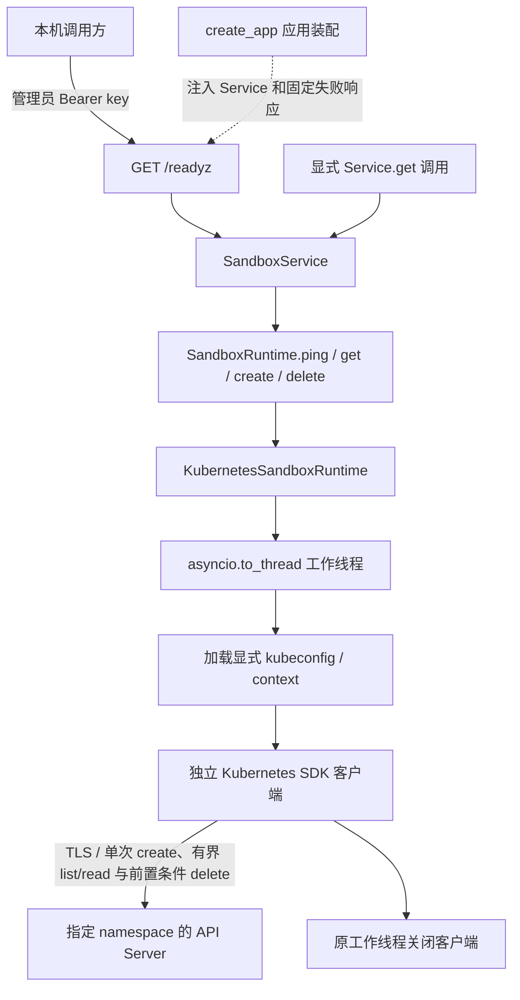

# Kubernetes Runtime 设计

Kubernetes Runtime 复用控制面的 `SandboxRuntime` 契约，当前实现只读 `ping()`、主 Pod 查询 `get(sandbox_id)` 和按布局安全删除 `delete()`，就绪探测通过依赖注入接入根 HTTP 链路。另有纯函数构建受约束的主 Pod 规格，并由 Runtime.create 完成默认拒绝 NetworkPolicy、Agent ClusterIP Service、主 Pod 提交、启动等待，以及可选的完整认证代理与私有 PVC 布局及失败回滚。本文说明职责、配置、安全边界和失败语义；代码流程、调用方式、测试与排查见[实现说明](IMPLEMENTATION.md)，公开响应以[控制面 API](../API.md#3-后端就绪检查默认-docker)为准。

## 当前能力与范围

| 能力 | 当前行为 |
| --- | --- |
| 构造 Runtime | 保存显式配置和工厂，不读取 kubeconfig 或创建客户端 |
| `ping()` | 在指定 namespace 只读列举至多一个 Pod，成功返回 `None` |
| `get(sandbox_id)` | 有界读取主 Pod，按布局核验原策略/Service，返回现有 `SandboxQueryResult` |
| `inspect_resources()` | 依据持久化版本、原 UID 和配置只读检查完整性，返回六类固定结果；不检查就绪、不修复资源 |
| `create(spec)` | 注入模式缺省沿原 running 语义；正式配置为八/九资源认证代理，在原 UID 核验、整体 ready 和本地入口准备后返回，失败精确补偿 |
| `delete(sandbox_id)` | 按持久化布局核验身份；代理布局先清理 proxy Pod，再清理 Agent 与依赖，使用原 UID/resourceVersion 前置条件并确认消失 |
| `build_pod_spec()` | 无外部 I/O 的 basic 主 Pod 规格构建；不是 Runtime.create，也不提交集群请求 |
| 私有 PVC 基础 | 独立构建/受管操作，并由版本 3 接入 Runtime 的挂载、事务、查询、入口身份和清理 |
| `get_endpoint()` | 只读已有应用会话，当次重新核验原身份及认证事实，返回 loopback 地址；不启动转发 |
| `/readyz` | 经 API → Service → Runtime 探测，保留管理员认证 |
| `/healthz` | 只表示控制面进程存活，不访问任何 Runtime |
| 其他 Runtime 方法 | 明确抛出 `KubernetesOperationUnsupported`，不伪造成功 |

默认应用仍使用 Docker；可信 `AGENT_SANDBOX_RUNTIME=kubernetes` 选择当前 basic 后端，必须明确提供目标和两种镜像。正式应用支持临时工作区及私有 PVC 的 HTTP 创建、自动认证入口、命令/文件和删除闭环，并保留只读 pending 核验及显式单轮恢复。应用重启后自动发现旧实例、失效重连、远程网关、周期恢复、DNS/出口放行、独立工作区复用和暂停/恢复仍待实现。

## 新建实例自动入口

Runtime 的可信 `prepare_entry_on_create` 默认 False，保持只读、历史和显式注入模式兼容；正式配置构造时为 True，要求已有认证代理配置。应用为空初始列表也持有管理器，构造不打开连接或进程。Service 仍只编排 Runtime，不导入管理器或 Kubernetes SDK。

创建顺序为 pending/凭据原子预写 → 原资源提交及两容器 running → 原 UID/事务/业务时间/认证事实核验 → 有界等待整体 ready → 一次会话准入及启动 → 当次目标复核 → Runtime 返回 → Service CAS 激活。就绪轮询只读取，不重试 POST，也不因当前配置接纳同名替代对象。打开前传递原 `LocalEntryTarget` 快照，管理器在构造会话/启动进程前比较，启动后继续复核；资源和认证事实发生变化时不交付入口。

等待就绪预算 30 秒，间隔至多 0.1 秒；会话自身启动仍为 10 秒，SDK 阶段和关闭使用既有有限期限。预算不等于整个请求的严格硬截止，取消也须等待在途线程/子进程收尾。默认会话容量为 8，可信显式管理器可在 1～32 范围配置；准入在 open 内无 await 地保留，不能先读数量保证容量。资源已创建后满额是允许的失败位置，必须回滚本次资源，不能抢占其他实例会话。

入口失败和取消先等待本次启动任务、确认原事务会话关闭，再复用 PodCreation 的原 UID 及布局回滚，私有 PVC 使用创建补偿删除语义。只有入口及全部资源确认清理才能报告 ROLLED_BACK；关闭失败不进入资源删除，保留自有句柄及 UNKNOWN，资源残留按原证据保留 pending、凭据和实例名额；创建并发额度仍在本次必要收尾完成后释放。激活冲突及提交不明仍由原 Service 处理，不增加另一条删除路径。

管理器跟踪在途创建准备范围，应用 close_all 先停止准入，等待这些操作及其补偿，再收尾会话；关闭未确认前保留应用 RunLock。正常 ASGI 退出仍先由服务器等待请求收尾，再执行 lifespan。GET endpoint 只读已有会话，删除保持先关闭入口再删资源；不提供重启自动发现、失效重连或远程入口。创建响应继续使用 started，之后 wait_ready 是实时观察，不能将创建时 ready 当作永久保证。

## 只读资源完整性检查

`inspect_resources(sandbox_id, expected_transaction_id=...)` 沿用现有 `SandboxResourceInspection`，服务于显式调用 `SandboxService.inspect_pending_once()`。Runtime 不读取 SQLite；Service 使用 pending 记录的原事务进行检查，结束后重新读取并比较完整生命周期记录和版本。记录删除、替换或状态改变时，结果改为 `changed/pending_record_changed`，不能沿用旧的成功结论。检查自身不改变管理状态；另行显式启用的启动恢复复用这项观察，并增加下述就绪、入口与凭据条件。

布局依据资源自身的版本、原 UID 收据和业务时间确定，不依据当前 Runtime 是否配置镜像或 StorageClass。支持历史单 Pod、Pod+策略、三资源，以及版本 1/2/3 的七/八/九资源布局；未知角色、版本、冲突事务和不一致 UID 不放行。私有 PVC 不等于独立工作区，非空 `expected_workspace` 仍明确不支持。

| classification | 固定 reason | 含义 |
| --- | --- | --- |
| `all_present` | `kubernetes_resources_complete` | 对应布局全部资源存在，已发布身份及必要配置一致 |
| `partial` | `kubernetes_resources_partial` | 已知布局缺少部分资源 |
| `partial` | `kubernetes_identity_incomplete` | 身份、时间、UID 收据或凭据事实尚未发布完整，未发现正向矛盾 |
| `partial` | `kubernetes_private_workspace_retained` | 九资源布局仅剩原私有 PVC，不是完整实例 |
| `partial` | `kubernetes_resources_deleting` | 身份完整但资源仍处于删除过程中 |
| `not_found` | `kubernetes_resources_not_found` | namespace 可读，两轮观察均无归属候选或确定名称对象 |
| `conflict` | `kubernetes_resource_conflict` | 身份、角色、事务、原 UID、布局或关联配置有正向冲突 |
| `unavailable` | `kubernetes_inspection_unavailable` | 权限、namespace、后端、超时、分页或关闭失败使观察无法可靠完成 |
| `changed` | `kubernetes_resources_changed` | 观察中确认对象出现、消失、替换或身份/配置改变 |

只读检查复用闭集发现、精确名称读取及配置核验，不调用完整 `get()`。Pending、未 Ready、容器退出或 PVC 健康异常本身不改变存在性结论；`all_present` 不代表 Agent 可响应、实例 ready 或允许恢复 active。仍需核对声明的卷源、准确 claimName、Service selector/端口、默认拒绝及最小放行策略、Secret 引用及原凭据摘要；摘要和 Secret 内容不进入检查结果或日志。

检查在同一工作线程借用独立客户端，使用有界列表与有限请求超时，两轮核对身份和声明配置。正常 Pod/PVC status、resourceVersion 和非平台控制器元数据变化不直接判作资源替换；Secret 使用 resourceVersion 检测变更，不序列化内容。它不能提供跨资源原子快照，也不能消除检查结束后的竞态。检查不读取 Agent HTTP，不打开入口会话，不创建、补写或清理任何集群和数据库对象。

## 私有持久工作区基础

`private_workspace.py` 提供私有存储的纯规格与受管操作；Runtime 版本 3 复用它，缺省 emptyDir、三资源和八资源布局保持兼容。纯构建函数接收已有 `SandboxSpec`、显式 namespace 和可信 StorageClass，不读取默认配置，不生成身份。PVC 名称为 `agent-sandbox-sbx-<32位十六进制>-workspace`，角色是 `private-workspace`，annotation `io.agent-sandbox.private-workspace-version=1`；完整归属、事务及最初业务时间来自原规格。它不使用未来独立工作区的占用协议，不接受 `spec.workspace`，也不包含实例 Token。

首版固定 `Filesystem`、`ReadWriteOnce`、`requests.storage=1Gi`，不指定既有 PV、selector、dataSource、快照或外部驱动参数。StorageClass 由后端明确传入，公共请求不能选择任意存储。该模块不管理 PV；Bound 只读核验原 PVC UID、请求规格、卷名及控制器报告的容量和访问模式。Pending 是正常阶段，尤其在 WaitForFirstConsumer 下不能等待独立 PVC 先 Bound 再创建消费者。Kubernetes 1.37 的 `Unused` 条件只描述空闲，不是失败，也不构成释放或删除授权，参见[官方说明](https://kubernetes.io/blog/2026/09/21/kubernetes-v1-37-pvc-last-used-time/)。

操作对象借用调用方在线程中持有的 CoreV1Api，不构建或关闭客户端，不启动后台任务。创建先检查有界归属候选与确定名称，任何既有对象都不接管；每个对象只尝试一次 POST。明确拒绝保留 UNCHANGED；响应丢失后在独立预算中寻找正向身份确认，找到原 UID 保留 REMAINING，否则为 UNKNOWN，不能从一次或反复 404 推断未提交。对象保留 submitted、原 UID 和失败证据，供下一轮事务聚合。创建失败不会自动删除数据，调用方必须根据这些证据决定安全收尾。

删除必须由调用方提供原 UID，先检查完整归属与存储规格，并在 namespace 内有界扫描所有 Pod，而非只扫描平台标签。仍有任何消费者 Pod 对象引用、发现分页或无法完成核验时拒绝删除；终态或删除中的消费者也须先清理。随后使用 UID/resourceVersion 前置条件正常删除 PVC，并等待确定名称和归属候选均不存在、namespace 仍可确认存在。Lost 等健康异常不阻止身份明确的清理；替代 UID、未知版本、归属冲突、权限和连接错误不能解释为已删除。不强删、不移除 finalizer；删除响应丢失只做结果确认，不自动重发 DELETE。

消费者扫描与新 Pod 创建不是原子占用协议，PVC protection 仍可能使删除等待超时，不能将本模块描述为单实例独占。`ReadWriteOnce` 也不提供应用级单 Pod 互斥，1Gi 请求不证明已经实现磁盘硬配额。当前 CSI hostpath 只验证同节点重新挂载，不承诺跨节点迁移或节点故障恢复。PVC 对象删除、PV 按回收策略删除、底层数据安全擦除是不同事项，本轮不实现安全擦除。

私有 PVC 挂载、原 UID 绑定、创建补偿与保留语义已接入版本 3；独立工作区协议与正式后端创建配置留待后续，当前 `create_workspace/inspect_workspace/delete_workspace` 仍明确不支持，尚未实现独立 `workspace_id` 复用。

## 分层与调用链



API 只调用共享的 `SandboxService`，不判断具体 Runtime 类型、不导入 Kubernetes SDK。应用装配层识别注入的 Runtime，向健康路由提供固定失败响应。Runtime 不访问 SQLite，Store 不调用集群；Kubernetes SDK 类型保留在后端实现内。

普通测试装配关闭 reaper 与 pending recovery，恢复测试仅在独立临时 SQLite 下显式开启，不运行默认 Docker 生命周期任务，也不打开开发数据库。整体装配、认证和存储规则见[控制面设计](../DESIGN.md)。

## 显式启动 pending 恢复

沿用 `create_app(pending_recovery_enabled=True)` 与既有批次配置，缺省仍为 False。应用在认证配置确认、取得 SQLite RunLock 并初始化存储后，先准备 `kubernetes_initial_sandbox_ids` 中的显式入口，再执行一轮 `SandboxService.recover_pending_once()`；完成后才启动 reaper 并接收请求。不扫描数据库自动打开入口，仍受最多八个初始 ID 及管理器自身会话容量限制。

恢复依次要求：资源完整且原事务一致，Runtime 原创建身份与数据库匹配，实例整体 ready，已有会话的 endpoint 当次核验有效，SQLite 原凭据与 Runtime 认证事实/摘要一致，最后重新读取完整 pending 记录并检查提交时期限。满足条件后，只按原事务和版本调用 Store.activate；不生成新身份、Token 或 TTL，不修改 Kubernetes 资源。`all_present` 单独不满足激活条件，私有 PVC Pending 虽可通过存在性检查，仍不能通过完整就绪检查。

资源缺失、冲突、变化、未就绪、入口缺失、凭据不符和过期均保留记录，以固定 skipped/failed reason 说明。不可靠的 Kubernetes 观察及配置/权限/连接/超时领域失败归为 `kubernetes_unavailable`，停止本轮但允许应用继续启动；Docker 仍为 `docker_unavailable`。任意 Runtime 原始 reason 不进入日志。显式初始入口打开失败则按原规则阻止启动、清理已经打开及启动中的入口，不能跳过入口准备激活实例。

激活提交响应丢失归为元数据不可用并阻止启动，保留数据库实际提交结果及全部资源，不删除、不重试激活或执行新建补偿。首次和重复取消等待当前候选及会话收尾，入口未确认关闭前保留自有句柄与 RunLock。该锁是本机应用所有权，不是跨资源原子快照或多 worker 调度保证。当前仍依赖显式入口列表，未增加恢复 HTTP 接口或周期任务；正式 Kubernetes 创建入口装配与独立工作区复用留待后续。

## 显式配置与认证

构造时必须提供以下配置，不从当前 kubectl context 自动选择目标：

| 配置 | 含义与约束 |
| --- | --- |
| `kubeconfig_path` | 单个明确的配置文件路径，不合并其他文件，不自动读取 `KUBECONFIG` |
| `context` | 指定 context 名称；非空 ASCII、最多 253 字符，无空白或控制字符 |
| `namespace` | 明确指定的 namespace；最多 63 字符，使用小写 DNS label 格式 |
| `proxy_image` | 可选可信代理镜像；缺省保持三资源，显式配置后要求 spec.access_token 并启用八资源，失败不降级 |
| `workspace_storage_class` | 可选可信 StorageClass；缺省 None 保持 emptyDir，仅允许与 basic 认证代理一起启用，选择九资源版本 3 |
| `agent_image` | 可信后端镜像引用，默认 `agent-sandbox-basic:dev`；构造时只校验值，不查镜像 |
| `client_factory` | 可选的可信测试工厂，延迟到工作线程中调用 |

构造仅执行值校验，不检查文件是否存在。每次 ping 都在工作线程加载指定文件与 context，配置缺失或错误直接失败，不退回 `current-context`、其他集群或 Docker。

首版针对本机 Minikube 的静态客户端证书及 CA，支持文件引用和 kubeconfig 内嵌证书数据。配置加载前拒绝 token、认证插件及其他非证书用户字段；不执行 exec/auth-provider，不尝试集群内认证。保留 TLS 证书校验，拒绝跳过验证、URL 中的凭据和 kubeconfig 的上游代理。

每次操作构建独立的 SDK Configuration，不修改 SDK 全局默认配置；显式禁用环境 HTTP 代理、urllib3 重试及 SDK 额外重试。不修改全局环境、不写回 kubeconfig，不把敏感配置或 SDK 原始响应用于公开文案。

## 主 Pod 规格构建

`pod_spec.build_pod_spec(spec, *, namespace, agent_image, workspace_storage_class=None)` 接收现有 `SandboxSpec`、显式 namespace 和可信后端传入的 Agent 镜像，返回官方 SDK 的 `V1Pod`。镜像不是公共请求字段；构建不解析镜像 ID、不检查缓存或运行契约，不读取 kubeconfig、环境或存储，不创建客户端，也不访问 Kubernetes、Docker、SQLite。

先用现有模型重新校验资源、网络和 UTC 时间，再校验 sandbox/事务格式。必要身份及时间不得缺失，业务时间不由 Pod 创建时间或当前时钟替代。仅支持 basic；其他环境、独立工作区绑定及非空出口白名单返回 `KubernetesOperationUnsupported`，不静默忽略。非法规格返回固定 `ValueError` 或既有非法 ID 错误，namespace/镜像配置错误使用 `KubernetesConfigurationError`。

| 项目 | 当前固定规格 |
| --- | --- |
| 身份 | 复用确定性 Pod 名、Agent 容器名和完整 `resource=container` 归属标签 |
| 业务时间 | 既有 created-at/expires-at annotations，UTC `Z`，保留微秒；不生成时间或事务 |
| 启动 | `/usr/local/bin/agent -listen 0.0.0.0:8080`，workingDir `/workspace`，容器 TCP 8080；无 hostPort |
| 镜像 | 显式后端参数，`imagePullPolicy=Never`；以后真实运行前须另行准备节点缓存 |
| 重启与健康 | `restartPolicy=Never`；HTTP `/healthz:8080` readiness，1 秒周期/超时；不配置 liveness 或自动重启 |
| 资源 | CPU `<cpu_millis>m`，内存 `<memory_mib>Mi`，requests 与 limits 相同；沿用现有严格范围 |
| 进程身份 | `runAsNonRoot=true`，固定 UID/GID 1000，Pod fsGroup 1000 |
| 容器权限 | 禁止 privileged 和提权、只读根、drop ALL capabilities、Pod `RuntimeDefault` seccomp |
| 宿主与凭据 | hostNetwork/hostPID/hostIPC 均 false，不自动挂载 ServiceAccount token，不注入 Service 环境变量 |
| `/workspace` | 缺省磁盘 emptyDir（1 GiB），版本 3 则挂载本事务准确 claimName 的私有 PVC |
| `/tmp` | 内存 emptyDir，sizeLimit 64 MiB；使用量计入容器内存约束 |

fsGroup 用于 emptyDir 的组写权限配置，不添加 root initContainer，不由用户进程递归 chown。`fsGroupChangePolicy` 对 emptyDir 不生效，本轮不配置它。本机 Minikube 创建集成已验证 basic 镜像下两个目录实际可写；其他镜像和发行版不因此获得兼容保证，容量配置也不是独立磁盘配额或节点空间预留。卷和权限语义见 [emptyDir](https://kubernetes.io/docs/concepts/storage/volumes/#emptydir) 与[安全上下文](https://kubernetes.io/docs/tasks/configure-pod-container/security-context/)。

输出只含一个 Agent 容器；缺省两个 emptyDir，版本 3 则为 /workspace PVC 加 /tmp emptyDir。没有 sidecar、initContainer、hostPath、Docker socket、外部挂载或环境变量继承。实例 access_token 即使存在于输入中也不会写入 Pod；管理员 key、kubeconfig 和代理凭据均没有交付路径。Docker 专用 container/network/volume 名不作为 Kubernetes 名称。每次构建新建 labels、annotations、资源字典、列表和 SDK 对象，不修改输入或共享可变结果。

规格遵循 get/delete 的名称、归属及按版本区分的单 Agent 挂载约定。UID、resourceVersion、调度及运行状态留给 API/节点提供；构建时不伪造这些事实。离线兼容测试仅模拟这些外部观察。

新建 Pod 使用下述默认拒绝策略；单有 Pod 安全上下文或策略对象不等于完整网络隔离，也不将其与 Docker internal bridge 的实现机制等同。Docker 的 PID 和 swap 约束不直接照搬为虚构 Pod 字段，节点级进程/资源部署限制仍待设计。正式控制面创建接入前仍需持久工作区、入口及明确的放行能力。

规格构建、server-side dry-run、真实创建和完整 sandbox 是不同阶段。`dry_run="All"` 只验证 API admission/默认化，不持久化 Pod，不证明镜像可运行、卷可写或 Agent ready。`KubernetesSandboxRuntime.create()` 现在只实现下述 Runtime 单 Pod 创建闭环；后续仍需入口、持久存储、受控网络放行及正式 Service/API 接入。

## Pod、Agent Service 与默认拒绝策略创建闭环

`Runtime.create(spec)` 复用 `build_pod_spec()`，Agent 镜像仅来自可信 Runtime 的 `agent_image` 配置。支持 basic、单 Agent、缺省 emptyDir 或显式版本 3 私有 PVC，其他环境、独立工作区和出口策略在客户端获取之前拒绝。保持 Never 拉取，不构建/加载镜像、不执行 apply、不重试 POST。

创建线程先确认显式 namespace，按 managed/project/sandbox-id 三标签有界发现所有 Pod 角色，再精确读取确定名称。存在候选、同名外来对象、重复/分页或布局歧义均拒绝，不能接管或删除创建前对象。三类资源均通过预检后，先提交并核验 NetworkPolicy，再提交并核验 Agent Service，最后提交 Pod；各自仅一次 POST，分别保存原 UID。验证响应名称、namespace、UID、完整归属、事务、业务时间与构建器指定字段；只容许 API 默认值和资源数量规范化，不放宽显式安全设置。

API 接受、Agent running 和 Agent ready 是三个阶段。创建在同一 UID 的 Agent 实际 running、Pod 不在删除或失败状态时返回 None，不强制等待 readiness。正常退出、明确等待错误、失败/删除状态、身份变化及超时均转入失败处理；后续 get 继续区分 running 与 ready。Runtime 不读写 SQLite，不激活生命周期记录。

| 预算 | 当前值 | 用途 |
| --- | --- | --- |
| 预检、POST 与启动等待 | 30 秒 | 单调时钟，0.1 秒轮询；请求各阶段至多 0.5 秒，随剩余预算缩小 |
| 丢失响应后的身份确认 | 5 秒 | 不重发 POST，只寻找同时匹配的完整事务、原始业务时间与唯一 UID 证据 |
| 原 UID 回滚 | 独立 45 秒删除预算 | 不受启动预算耗尽影响；复用优雅删除、UID/resourceVersion 前置条件和消失确认 |

这些是工作线程操作/轮询预算，不是能强行打断 SDK、配置加载或关闭的硬总期限。POST 响应丢失时，即使发现匹配 Pod 也只用于失败补偿，不把结果不明的请求重新解释为创建成功。一次或反复 404 都不能证明未知 POST 从未提交；观察到身份/布局冲突后结束确认，不遗忘冲突再接管后来的对象。

回滚先确认 Pod 消失，再删除原 Service，最后删除原策略；Pod 未确认清理时保留 Service 和策略，Service 未确认清理时保留策略。回滚从不只凭 sandbox ID/事务重新取得删除权：已确认 UID 后始终固定原 UID。若响应丢失，只有空预检、单次 POST 和完整唯一匹配的正面观察才能确认本次对象；不能取得该证据则保留 UNKNOWN。PodDeletion 在任何 DELETE 前复核原 UID；替代对象、冲突对象或不支持布局不得被误删。409 创建拒绝不进入对象接管或清理。

| `CreationFailureInfo.resource_state` | 本轮证据 |
| --- | --- |
| UNCHANGED | 三类资源均未变更；若策略或 Service 已创建，即使 Pod POST 被拒绝也不能返回此状态 |
| ROLLED_BACK | 全部本次资源的原 UID 已确认清理，按 Pod → Service → 策略顺序完成消失核验 |
| REMAINING | 清理未完成，仍正面观察到原 UID/事务；或刚确认创建成功后客户端关闭失败 |
| UNKNOWN | 无法确认 POST 是否提交、身份/UID 变化、后端不可达或清理结果不明 |

普通失败使用固定创建领域错误；有残留或不确定证据时使用 `SandboxCleanupFailed`，保留 sandbox ID 和结构化证据。共同转换器不会把这些错误变成普通连接错误。主失败优先于关闭失败；成功后的单独关闭失败也不能抹去已创建资源。

异步取消会设置线程事件，在途请求返回后停止推进并做有界回滚，重复取消继续等待收尾。只有 UNCHANGED/ROLLED_BACK 才能传播普通 CancelledError；REMAINING/UNKNOWN 必须保留领域失败。即使线程刚完成启动和关闭、取消赢在异步结果交付，外层也会以新客户端按已保存原 UID 补偿，不能留下晚到成功的 Pod。

当前 basic 临时工作区已能沿 Service → Runtime 完成创建、激活及补偿；正式 Kubernetes 应用装配要求启用八/九资源认证代理布局，但创建成功仍不自动打开入口。Service 私有资源补偿的 `delete_workspace=True` 按后端卷语义处理；独立工作区/镜像兼容解析、DNS/出口放行和完整生产生命周期仍待开发。Docker 工作区行为不变，emptyDir 数据随 Pod 删除，不提供保留或完整隔离承诺。

## 默认拒绝网络布局

新创建使用 `io.agent-sandbox.kubernetes-network-version=1` 标签，写入 Pod 与专属 NetworkPolicy；历史无标记的单 Pod 仍可查询、删除，不隐式增加策略或宣称其具备新隔离能力。未知版本、矛盾或损坏标记保守失败，不降级为历史布局。

策略使用 `networking.k8s.io/v1`，名称为主 Pod 确定名称加 `-deny`，资源角色为 `network-policy`。完整归属、事务及原始业务时间与 Pod 一致；podSelector 精确包含 managed、project、sandbox-id、transaction-id、resource=container 以及网络布局版本六项标签，不使用空 selector 或宽泛 namespace 选择。`policyTypes=["Ingress","Egress"]`、`ingress=[]`、`egress=[]`；不创建空规则 `{}`，不放行 DNS、任意来源或目的，不加 ownerReference 依赖自动垃圾回收。

在策略创建响应核验通过后，将原策略 UID 写入 Pod 的 `io.agent-sandbox.network-policy-uid` annotation，然后才提交 Pod。重启后的 get 和公共删除都核对这一绑定，不能把同名同标签的新 UID 策略当成原对象。策略自身只保存归属、版本和业务时间，无宿主或实例凭据。

get 对新布局同时检查策略唯一性、归属/事务/时间、绑定 UID、selector、双向零规则及未在删除中；API 省略空规则数组与空列表语义相同，包含一个空规则则是放行，必须拒绝。查询缺失、被放宽或被替代的策略返回固定 `SandboxQueryFailed`，不继续返回正常 ready。策略对象核验不会发起 Pod 网络探测。

清理的归属核验与拒绝规则完整性分开：合法归属的放宽策略仍可在 Pod 已消失后删除。删除前核对对应布局的全部资源，不按标签批量删；各自使用精确名称、原 UID 与 resourceVersion 前置条件，不接管替代对象。先优雅删除并确认 Pod 消失，新布局还须确认 Service 清理，再删除策略；历史两资源及新布局的受支持残留组合均可收敛。Pod 清理失败、存在残留或 POST 结果不明时，保留策略；取消和关闭失败也不能绕过这一顺序。

失败证据覆盖整个事务：策略或 Service 已创建、Pod 未提交不等于 UNCHANGED；Pod 被明确拒绝后，只有全部已提交资源也确认删除才能报告 ROLLED_BACK。策略 POST 响应丢失同样需要有界正面核验，不能因尚无 Pod 就推断未创建。确认残留报告 REMAINING，不能确认时保留 UNKNOWN 及恢复依据。

CoreV1Api 与官方 NetworkingV1Api 使用同一个独立 ApiClient，延迟到工作线程装配。Networking facade 不拥有第二个连接池，不单独关闭客户端；成功、失败和取消后均由该 worker 关闭一次。策略创建与删除不自动写重试，读取/消失确认使用有限单调预算；Pod 的长时间优雅删除不会耗尽随后策略清理的独立预算。

NetworkPolicy 依赖 CNI 执行，API 对象存在不能证明已即时生效，也不承诺绝对没有启动窗口。策略是叠加放行模型：其他选择同一 Pod 的允许策略可能扩大可达范围；本轮不管理集群全部策略、宿主流量或 CNI 配置。宿主/节点访问、exec 和 port-forward 不是此网络边界的验证替代，也不构成多租户隔离。相关语义见[官方 NetworkPolicy 说明](https://kubernetes.io/docs/concepts/services-networking/network-policies/)。

当前 Calico 环境已通过有界、数字 IPv4 Pod IP 的跨节点 HTTP 对照测试；readiness 无需添加例外仍正常。不将该结果外推为全部 CNI、所有协议或 IPv6 验收，不因失败放宽规则。DNS/出口策略放行、独立工作区复用和正式 Service/API 创建接入仍待开发；私有 PVC 见版本 3 章节。

## 可选的完整代理 Runtime 布局

`KubernetesSandboxRuntime(proxy_image=...)` 显式启用完整布局；缺省仍创建 NetworkPolicy、Agent Service、Agent Pod 三资源，不改变默认 Docker 装配和公共 HTTP API。Token 必须来自合法的 `spec.access_token`，缺失时在客户端获取和资源变更前拒绝，Runtime 不生成或替换凭据；失败时不能回退到三资源。

| 资源角色 | 确定名称后缀 | 职责 |
| --- | --- | --- |
| container | 主 Pod 原名称 | 不可信 Agent/用户工作负载 |
| network-policy | -deny | Agent 双向默认拒绝 |
| agent-service | -agent | Agent 内部 TCP 8080 寻址 |
| proxy-access | -access | immutable Opaque Secret，仅代理 secretKeyRef 引用 |
| proxy | -proxy | 独立认证 Nginx，非 root、只读根、有界资源 |
| proxy-service | -proxy（Service 类型） | 代理内部 TCP 8080 寻址，独立于 Agent Service |
| agent-proxy-ingress | -proxy-in | 只允许同实例/事务 proxy 到 Agent TCP 8080 |
| proxy-isolation | -proxy-deny | 代理入站拒绝，出站仅允许对应 Agent TCP 8080 |

新建 Runtime 布局版本 annotation 为 `io.agent-sandbox.kubernetes-proxy-version=2`，历史七资源版本 `1` 继续支持查询和清理；镜像/上游协议标记 `proxy-upstream-version=1` 保持独立含义。创建前在 Agent 元数据记录预期 Token SHA-256 与可信代理镜像；`proxy-resource-uids` 保存规范 UUID，版本 1 只接受 agent/policy/service/secret/proxy/ingress/isolation 七键（最多 512 字符），版本 2 增加 proxy_service（最多 768 字符）。查询要求对应版本的完整键集，部分创建记录仅供持有原 UID 证据的补偿/删除；未知键、重复键、版本冲突或缺失字段均不能将新布局降级。逐步发布后最终八类资源均保留完整记录；metadata JSON Patch 同时 test UID 和 resourceVersion，更新失败走创建补偿，不刷新身份强行重试。

该摘要是对 Secret 凭据完整性的核验依据，不是加密或访问凭据。Secret 数据仅做 Kubernetes Base64 编码；原始 Token 不进入 Agent、labels 或公共查询，摘要、镜像和 UID 记录也不进入 `SandboxQueryResult`。受管标签/annotations 属于可信平台约定，不能防御集群管理员篡改，不构成跨系统 fencing。

所有角色和确定名称预检通过后，创建 Agent 默认拒绝策略、Service、Agent Pod，并等待 Agent 实际 running，再创建 Secret、代理隔离及 Agent 入口规则、Proxy Service，最后创建代理 Pod。Secret 和代理隔离先于代理 Pod；每种资源最多一次 POST，分别固定原 UID。代理实际 running 后可成功，不要求全部 readiness 通过。镜像仍 Never 拉取，缺失镜像进入失败补偿。

新布局查询有界发现两类 Pod、三类策略、两类 Service 和一个 Secret，每类读取最多预期数量加一以发现超量，拒绝未知/重复角色、分页未结束和冲突事务，再逐个精确读取。核对持久 UID、原始业务时间、布局、预期镜像、Service 上游、Secret 引用、两条精确网络规则；Secret 必须原 UID、Opaque、immutable、唯一规定键，解码后的合法凭据摘要与创建时的预期一致。凭据损坏或任一资源缺失/配置不符均查询失败，不修复或降级。只有 Agent 与代理均有运行和 readiness 证据才返回 ready；代理未就绪保持 running/starting，代理失败返回固定 failed reason。状态不证明存在外部入口。

公共删除按资源自身持久标记识别，不依赖当前 Runtime 是否仍配置 proxy_image。先完整核验清理身份与原 UID 记录，先停止并确认代理 Pod 消失，再确认 Agent Pod 消失；随后删除 Secret、Proxy Service、Agent Service 和策略，Agent 默认拒绝最后删除。任何 Pod 未确认消失时保留其余资源，不提前撤销隔离或凭据。健康、Secret 内容和镜像配置校验不作为合法归属残留的删除前提；未知版本、冲突归属或替代 UID 则拒绝误删。支持部分残留与重复调用；某资源自身的记录尚未发布时，仅能用其他存活记录中已持久化的准确原 UID 继续清理。没有足够原 UID 依据的结果不明对象不能被自动接管。

创建回滚采用相同的 Pod 清理顺序，再清理伴随资源及原三资源；旧事务不能按名称获得替代对象的删除权。丢失响应逐资源有界寻找唯一正面身份，反复 404 不能证明没有提交。全部本次资源确认消失才是 ROLLED_BACK；REMAINING/UNKNOWN 保留结构化证据，取消和重复取消不能跳过必要收尾。原 API 接受、容器 started、组件 ready 三阶段保持区别。

Proxy Service 使用纯函数 `build_proxy_service(agent_pod)` 构建，确定名称为主 Pod 名加 `-proxy`，角色为 `proxy-service`，类型固定 ClusterIP，地址由 Kubernetes 分配。selector 只含本实例、本事务、网络版本及 proxy 角色六标签；仅 TCP 8080 → 数字 8080，不发布未就绪后端，不设置 NodePort、LoadBalancer、externalIPs、ExternalName 或 headless，不手工创建 EndpointSlice。查询核验原 UID、归属、时间、路由和已分配地址，缺失、替换或配置变更返回固定查询错误。创建阶段尚无后端是正常情况，成功条件仍为两个容器 running，不新增 EndpointSlice 等待。

当前仅提供集群内 Runtime 链路。不会创建宿主端口或“测试客户端访问代理”规则；代理入站仍默认拒绝。独立测试 fixture 的访问例外不属于生产布局。没有 DNS、公网、用户应用端口放行，已有会话的 get_endpoint 交付见后文，持久工作区和正式 Kubernetes Service/API 创建接入仍未实现；当前临时工作区的 Service 补偿已对齐，持久卷语义不在本轮范围内。已有实例可显式建立 WSL 本地会话并交付 endpoint，仍不提供通用宿主入口或新增网络放行。

## 独立认证代理验证方案

本轮复用同一 Nginx 认证模板：缺省保留 Docker `sandbox:8080` 和 Docker DNS；可信启动项 `SANDBOX_AGENT_UPSTREAM_IPV4` 指定规范 IPv4 时固定使用该地址的 8080，移除 Docker resolver，暂时拒绝 `/services/` 应用端口路由。输入在生成配置前校验，模板替换仅使用明确的变量白名单；私有配置权限、Token 移除及固定失败文案沿用现有规则。

独立规格构建器放在 `proxy_spec.py`，只从已核验的主 Pod/Agent Service 派生独立代理 Pod、不可变 Opaque Secret 和两项最小策略；不访问集群。Secret 仅经 `secretKeyRef` 交给非 root 代理，不进入 Agent、labels 或 Pod 明文。代理使用只读根、禁止提权、drop ALL、RuntimeDefault seccomp、有界资源和 `/tmp` emptyDir，不挂载 ServiceAccount token 或工作区。

保留 Agent 默认拒绝：额外的 Agent ingress 仅允许同 namespace、同 sandbox、同事务的 proxy 角色 TCP 8080；代理自身 ingress 默认拒绝，egress 只允许对应 Agent TCP 8080。测试 fixture 单独放行唯一客户端到代理，不视为正式外部入口或 DNS 放行。

实施顺序为离线渲染/拒绝测试、纯规格与网络边界测试、独立标签构建加载、实际 Pod 网络认证/命令/文件/SSE 与隔离验证，最后以同一测试镜像运行 Docker 默认模式回归。fixture 保存完整身份和原 UID 独立清理。该独立实验用例继续保留；本轮 Runtime 的可选自动布局见上节。缺省三资源、公共 API 与 get_endpoint 的既有边界保持。

## 专属 Agent Service 与布局兼容

新建布局在 Pod annotation 中声明 `io.agent-sandbox.agent-service-version=1`，并在 Service 响应核验后写入 `io.agent-sandbox.agent-service-uid=<原 UID>`。这两个字段不增加 selector 标签，NetworkPolicy 仍精确选择原来的六项标签。Service 自身保存相同版本、完整归属、事务及原始业务时间，角色为 `agent-service`，名称为主 Pod 确定名称加 `-agent`；不保存自身 UID annotation、实例 Token 或宿主凭据。

| 布局 | 识别及行为 |
| --- | --- |
| 历史单 Pod | 无网络版本和 Service 标记；继续查询/清理，不补建资源 |
| 历史 Pod + NetworkPolicy | 网络版本 1，无 Service 标记；只要求原策略，不要求新 Service |
| 三资源 | 网络版本 1、Agent Service annotation 版本 1，以及 Pod 对两种资源的原 UID 绑定 |
| 历史七资源 | Runtime 代理布局版本 1，七键 UID 记录；不要求或补建 Proxy Service |
| 八资源 | Runtime 代理布局版本 2，八键 UID 记录；严格要求原 Proxy Service，保持 emptyDir |
| 九资源 | Runtime 代理布局版本 3，九键 UID 记录新增 workspace；严格要求原私有 PVC、StorageClass 与精确挂载 |

未知版本、UID 无版本、标记位置错误或损坏不降级成历史布局。Service 规格由纯函数 `build_agent_service(pod)` 构建：固定 ClusterIP，由 API 分配地址，只有 TCP 8080 → 数字 8080，selector 为本 sandbox、本事务及主容器角色的六项标签。不发布未就绪后端，不设置 headless、NodePort、LoadBalancer、externalIPs 或 ExternalName，不手工创建 Endpoints/EndpointSlice。

get 对声明需要 Service 的 Pod 有界发现并精确读取 Service，核验名称、namespace、完整归属、事务、业务时间、版本与绑定 UID，再核验 ClusterIP、端口、selector 和未在删除中。接受 Kubernetes 分配的合法单/双栈地址及已知默认字段；例如 `publishNotReadyAddresses=false` 在 API 响应中可能省略。Service 缺失、同名替代、配置篡改均返回固定查询领域错误，不自动修复，不继续返回正常 ready。该核验不是跨资源原子快照，也不读取 EndpointSlice；真实测试单独核对控制器生成的后端。

公共删除先核验三类资源身份，不依赖健康、readiness 或 Service 路由完整性来清理合法归属的残留。Service DELETE 使用精确名称和原 UID/resourceVersion 前置条件，单次提交后有界确认消失，不删除替代对象；随后才能清理策略。仅剩 Service、策略、Pod 或其他受支持子集均可重试收敛。创建响应丢失时有界寻找唯一正面身份，不重发 POST；三类资源全部确认消失才是 ROLLED_BACK，不能从 Pod 未创建或一次 404 推断整笔事务无变更。

Service 使用已有 CoreV1Api 和同一 worker 拥有的 ApiClient，没有额外连接池。每次 Service 消失确认有独立 5 秒单调预算，SDK 连接/读取各至多 0.5 秒；预算不是强制中断线程的硬期限。关闭失败不覆盖原有创建/清理证据。

Service 仅提供内部寻址，不添加任何网络放行。当前 Calico 显式测试验证有就绪 EndpointSlice 时，跨节点普通 Pod 通过数字 ClusterIP 访问仍被拒绝，且正面对照可达；不外推为其他 CNI、IPv6 或所有协议已验收。`get_endpoint()` 只允许交付已有认证代理会话，不交付裸 Agent 地址。受认证代理、Secret 及最小网络规则现已通过可选八资源布局管理，见前节；正式外部入口、DNS/出口放行、独立工作区复用和正式 Service/API 创建接入仍待实现。

## 主 Pod 查询约定

`get()` 仅访问显式 namespace，非法 `sbx_<32位小写十六进制>` ID 在创建客户端前返回 `SandboxNotFound`。首版使用以下可供后续 create 复用的约定：

| 项目 | 约定 |
| --- | --- |
| 主 Pod 名称 | `agent-sandbox-sbx-<32位十六进制>`；公共 ID 保留不变，名称将下划线转换为连字符 |
| Agent 容器 | 固定为 `agent`，仅接受一个普通容器；暂不支持 init、ephemeral 或 sidecar 容器 |
| 归属标签 | `io.agent-sandbox.managed=true`、`project=agent-sandbox`、`sandbox-id=<id>`、`resource=container`、`transaction-id=txn_<32位小写十六进制>`，均使用同一 `io.agent-sandbox.` 前缀 |
| 原始业务时间 | annotations `io.agent-sandbox.created-at`、`io.agent-sandbox.expires-at` 必须同时存在 |
| readinessProbe | HTTP GET `/healthz`、数字端口 8080、HTTP scheme；不指定其他 host、headers 或其他探测方式 |

按 managed、project、sandbox-id、resource 四项标签执行 `limit=2` 的单页发现，不按事务或预期名称过滤，以免隐藏同实例的冲突候选。多候选、continuation token 或剩余结果标记均拒绝，不任取第一个或继续翻页。候选必须匹配名称、namespace、完整标签及规范 UUID 形式的 Pod UID；随后按确定名称精确读取，再核对 UID、事务和原始业务时间未变化。两次读取间布局版本或绑定 UID 变化同样拒绝，不能因丢失 Service 标记而降级跳过核验。列表与精确读取不是跨系统原子快照，也不能防止集群管理员在核验后修改对象。

时间只从 annotations 读取，允许 `Z` 或 `+00:00` 的严格 UTC RFC 3339，最多保留六位小数，期限不得早于创建时间。不使用 Pod 的 `metadata.creationTimestamp`，不兼容时间缺失的历史 Kubernetes 对象，不补造时间或事务。labels/annotations 中出现 `io.agent-sandbox.workspace-` 绑定标记时拒绝查询，不将其伪装为无工作区实例。

`SandboxService.get()` 沿用现有身份核验：匹配 sandbox ID、事务、created_at 和工作区身份后，才合并 SQLite 的当前 expires_at；没有记录时返回 Pod 原始时间且不自动接管。Runtime 不访问 SQLite，查询不更新版本、管理状态、Pod 或 annotations。期限已过不改变只读状态，也不触发资源删除。

### 状态与就绪证据

| 实际观察 | 返回状态与主要 reason |
| --- | --- |
| Pending、未调度或等待容器出现 | `starting` / `pod_unscheduled`、`pod_pending` |
| ContainerCreating、PodInitializing | `starting` / `agent_container_creating`、`agent_initializing` |
| Agent 正在运行但 readiness 未通过 | `running` / `agent_not_ready` |
| 缺少 readinessProbe，或 Pod Ready 为 False | `running` / `agent_readiness_probe_missing`、`pod_not_ready` |
| 约定 probe 存在、Agent running 且 ready=True、Pod Ready=True | `ready` / `agent_readiness_passed` |
| Pod Succeeded 且 Agent 正常退出、事实一致 | `stopped` / `agent_completed` |
| Pod 明确 Failed、Agent 非零退出或 OOM | `failed` / `pod_failed`、`agent_exited_nonzero`、`agent_oom_killed` |
| 镜像拉取、镜像缺失、容器配置/启动或 crash loop 错误 | `failed`，使用各自固定的 Agent reason |

未知 phase、未知等待原因、缺失/重复容器状态、多个同时存在的 container state、运行与终态矛盾或错误 probe 均返回 `SandboxQueryFailed`。Pod Ready=True 不能替代约定 Agent probe；Kubernetes 对无 probe 的默认 ready 行为不作为本项目的就绪证据。reason/message 均为固定文案，不透传原始 message 或 Events。

删除中的 Pod 不返回 ready：原 ready 降为 running，其他非失败状态保留当前分类并标记 `pod_deleting`；明确失败仍保留失败原因。没有 Kubernetes `paused` 映射。新布局的 ready 还要求策略和 Agent Service 对象核验通过，但它仍只是主 Pod/Agent 与策略、Service 配置的当前观察，不是 CNI 数据面探测，不证明入口、出口或用户应用可用。状态依据参见 [Pod 生命周期](https://kubernetes.io/docs/concepts/workloads/pods/pod-lifecycle/)。

## 单主 Pod 删除

`delete()` 保留公共 Runtime 签名，非法 sandbox ID 在创建客户端前拒绝；指定事务时必须是合法 `txn_<32位小写十六进制>`。`delete_workspace` 只接受真正 bool，非法值在关闭会话/访问集群前拒绝；`expected_workspace` 非空仍提前返回不支持。对于已支持且无独立绑定的临时布局，True 和 False 均执行同一精确 Pod 及伴随资源删除；emptyDir 随 Pod 清除，不增加存储删除操作，False 也不承诺数据保留。

删除只解释归属和资源布局，不调用状态映射：Pending、失败、正常退出、readiness 异常以及业务时间缺失均不妨碍身份正确的 Pod 清理。开始变更前核对以下事实：

- 按 managed/project/sandbox-id 三项标签发现所有 Pod 角色，`limit=2`，拒绝多候选及未结束分页；不按 resource 或事务过滤隐藏冲突。
- 即使没有标签候选，也精确读取约定名称，不能把同名外来对象当成不存在。候选与精确读取必须有相同 UID 和事务。
- 核对 namespace、确定名称、规范 UID、完整主 Pod 归属和有效 resourceVersion；若指定预期事务，还必须严格一致。
- 仅接受单 Agent 容器；init、ephemeral、额外普通容器均不支持。旧版本只允许 emptyDir；版本 3 仅额外允许原私有 PVC 的准确挂载。未知平台配置/绑定标记保守拒绝，不能删完主 Pod 就声称已清理其他资源。

DELETE 使用明确的 namespace/name 和 `V1DeleteOptions` 中的 UID、精确读取所得 resourceVersion 前置条件。正常优雅删除，不设置零宽限期、不强删、不移除 finalizer。前置条件冲突返回 `SandboxDeleteConflict`，不刷新身份再尝试。原 Pod 已有 deletionTimestamp 时不重复发送 DELETE。

DELETE 响应不是完成证明。线程在一个 45 秒单调时钟预算内，每隔最多 0.1 秒精确读取原名称；每次 SDK 连接/读取阶段最多 0.5 秒，并按剩余预算收紧。等待时 UID、事务、归属或布局变化立即冲突，不接管替代对象；resourceVersion 的正常状态更新不改变原 UID/事务身份，也不触发再次删除。

名称读取 404 后，还要确认同 sandbox 的 Pod 候选为空，并只读核验指定 namespace 仍存在。因此删除需要 Pod list/get/delete 及目标 namespace 的 get 权限；namespace 不存在、权限不足或后端不可达不能作为删除成功依据。原本不存在及重复删除也采用相同确认规则。

DELETE 连接中断、超时或服务端异常可能发生在提交之后：不自动重发 DELETE，只在剩余预算内复查。确认消失可成功，不能确认则 `SandboxDeleteFailed`；权限失败保留 Kubernetes 分类。达到预算时保留失败，不能假定没有执行。SDK 阶段超时、配置加载和关闭仍有各自边界，45 秒不是强制中断线程的硬期限。

Runtime 不访问 SQLite。Service 只有在 Runtime 成功后才沿原身份/版本保护清理记录；失败时保留 deleting 记录供重试。取消仍等待线程及客户端收尾，不执行反向补偿、不重新创建 Pod。

确认范围是 Kubernetes API 中目标对象消失，不承诺故障节点上的旧进程已被额外强制隔离。标签和前置条件也不是对集群管理员的认证或 fencing。相关语义参见 [Pod 终止流程](https://kubernetes.io/docs/concepts/workloads/pods/pod-lifecycle/#pod-termination)。

## 探测与期限

每次探测只执行以下调用，不 watch、不自动分页、不读取 Secret，也不执行命令或创建资源：

```python
api.list_namespaced_pod(
    namespace,
    limit=1,
    watch=False,
    _request_timeout=(0.5, 0.5),
)
```

空列表同样成功，响应中的 continuation token 不会触发下一次请求。成功只表示 API 可达且具有指定 namespace 的 Pod 列表读取权限，不证明有创建/删除权限、所有节点健康、Agent 就绪或任何 sandbox 资源存在。

| 限制 | 当前值 | 边界 |
| --- | --- | --- |
| 连接阶段 | 0.5 秒 | SDK transport timeout |
| 读取阶段 | 0.5 秒 | SDK transport timeout，不等于所有响应读取的硬总期限 |
| HTTP 就绪等待预算 | 默认 1 秒 | 触发 asyncio 取消，仍需等待 Kubernetes 线程收尾 |

文件加载、DNS、SDK 请求和关闭不构成一个严格的总 deadline。不能把各阶段 timeout 相加后宣称操作必然在该时刻结束，也不保证 `/readyz` 精确在 1 秒内响应。

## 取消、关闭与错误

同步 SDK 操作完全由工作线程持有，get 的发现和精确读取分别使用有限连接/读取超时。异步等待被取消时，复用 `core/tasks.py` 等待当前线程完成；首次和重复取消都不能从另一个线程提前关闭客户端。收尾读取最终结果和异常，再传播取消或线程失败，避免遗留未读取的后台异常。

成功和失败路径均关闭已取得的客户端。主操作与关闭同时失败时保留主操作错误；只有关闭失败时也不能报告成功。Runtime 使用下列固定领域错误，HTTP 根就绪接口将失败统一为当前后端不可用：

| Runtime 错误 | 分类 |
| --- | --- |
| `KubernetesConfigurationError` | 配置、context、证书或认证方式不符合要求 |
| `KubernetesPermissionDenied` | API 返回 401 或 403 |
| `KubernetesTimeout` | 连接/读取超时，或 API 返回 408、504 |
| `KubernetesConnectionFailed` | 其他连接、API 或客户端关闭失败 |
| `KubernetesOperationUnsupported` | 当前未实现的 Runtime 能力 |
| `SandboxNotFound` | 非法 ID、发现无候选或已确认的目标 Pod 在精确读取时消失 |
| `SandboxQueryFailed` | 归属、业务时间、拓扑或状态事实异常，分页/重复候选或发现后身份变化 |
| `SandboxDeleteConflict` | 删除身份/布局歧义、替代对象或 DELETE 前置条件冲突 |
| `SandboxDeleteFailed` | 删除等待预算耗尽，仍无法确认原对象已消失 |

Pod 集合读取的 404 视为显式 namespace 配置不可用，不能伪装为实例不存在；权限、连接和超时继续保留 Kubernetes 分类。共同错误转换器保留查询领域错误，不将其归并成连接故障。

根就绪成功为 HTTP 200 `{"status":"ready"}`；Kubernetes 失败为 503 `kubernetes_unavailable` / `Kubernetes runtime is unavailable`。Docker 仍使用原有 `docker_unavailable` 响应。仅精确 GET `/healthz` 匿名，未认证请求不会进入 Service 或创建客户端；完整响应见[API](../API.md#3-后端就绪检查默认-docker)。

未支持的创建规格在提交前拒绝，提供 UNCHANGED 证据；运行时创建失败则按本次资源观察给出下述四类证据，不能套用历史错误类的默认回滚结论。

## 信任边界与后续方向

kubeconfig 与静态证书属于可信宿主配置，不传给 Agent 或用户任务，不写入数据库、日志或响应。当前只实现已记录的默认拒绝与最小代理网络规则；ping 成功不证明工作负载权限、网络或存储隔离已完整配置。

后续仍需正式创建入口配置、受控出口放行与独立工作区复用，再接入完整生产生命周期。当前删除覆盖主 Pod、策略、Service、可选认证代理及私有 PVC，恢复依赖显式本地入口；本地转发由应用会话持有，Runtime 删除在同一身份协调下先关闭会话，再清理集群资源。

## WSL 独立本地入口会话

本地入口是调用方显式持有的异步会话，不属于 Runtime 资源创建组合、应用 lifespan 或公共 endpoint。只接受受管版本 2 八资源或版本 3 九资源代理布局：通过现有完整查询核验获取整体 ready 的实例、原事务、Proxy Service/Pod 确定名称与全部原 UID 记录。原 Service 用于约束目标身份，实际 kubectl 只转发原代理 Pod 的 8080；不允许传任意对象、远端端口或 URL。

选用现有 kubectl 子进程，而非新增 Python 转发协议实现：参数数组显式指定 kubeconfig/context/namespace、`--address=127.0.0.1` 与 `:8080`，端口由 kubectl 分配，避免预分配端口的竞争。只在收到严格的 loopback 监听确认且进程存活、再次核验原身份后交付 URL；会话不保存实例 Token。持续消费两条输出流，仅在短片段中解析端口或固定错误分类，不缓存或公开原始诊断。环境只传必要的程序路径与固定 locale，不继承代理或管理员密钥。

启动采用有限预算；取消或预算耗尽仍等待已发起的 SDK/进程创建取得最终结果，回收迟到的句柄，不能把 asyncio 超时视为底层操作已停止。关闭只操作自有句柄，terminate 后有界等待，必要时 kill 并再次有界回收；失败明确报告，重复取消不能打断收尾。会话不自动重连，进程退出后 URL 不再可用；关闭不删除实例。实测空闲 kubectl 在 Pod 消失后不一定立即退出，因此每两秒复用只读目标核验；发现目标丢失、未就绪、身份变化或后端无法确认时，使会话失效并关闭自有进程。不承诺零延迟失效，监听与身份的观察也不是跨系统原子快照。每会话使用私有临时 discovery 缓存，进程确认回收后清理，不写当前目录或用户默认缓存。port-forward 属于 Kubernetes API 通道，不代表普通 Pod 到 ClusterIP 已获网络放行，不用于证明 NetworkPolicy 数据面效果。这里只验收 WSL；应用持有会话及 get_endpoint 的显式接入见下节。

动态端口与明确的 Pod 目标遵循 [kubectl port-forward 官方约定](https://kubernetes.io/docs/reference/kubectl/generated/kubectl_port-forward/)。这里绑定具体数字 IPv4 loopback，且没有自动重选 Pod 的服务端抽象。

## 应用持有的会话与 endpoint 交付

`KubernetesLocalEntryManager` 由可信装配建立或显式注入，单应用、单事件循环持有。默认没有管理器，不建立会话，Docker 行为不变。管理器默认容量 8，可在可信构造时指定 1～32 的严格整数；启动中、活跃和关闭未确认均计数，不自动淘汰或重连。相同 ID 的并发 open 共享一个强引用启动任务；等待者取消只结束等待，任务仍归应用，异常结果会被读取。失败且确认清理才释放登记，清理失败保留句柄与容量供显式 close/close_all 重试。

应用装配接受 `kubernetes_entry_manager` 和 `kubernetes_initial_sandbox_ids`（默认空、最多八个不重复规范 ID，装配时复制），不扫描集群。管理器只能归属一个应用，不能让第二应用因锁竞争或启动失败关闭第一应用的会话。lifespan 在认证配置检查及 SQLite 所有权/初始化之后逐个打开初始 ID；启动失败和退出均停止准入，等待在途打开、关闭与进程回收。回收工作先停，随后关闭会话，确认完成才释放应用运行锁；关闭失败保留管理器、运行锁及运行中标记，明确失败，不能通过重进 lifespan 偷换所有权。

`Runtime.get_endpoint()` 只读取已存在且有效的会话。每次交付重新解析目标，核对原事务、创建时间、全部资源 UID、版本、当前 ready 事实与存活状态，并严格限定无路径/凭据的 `http://127.0.0.1:<port>`。Runtime 返回 auth_required=True、auth_version=1、原事务/时间和经 Secret/资源记录核验的 credential_digest，不返回明文 Token；目标快照隐藏摘要 repr，不加入 Token。services_version 仍为 None，不宣称 Kubernetes 应用端口转发已可用。

Service 沿用既有记录、资源身份和摘要核对，再读取原凭据并附加 Token。HTTP endpoint 仍需管理员 Key、no-store，响应字段不变；无管理器、未打开、正在关闭、退出或身份变化均返回固定 503 sandbox_endpoint_unavailable，不启动或修复转发，不回退到 Pod IP/ClusterIP/匿名入口。读取预算超时仍使用既有 504；当次 Service 二次核验中的 Kubernetes 错误也按 endpoint 不可用脱敏，不影响 Docker 错误行为。

删除在参数/事务格式校验后进入管理器按实例的删除协调：核对匹配事务，等待并关闭对应本地会话，再执行原 UID 资源删除。直到 SDK 线程与取消收尾完成前，该 ID 不接受新 open 或 lookup；其他 ID 不受此协调阻塞。错误事务不能关闭别的会话，关闭失败不继续删除资源。此协调不替代原 UID/resourceVersion 校验，也不承诺跨进程协调或 TTL 瞬时撤销。

当前只接通“已有就绪八/九资源实例 → 应用持有会话 → 管理员 HTTP 获取凭据”的 WSL 验证链路，不开放完整 Kubernetes 创建 API。临时及私有 PVC 工作区的 Service 创建补偿均已对齐，独立工作区复用、正式后端切换和完整 Kubernetes 生命周期 API 仍待开发；默认生产装配继续 Docker。

## Service 创建与临时工作区补偿

Service 保持后端无关：生成随机实例 ID、原事务、宿主 UTC 时间和独立 Token，通过同一 SQLite 事务预写 pending/凭据，然后调用 Runtime.create，最后按版本激活。Runtime 不读写 SQLite，Service 不导入 Kubernetes SDK。正式 Kubernetes 创建在 Runtime 返回前准备入口；显式注入且未启用自动模式时仍可由可信调用方 open。active 表示创建编排确认，之后的 ready 需实时观察；GET 不补开会话。

原阻塞来自 Service 已确认创建后的私有资源补偿会调用 Runtime.delete(delete_workspace=True)。此前 Kubernetes 在参数阶段拒绝，导致本可清理的八资源无法经该补偿路径确认清理；现在该 bool 在 emptyDir 布局仅表达后端私有临时资源清理，不表示 PVC、独立工作区或磁盘保留。临时布局不执行 PVC/PV 存储变更；统一闭集发现包含 PVC 只读检查，版本 3 行为见私有持久化节；主 Pod 与代理 Pod 在原身份校验之外都检查卷源只能是 emptyDir，混合/未知来源、独立绑定、未知版本或归属冲突仍拒绝。Legacy 无卷布局继续可清理；健康/时间损坏与存储/身份不支持保持区分。

原 Service 证据与 CAS 规则不变：Runtime 返回 UNCHANGED/ROLLED_BACK 后才可清除原 pending/凭据；REMAINING/UNKNOWN 保留记录及容量。激活已明确缺失时补偿原事务；版本冲突只回收已确认资源，不删除较新记录；激活可能已提交的普通异常保留资源/元数据，不猜测反向清理。取消后迟到的成功/active 结果仍按原身份清理，重复取消等待 SDK、会话和元数据 CAS 收尾；关闭、资源清理或记录 CAS 失败保留恢复依据，不能宣称全部完成，也不撤销用户进程已写入的内容。

显式验证使用真实 Service 与临时 SQLite，不手工补写成功记录。默认测试覆盖 pending/凭据原子预写、激活冲突及提交不明、四类资源证据、激活后及迟到成功竞争取消、SDK/会话关闭失败、旧事务不能删除替代凭据。Minikube 验证通过 Service 创建八资源，ready 后显式 open 并经管理员 endpoint 执行命令/文件/SSE，经 Service.delete 清理；同时用已提交激活的取消竞争验证原问题补偿路径。独立原 UID fixture 兜底，不以测试侧清空数据库或强删资源代替补偿。


## Runtime 私有持久工作区（版本 3）

可信构造参数 `workspace_storage_class="agent-sandbox-workspace"` 仅在配置了 proxy_image 时有效；创建仍只支持 basic，缺失合法 spec.access_token 或使用独立 workspace 绑定均在提交前拒绝。默认 None 不启用 PVC；历史单 Pod、策略、三资源、七/八资源继续查询和清理，不自动升级。代理上游协议版本仍为 1，Runtime 布局版本 3 与之独立。

九键资源记录在原八键上增加 `workspace`，最大编码 1024 字节，拒绝未知/重复键、未知版本、非规范 UID 与冲突收据。所有资源保存 `private-workspace-version=1`、`private-workspace-storage-class` 和 `private-workspace-uid` annotations；原事务/业务时间保持。记录发布使用原 UID/resourceVersion 的 JSON Patch test 保护。PVC 不设置随 Pod 删除的 ownerReference，不保存明文 Token，也不填充公共 workspace_id。

预检覆盖全部已知资源角色及确定名称。先通过原 PVC 模块单次提交，不等待 Bound，再建立原默认拒绝策略、Agent Service 和消费者 Pod，最后建立原代理相关资源。Pod 的 /workspace 只能指向已记录准确 claimName，/tmp 仍为 emptyDir，代理没有任何 PVC 挂载；非 root、fsGroup、只读根和网络策略保持。WaitForFirstConsumer 由调度器处理，Pending 不构成存储创建失败。容器实际 running 才完成 create；get 的完整 ready 还需要 Bound 的原 PVC、访问模式/容量、精确卷源及挂载、全部九资源与代理 readiness。缺失、替代 UID、类/容量/挂载篡改、缺失 v3 标记不能降级为正常旧布局。入口快照按明确的版本 2/3 接受精确八/九键集合，把 PVC UID 纳入会话身份，响应契约与凭据规则不变。

删除先关闭匹配事务的本地会话，确认 proxy Pod 和 Agent Pod 均消失，再处理伴随资源。`delete_workspace=False` 有意保留原 PVC，其余资源删除完成即视为实例清理成功，Service 可删除原生命周期记录与凭据并释放实例容量；保留的 PVC 仍持有完整原 UID 记录。仅剩 PVC 时默认重复删除成功，随后可显式 `delete_workspace=True`，根据 PVC 自身布局/身份精确清理，不依赖当前构造配置或原 SQLite 记录仍存在。PVC 初始 expires_at 不构成自动清理依据。

显式删除与创建失败、取消、Service 激活失败补偿会请求清理本次私有 PVC。必须先确认消费者对象全部消失，再复用原模块的 namespace 全量有界消费者检查与原 UID/resourceVersion 删除；失败或不明时保留数据和恢复依据，不强删 finalizer、不直接删除 PV。创建补偿留下 PVC 不得报告 ROLLED_BACK；只有全部本次资源确认清理才是已回滚。正常保留卷不等于创建补偿中的清理完成，也不意味着可自动接管给下一个实例。

为发现仅剩 PVC 的资源及拒绝未知角色，闭集发现包含有界 PVC list/get，旧布局的归属删除也使用这一读取检查；运行身份因此需要 PVC 读取权限。持久化创建/清理另需 PVC create/patch/delete 及消费者 Pod/namespace 读取权限。不会创建或修改 StorageClass、PVC 以外的存储插件或 PV。对未知平台标记仍采用闭集拒绝，而非放宽所有字段。

该能力是本实例私有数据的保留，不是跨实例 workspace_id 复用、进程恢复、扩容、快照、硬磁盘配额、跨节点恢复或安全擦除。当前 hostpath CSI 只验收同节点重挂载；后续工作为正式 Kubernetes 创建入口配置和独立工作区复用/占用协议，未开放新的公共请求参数或 SDK 能力。
