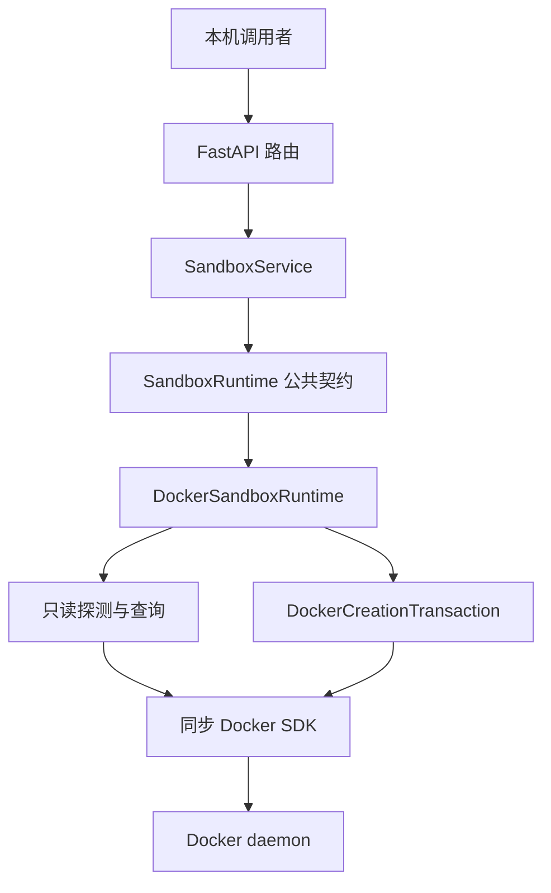
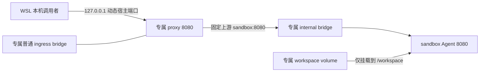
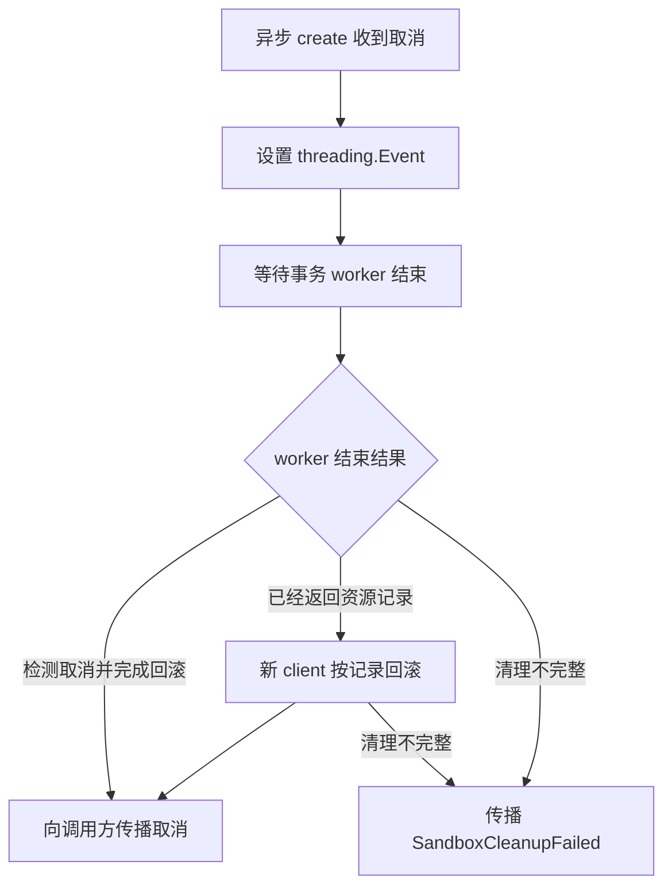

# Docker Runtime 设计与实现说明

Docker Runtime 将控制面的公共运行时契约转换为固定策略的 Docker 操作，完成 sandbox 创建、内部状态查询和本机入口查询。核心设计是将同步资源事务与异步请求处理分开：创建时记录每项已确认资源，失败或取消时核验归属后逆序清理；查询时重新读取 Docker 事实，控制面重启后仍能恢复状态和入口。

实现主要位于 [docker_runtime.py](../../control_plane/runtime/docker/docker_runtime.py) 和 [transaction.py](../../control_plane/runtime/docker/transaction.py)。本文描述当前实现，不将删除、TTL、资源池或其他运行时作为已经提供的能力。

## 1 职责与调用链



| 代码位置 | 职责 |
| --- | --- |
| [app.py](../../control_plane/app.py) | 装配一个 Runtime 和一个共享 Service，注册路由 |
| [api/sandboxes.py](../../control_plane/api/sandboxes.py) | HTTP 请求约束、查询整体超时和稳定错误响应 |
| [core/service.py](../../control_plane/core/service.py) | 生成实例和事务标识、组织规格、校验查询 ID、委托运行时 |
| [runtime/sandbox_runtime.py](../../control_plane/runtime/sandbox_runtime.py) | 定义与后端无关的异步抽象方法 |
| [docker_runtime.py](../../control_plane/runtime/docker/docker_runtime.py) | 线程适配、取消等待、Docker 状态映射和入口恢复 |
| [transaction.py](../../control_plane/runtime/docker/transaction.py) | client 工厂、资源归属工具、创建事务和精确回滚 |

API 和 Service 不导入具体 Docker 实现；只有应用装配层选择 Docker 后端。Agent 的命令执行、文件操作和 SSE 属于数据面，调用者通过代理 endpoint 直接访问，控制面不执行或转发用户命令。

## 2 公共契约与结果语义

`DockerSandboxRuntime` 实现以下四项方法：

| 方法 | 输入与输出 | 语义 |
| --- | --- | --- |
| `ping() -> None` | 无参数；失败抛出领域异常 | 只读检查 Docker daemon 可用性 |
| `create(spec: SandboxSpec) -> None` | 固定资源规格 | 创建并启动 sandbox 与 proxy，必要时回滚 |
| `get(sandbox_id: str) -> SandboxQueryResult` | 实例 ID；状态、reason、message | 查询内部容器和 Agent 健康事实 |
| `get_endpoint(sandbox_id: str) -> SandboxEndpoint` | 实例 ID；sandbox_id、url | 查询经过核验的本机代理入口 |

Service 生成 `sbx_` 加 32 位小写十六进制字符的实例 ID，以及格式相同、前缀为 `txn_` 的独立事务 ID。`get()` 和 `get_endpoint()` 在调用 Runtime 前校验实例 ID，无效 ID 直接抛出 `SandboxNotFound`。

三个对外结果需要分别理解：

- 创建响应 `started`：Docker 已完成两容器的启动调用，不等待健康检查通过。
- 状态响应 `ready`：sandbox 内部 Agent 的 Docker health 为 `healthy`。
- endpoint 查询成功：proxy 运行且健康，资源归属、网络和实际发布端口符合当前入口规则。

内部 Agent ready 不代表入口已可用。没有代理的旧实例仍可查询内部状态，但 endpoint 返回入口不可用。

## 3 Docker client 与异步执行

`DockerClient` 和 `ProbeDockerClient` 是 `Protocol`，描述实现所需的对象接口。前者具有容器、网络、volume、镜像和低层 API 能力；后者仅要求 `ping()` 和 `close()`。构造 Runtime 时只保存注入的工厂，不创建 client；导入应用和调用 `create_app()` 不连接 Docker。

默认工厂分为两种：

| 工厂 | SDK timeout | 使用位置 |
| --- | --- | --- |
| `create_probe_client()` | 0.5 秒 | Docker 只读 ping |
| `create_runtime_client()` | 5 秒 | 创建、状态查询、入口查询及提交后回滚 |

每次操作延迟创建 client，并在 `finally` 中关闭。创建成功后没有保留常驻 Docker client；提交后取消需要通过工厂重新打开 client，按原资源记录清理。

Docker SDK 调用是同步的。Runtime 使用 `asyncio.to_thread()` 将这些调用放到工作线程中，HTTP 事件循环可以继续处理其他请求。5 秒是 SDK transport timeout，不是整个创建事务的总期限；事务包含多个顺序调用和可能的回滚。

API 使用 `asyncio.wait_for()` 限制只读请求的整体等待。`create_app()` 默认 `readiness_timeout=1.0`、`sandbox_query_timeout=1.0`；状态和入口查询共享后者的配置值，但每次请求独立计时。创建接口当前没有同样的整体超时参数。

异步等待超时不会强行停止已进入 SDK 的线程调用。只读操作最终仍需结束同步调用并关闭 client；创建取消则还必须完成资源清理。

## 4 独立资源与网络拓扑

每个 sandbox 独占五项资源，资源名称由实例 ID 派生。

| 角色标签 | Docker 类型 | 名称 |
| --- | --- | --- |
| `network` | internal bridge | `agent-sandbox-<sandbox_id>-internal` |
| `ingress` | 普通 bridge | `agent-sandbox-<sandbox_id>-ingress` |
| `workspace` | 命名 volume | `agent-sandbox-<sandbox_id>-workspace` |
| `container` | sandbox 容器 | `agent-sandbox-<sandbox_id>` |
| `proxy` | 代理容器 | `agent-sandbox-<sandbox_id>-proxy` |

`container/network/workspace` 保留原角色含义，新增 `proxy/ingress`。`resource_manager()` 将 container 和 proxy 映射到 `client.containers`，workspace 映射到 `client.volumes`，两种网络映射到 `client.networks`。



sandbox 只连接专属 internal 网络，不发布宿主端口。创建时通过 `networking_config["EndpointsConfig"]` 设置别名 `sandbox`，代理可以在该网络中解析固定上游。

proxy 创建时连接专属 ingress，随后通过 `connect_container_to_network(proxy_id, internal_network_id)` 接入 internal；两网连接完成后才启动 proxy。实例之间不共享 ingress，入口恢复和清理均可核验本实例完整归属。

Docker socket 只由宿主侧控制面访问；proxy 不挂载 socket、workspace 或额外宿主目录。

### 资源权限与限制

| 配置 | sandbox | proxy |
| --- | --- | --- |
| 固定镜像 | `agent-sandbox:dev` | `agent-sandbox-proxy:dev` |
| 用户 | `sandbox` | `nginx` |
| CPU 配额 | 1 CPU | 0.5 CPU |
| 内存与内存加 swap 上限 | 均为 256 MiB | 均为 64 MiB |
| PID 上限 | 64 | 32 |
| 根文件系统 | 只读 | 只读 |
| `/tmp` tmpfs | 32 MiB | 16 MiB |
| capabilities | drop ALL | drop ALL |
| security option | `no-new-privileges:true` | `no-new-privileges:true` |
| init | 开启 | 开启 |
| workspace | 可写挂载至 `/workspace` | 无挂载 |
| 宿主端口 | 不发布 | loopback 动态发布 8080 |

`memswap_limit` 与 `mem_limit` 相同，用于不提供额外 swap 额度。两者的 `/tmp` 均使用 `rw,nosuid,nodev` 和 `mode=1777`。

代理使用 [Dockerfile.proxy](../../deploy/local/Dockerfile.proxy) 打包 [proxy.conf](../../deploy/local/proxy.conf)，直接启动 Nginx，避免启动脚本修改只读根文件系统。配置固定转发到 `sandbox:8080`，请求不能指定上游。文件接口关闭请求和响应缓冲，并限制代理处的并发连接；SSE 关闭响应缓冲，保留 40 秒读写超时。代理临时目录和 PID 文件位于 `/tmp`。

## 5 创建事务与资源记录

`DockerCreationTransaction.create_sync(spec, cancelled)` 是同步事务入口，成功返回本次资源记录的 tuple。具体顺序如下：

| 步骤 | 操作 | 成功后的记录 |
| --- | --- | --- |
| 1 | 检查两个固定镜像已存在，不 pull 或 build | 无资源 |
| 2 | 创建 internal bridge | network ID 与预期标签 |
| 3 | 创建普通 ingress bridge | ingress ID 与预期标签 |
| 4 | 创建 workspace，并核验返回标签 | volume 标识与预期标签 |
| 5 | 创建 sandbox，设置网络别名和安全配置 | container ID 与预期标签 |
| 6 | 按 ID 加载并启动 sandbox | 使用已有记录 |
| 7 | 创建 proxy，配置动态 loopback 端口 | proxy ID 与预期标签 |
| 8 | 按精确 ID 将 proxy 接入 internal | 使用已有记录 |
| 9 | 按 ID 加载并启动 proxy | 使用已有记录 |
| 10 | 最后检查取消信号，返回完整记录 | 创建完成 |

每次确认创建后、进入下一步前都会检查取消信号。

### 为什么先记录再 inspect

`_ResourceRecord` 保存 `kind`、`resource_id`、`labels`。容器和网络使用 Docker 返回的 ID；volume 使用 Docker 返回的 `Name` 作为加载标识。

代码调用低层 `client.api.create_*()` 获取响应，立即加入 `records`，之后才执行可能失败的模型加载、网络连接或启动。这样，容器已经创建但后续 inspect 失败时，回滚仍能找到其确切 ID。

低层响应缺失有效资源标识时，代码抛出 `SandboxCleanupFailed`：没有可靠标识就不能保证定位和清理该项资源。

### workspace 的特殊归属检查

volume 创建可能返回同名已有资源，因此不能仅凭名称将其当成本次创建结果。代码核验响应中的全部预期标签，只有匹配后才记录并挂载。标签不符时抛出 `SandboxResourceConflict`，该 volume 不进入回滚清单；此前创建的网络仍会清理。

### 动态端口分配

proxy 的 host config 使用：

```python
port_bindings={8080: ("127.0.0.1", None)}
```

这里的 `None` 表示由 Docker 分配宿主端口。代码不提前探测或预占本机端口，实际发布结果在容器启动后由 endpoint 查询读取。

## 6 完整归属核验与逆序回滚

所有受管资源具有以下标签：

```text
io.agent-sandbox.managed=true
io.agent-sandbox.project=agent-sandbox
io.agent-sandbox.sandbox-id=<sandbox_id>
io.agent-sandbox.transaction-id=<transaction_id>
io.agent-sandbox.resource=<resource_role>
```

实例 ID 标识逻辑实例，事务 ID 区分创建尝试。`labels_match()` 要求每个预期键值都匹配，允许存在其他附加标签；它不是整个标签字典的相等比较。

`resource_labels()` 统一读取不同 inspect 结构：容器标签位于 `Config.Labels`，网络和 volume 标签位于顶层 `Labels`。`query_labels_match()` 还检查事务 ID 是符合 `txn_[0-9a-f]{32}` 的字符串；跨资源事务一致性由 endpoint 查询进一步核验。

`_rollback()` 按 `reversed(records)` 清理，完整事务的逆序为：

```text
proxy → sandbox → workspace → ingress → internal
```

先删除容器，可以解除容器与网络、volume 的依赖。每项资源都通过记录标识重新加载并 reload，确认返回标识未变化、完整预期标签仍匹配后才删除。容器执行 `remove(force=True)`，网络和 volume 执行 `remove()`。

核验失败或删除异常时，代码标记清理失败，并继续处理剩余记录。它不会按资源名称前缀扫描和删除，也不会因为一项清理失败而放弃其他资源。当前实现将加载时的资源不存在异常也计入清理失败，不把它自动当作幂等成功。

例如 proxy 接入 internal 时失败，proxy 已记录，因此会先删除 proxy，再删除 sandbox、workspace 和两网。如果 proxy 创建直接失败且没有确认 ID，则回滚只处理已经记录的前四项资源。

Docker 操作会逐步生效，事务依靠补偿删除恢复。全部清理成功时抛出原操作对应的领域异常；清理不完整时抛出含 sandbox ID 的 `SandboxCleanupFailed`，内部异常链保留操作与回滚背景。

## 7 异步取消与提交后的清理

Python 的异步取消不能直接终止同步 Docker SDK 调用。Runtime 使用 `threading.Event` 将取消请求传给事务线程，并通过 `asyncio.shield()` 保护线程任务的异步包装，避免请求取消直接取消等待句柄。



### 事务执行中取消

正在执行的 SDK 调用先返回。事务随后在检查点发现 Event 已设置，抛出 `CreationCancelled`，统一进入异常处理和逆序回滚。Runtime 等待 worker 完成后，再向调用方传播原 `asyncio.CancelledError`。

如果取消发生时 worker 正因其他操作错误退出，事务也会尝试清理已记录资源；Runtime 在清理未失败的情况下传播请求取消，清理失败则保留 `SandboxCleanupFailed`。

### 事务完成与取消同时发生

worker 可能已经通过最后一次取消检查并返回资源记录，而异步调用方尚未收到结果。这时仅设置 Event 已来不及让事务自行回滚。

Runtime 取得 worker 返回的 records 后，调用 `rollback_committed(spec, records)`。该方法新建 client，使用原始精确标识和预期标签重新清理，再关闭 client。这里的 committed 指同步创建已完成，不表示存在数据库提交或持久化事务日志。

### 重复取消

`_await_through_cancellation()` 在循环中 `await asyncio.shield(task)`。外层再次收到取消时，只要被等待任务本身没有取消，就继续等待。因此重复取消不会让调用方提前离开清理等待。

该机制覆盖当前进程内的请求取消；它不能在控制面进程已经崩溃后继续执行清理。

## 8 内部状态查询

`get_sandbox_sync()` 按 managed、project、sandbox ID 和 `resource=container` 标签筛选所有状态的容器，要求唯一候选。随后按候选精确 ID 重新加载、刷新并核验完整归属，再通过 `map_container_state()` 和 `map_running_state()` 映射状态。

| Docker 事实 | 公共 status | reason |
| --- | --- | --- |
| created | starting | `container_created` |
| restarting | starting | `container_restarting` |
| running，无 health | running | `health_check_not_configured` |
| running，health starting | starting | `health_check_starting` |
| running，health healthy | ready | `health_check_passed` |
| running，health unhealthy | failed | `health_check_failed` |
| paused | stopped | `container_paused` |
| exited，OOMKilled | failed | `container_oom_killed` |
| exited，退出码 0 | stopped | `container_exited` |
| exited，其他退出码 | failed | `container_exited_with_error` |
| dead | failed | `container_dead` |

响应还包含对应的稳定 message。无法识别的状态或错误结构抛出 `SandboxQueryFailed`，不会凭猜测报告 ready。多个 sandbox 候选也返回查询失败，不任意选择一个。

查询不启动、停止、重建或修复资源；Agent 健康由容器自身 HEALTHCHECK 探测，控制面读取 Docker 的记录。

## 9 专属入口查询

`get_endpoint_sync()` 不依赖创建时的内存 records。它从 Docker 重新取得 sandbox、proxy 和两网的信息，按以下步骤核验：

1. `_owned_container()` 分别筛选 sandbox 和 proxy，要求角色对应的唯一候选，按精确 ID reload，并检查完整归属与事务 ID 格式。
2. 比较两容器事务 ID，要求同一次创建；proxy 必须 `State.Status=running` 且 `State.Health.Status=healthy`。
3. 从实例 ID 派生预期网络名称，由 `_verify_entry_networks()` 校验实际连接和网络属性。
4. `_published_loopback_url()` 解析 proxy 实际发布端口，生成 `SandboxEndpoint`。
5. 在成功和异常路径关闭本次 client；入口查询的关闭异常也转换为稳定不可用或超时异常。

### 网络核验

实际连接必须满足：sandbox 恰好只连接预期 internal，proxy 恰好连接预期 internal 和 ingress；sandbox 的 internal 连接包含别名 `sandbox`，且没有实际发布的宿主端口。两容器连接的 internal `NetworkID` 必须相同。

两网都按实际 NetworkID 加载和刷新，并核验精确 ID、预期名称、`Driver=bridge`、internal 属性和完整事务标签。仅核对容器中的网络名称，无法确认它们连接的是同一项受管资源。

### 实际端口核验

地址只取自：

```python
proxy.attrs["NetworkSettings"]["Ports"]["8080/tcp"]
```

该映射必须是恰好含一项绑定的 list，`HostIp` 精确等于 `127.0.0.1`，`HostPort` 是 1 至 5 位数字字符串，数值介于 1 和 65535。通过后返回例如：

```json
{"sandbox_id":"sbx_0123456789abcdef0123456789abcdef","url":"http://127.0.0.1:49153"}
```

`HostConfig.PortBindings` 描述配置请求，不能证明动态宿主端口已经生效。映射缺失、多重绑定、通配地址或错误端口都会被拒绝。

sandbox 候选不存在、消失或归属不完整时，入口查询返回未知实例。已有 sandbox 缺少 proxy、proxy 未就绪、候选歧义或其他入口核验失败时，返回入口不可用。旧实例不会因查询而自动补建 proxy。

入口健康检查经 proxy 访问上游 Agent，但这里没有向宿主发布地址再发送一次 HTTP 请求。endpoint 成功表示当前 inspect 事实符合入口规则；资源可能在查询之后退出，调用者仍需处理实际请求失败。url 仅为本机 WSL 开发地址，不承诺远程访问能力。

## 10 领域异常与 HTTP 错误

创建的 `_classify_error()` 保留已有 `SandboxError`，并转换底层异常：

| 原因 | 领域异常 | 创建 HTTP 响应 |
| --- | --- | --- |
| 任一固定镜像不存在 | `SandboxImageUnavailable` | 503 `sandbox_image_unavailable` |
| Docker API 409 或 volume 归属冲突 | `SandboxResourceConflict` | 409 `sandbox_resource_conflict` |
| 其他 Docker API 错误或一般创建错误 | `SandboxCreateFailed` | 500 `sandbox_create_failed` |
| client 创建、Docker 或 HTTP 传输失败 | `DockerUnavailable` | 503 `docker_unavailable` |
| 无有效创建标识或回滚不完整 | `SandboxCleanupFailed` | 500 `sandbox_cleanup_failed`，含 sandbox ID |

底层异常通过 `raise ... from error` 保留在内部异常链，HTTP 层只返回固定 code/message。

| 查询场景 | 状态查询 | endpoint 查询 |
| --- | --- | --- |
| 无效 ID、sandbox 不存在或归属不符 | 404 `sandbox_not_found` | 404 `sandbox_not_found` |
| Docker 不可用 | 503 `docker_unavailable` | 503 `sandbox_endpoint_unavailable` |
| HTTP 整体等待超时 | 504 `sandbox_query_timeout` | 504 `sandbox_endpoint_timeout` |
| 状态歧义或无法解析 | 500 `sandbox_query_failed` | 503 `sandbox_endpoint_unavailable` |
| proxy 缺失、未就绪或入口核验失败 | 不检查入口 | 503 `sandbox_endpoint_unavailable` |

入口同步查询还显式将 `TimeoutError` 和 requests transport Timeout 转成稳定 TimeoutError，再由 API 返回 504。状态查询当前将 SDK 的 requests transport 异常归为 DockerUnavailable；不能将两条查询的底层超时分类视为完全相同。

## 11 验证方法与代码索引

默认测试使用注入的 FakeRuntime 或 Docker 测试替身，不修改真实 Docker 资源。

| 测试文件 | 主要覆盖内容 |
| --- | --- |
| [test_docker_runtime.py](../../control_plane/tests/test_docker_runtime.py) | ping 延迟工厂、0.5 秒 timeout、失败和关闭 |
| [test_sandbox_service.py](../../control_plane/tests/test_sandbox_service.py) 与 [test_app.py](../../control_plane/tests/test_app.py) | 公共契约、Service 委托、ID 校验、HTTP 错误和超时 |
| [test_sandbox_runtime.py](../../control_plane/tests/test_sandbox_runtime.py) | 镜像检查、创建顺序、安全配置、网络、失败及精确回滚、各阶段取消和重复取消 |
| [test_sandbox_query.py](../../control_plane/tests/test_sandbox_query.py) | 状态映射、完整归属、歧义和新 Runtime 恢复查询 |
| [test_sandbox_endpoint.py](../../control_plane/tests/test_sandbox_endpoint.py) | 代理健康、事务、拓扑、实际端口、旧实例、404/503/504 和 client 关闭异常 |
| [test_sandbox_docker_integration.py](../../control_plane/tests/test_sandbox_docker_integration.py) | 真实配置、双实例正确路由、工作区独立、文件/SSE、入口恢复及出口对照 |

在仓库根目录构建镜像：

```bash
docker build -t agent-sandbox:dev ./sandbox_agent
docker build -t agent-sandbox-proxy:dev -f deploy/local/Dockerfile.proxy deploy/local
```

在 `control_plane/` 执行默认验证或启动控制面：

```bash
uv sync --locked
uv run --locked pytest
uv run python -m compileall -q app.py api core runtime tests
uv run uvicorn control_plane.app:app --app-dir .. --host 127.0.0.1 --port 18083
```

显式运行真实集成测试：

```bash
RUN_DOCKER_INTEGRATION=1 uv run --locked pytest -m docker_integration -v
```

集成测试创建唯一实例，记录低层 create 返回的精确标识，清理前重新核验完整归属。双实例测试通过返回 URL 检查 `/healthz`、同步命令、二进制文件往返和 SSE 首帧提前到达，并以新 app/runtime 恢复两地址、检查同名文件内容不同。

公网出口验证先要求普通 bridge 对照能连接同一 IP 和端口，再检查 internal sandbox 无法连接。对照不可达时测试失败，不将整个环境断网误判为隔离成功。默认目标为 `1.1.1.1:80`，可通过 `AGENT_SANDBOX_EGRESS_IP` 指定对照 IP。

已有验收结果和日期记录在 [PROJECT_PROGRESS.md](../PROJECT_PROGRESS.md)。HTTP 示例见 [CONTROL_API.md](../CONTROL_API.md) 和 [CURL_TESTS.md](../CURL_TESTS.md)；动态入口范围见 [DYNAMIC_ENDPOINT.md](../DYNAMIC_ENDPOINT.md)。

## 12 当前实现边界

资源清单只存在于当前创建调用内，没有持久化事务日志。控制面重启后可以从 Docker 标签恢复状态和入口查询，但不会自动恢复或回滚中断的创建事务。进程崩溃或 Docker 已创建资源而 client 未取得确认标识的情况，仍可能需要人工核验和清理。

归属标签用于区分资源和防止误删，不提供认证，也不能防止有 Docker 管理权限的主体修改资源。internal 网络和固定权限限制是当前的配置边界，不应据此宣称已经具备完整的安全隔离能力。

当前没有公开删除 API、TTL、后台资源回收、续期、暂停恢复或任意用户服务端口暴露。后续生命周期能力需另外定义状态、清理和恢复语义；现有查询均保持只读，不隐式修复或迁移旧实例。
