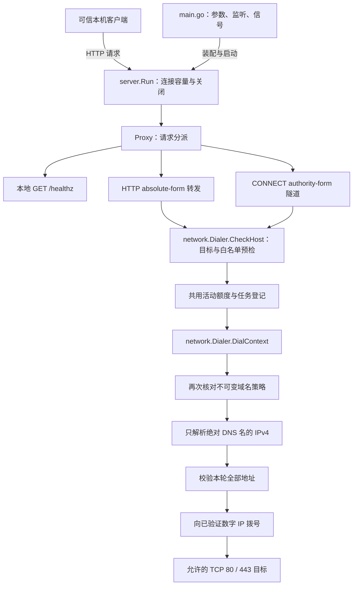
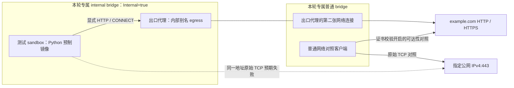

# Egress Proxy 设计

`egress_proxy/` 是独立的 Go 1.25 HTTP/1.1 显式代理，提供普通 HTTP 转发和 CONNECT TCP 隧道。两条路径都经过精确域名白名单、IPv4 地址校验和固定数字 IP 拨号。

当前仅用于可信本机开发，没有认证，默认监听 `127.0.0.1:18084`。已提供独立容器镜像和显式 Docker smoke，尚未接入控制面或动态 Docker Runtime，现有开发实例的联网行为保持不变。

## 设计目标与调用链

出口代理在可信进程中执行域名与目标地址策略，不把策略判断交给 sandbox 内的任务。当前实现独立运行，以 HTTP/1.1 显式代理作为协议边界；核心原则是默认拒绝、所有上游连接都经过受控 Dialer、数据流和服务生命周期均有界。



图中预检先于 DNS 与拨号，方便在拒绝请求时返回稳定错误；Dialer 自身仍执行完整校验，不能依赖 HTTP 层曾经检查过目标。两种协议只在转发方式上不同，策略、连接建立及活动额度共用同一条链路。健康检查不取得上游连接，也不消耗代理活动额度，但仍受入站连接上限约束。

### 模块职责

| 位置 | 职责 | 依赖边界 |
| --- | --- | --- |
| [main.go](../../egress_proxy/main.go) | 参数校验、装配、监听与信号 | 在配置合法后才监听，不处理代理协议 |
| [network/](../../egress_proxy/network/) | 不可变白名单、域名和 IPv4 校验、固定地址拨号 | 不依赖 HTTP handler；可信 resolver/dial 可注入 |
| [server/proxy.go](../../egress_proxy/server/proxy.go) | 本地健康、HTTP 请求验证及流式转发 | 不另建上游拨号路径 |
| [server/connect.go](../../egress_proxy/server/connect.go) | CONNECT 验证、接管及双向转发 | 不解析 TLS，不自行验证上游证书 |
| [server/headers.go](../../egress_proxy/server/headers.go) | 逐跳头过滤与有界头部观察 | 标准库继续负责 HTTP framing |
| [server/transfer.go](../../egress_proxy/server/transfer.go) | 按实际字节限制请求体、响应体及隧道数据 | 不引入完整 body 缓存或无界队列 |
| [server/server.go](../../egress_proxy/server/server.go)、[connections.go](../../egress_proxy/server/connections.go) | 任务登记、容量、连接所有权与关闭等待 | 不在锁内拨号、复制或等待网络操作 |

### 关键取舍

- HTTP 使用独立 Transport 和 RoundTrip，放弃连接复用、自动解压与自动重定向，使每次目标选择和字节计数可解释。
- CONNECT 在成功拨号后才提交 200，由 handler 持有整个隧道生命周期；半关闭允许反向数据继续，异常则关闭两端并等转发结束。
- 任务登记与服务关闭同步，已开始的拨号和传输完成收尾后才释放额度；HTTP Server 的关闭不能替代已接管连接的管理。
- 策略与依赖在装配时确定，不提供动态策略、私网豁免或任意上游代理。当前限制和验证范围不会因白名单命中而放宽。

## 启动

在 `egress_proxy/` 执行：

```bash
go run . -listen 127.0.0.1:18084 -allow-domain example.com
```

`-allow-domain` 可以重复指定；不指定时拒绝所有代理目标，本地健康检查仍可使用。白名单最多 32 条输入，仅接受合法 ASCII DNS 域名，大小写统一并允许单个末尾根点，规范化重名合并。非法配置在监听前失败，不接受通配符、URL 或 IP，不自动放行子域名。

收到 SIGINT 或 SIGTERM 后停止接入，取消普通转发、关闭隧道并等待收尾。HTTP 服务与代理任务共用 5 秒关闭预算；超时返回错误，不宣称尚未结束的操作已经清理完毕。

## Docker 镜像与独立 smoke

在仓库根目录构建出口镜像，构建上下文只包含 `egress_proxy/`：

```bash
docker build -t agent-sandbox-egress:dev ./egress_proxy
```

[Dockerfile](../../egress_proxy/Dockerfile) 使用 Go 多阶段构建，`CGO_ENABLED=0` 生成静态二进制，运行阶段为 Alpine 3.22。进程使用 `10001:10001` 用户，exec-form ENTRYPOINT 显式监听 `0.0.0.0:18084`；直接 `go run .` 的 loopback 默认值不变。可信启动方仍通过重复的 `-allow-domain` 传入白名单，镜像默认不放行任何域名，不自动发布宿主端口。

镜像 HEALTHCHECK 只访问 `http://127.0.0.1:18084/healthz`，BusyBox wget 显式使用 `-Y off` 禁用环境代理，不依赖公网。SIGTERM 直接传给代理进程，继续使用既有的有限关闭等待。

[独立 smoke](../../deploy/local/smoke-egress.sh) 必须显式执行，宿主需要 Docker CLI、可连接的 daemon 和 Python 3；它不依赖当前目录、不纳入 Go 默认测试，也不调用现有 Compose。启动前检查 `agent-sandbox-egress:dev` 和已有 `agent-sandbox-python:dev`，按镜像 ID 固定本次选择，禁止隐式 pull/build，不重建 Agent 镜像。

```bash
sh -n deploy/local/smoke-egress.sh
python3 -m unittest discover -s deploy/local -p test_smoke_egress.py
RUN_EGRESS_DOCKER_SMOKE=1 sh deploy/local/smoke-egress.sh
```

未设置开关时退出码为 2，且不调用 Docker。可附加一个公网 IPv4 参数，默认 `1.1.1.1`，直连对照端口固定为 443；真实 HTTP/HTTPS 目标固定为白名单中的 `example.com`。



这只是 smoke 创建的临时拓扑，不代表已受控制面管理。测试 sandbox 仅接入 internal 网络，出口代理连接两张指定网络，无宿主端口映射。先运行空白名单代理检查拒绝，再正常 SIGTERM 退出，随后运行允许 `example.com` 的代理；对照客户端只接普通网络。代理及测试客户端均设置只读根文件系统、drop ALL capabilities、no-new-privileges、0.5 CPU、128 MiB 内存及相同 swap 上限、32 PID，无 workspace、宿主目录、凭据或 Docker socket 挂载，也不使用特权、host 网络或 NET_ADMIN。

脚本分别检查：

1. inspect 的实际网络 ID、资源限制、用户、挂载和端口，以及本地健康；故意设置无效代理环境变量，验证健康检查不会使用它们。
2. 空白名单和未允许域名的代理自身 403 错误，区别于上游返回的状态。
3. 普通网络到指定数字 IPv4:443 的成功对照，再验证 internal sandbox 清除代理变量后对同一地址直接使用 IPv4 socket 连接失败。
4. 普通网络到 `example.com` 的 HTTP/HTTPS 对照，以及 sandbox 经明确配置的代理客户端完成两种请求；HTTPS 使用系统 CA 正常校验证书，不关闭校验、不自动回退直连。
5. 向出口代理仅发送 SIGTERM，要求 8 秒内退出码为 0，不用强杀伪装优雅退出；停止后两种代理请求均失败，并复查直连边界。活动 HTTP/CONNECT 的收尾继续由 Go 协议测试覆盖。

所有 Docker CLI 调用和网络操作都有有限超时。每轮产生唯一 run-id，记录实际容器与网络 ID，并写入完整 `io.agent-sandbox.egress-smoke.*` 归属标签；这些标签不把资源登记为控制面实例。正常、失败和信号退出都先核对精确 ID 与全部标签，再按容器、网络逆序清理。CLI 创建响应不明时仅按本轮精确意图名称核验资源，不通过前缀扫描或全局 prune 清理；仍不明确的结果和清理失败会报告 run-id、意图名称或残留 ID，不声称已经清理完整。信号先记录取消，等待进行中的有限 Docker 调用返回并登记结果，再进入清理；重复信号不跳过清理。

公网对照不可达时明确输出“公网链路未完成验证”，本地配置与拒绝检查可以单独通过，但整体返回非零。证书错误、超时/DNS/网络问题和代理返回的固定错误码分别报告，不打印响应体或底层异常，也不将请求失败直接当作隔离证据。只有全部链路验证和资源清理成功才输出整体 PASS。

本轮只验证独立容器拓扑；下一步才将出口容器接入控制面的创建、回滚、删除和 pending 核验。它不改变现有实例网络，也不承诺限制所有 DNS、UDP、IPv6、宿主机访问或允许站点的二次转发。

## 协议

### 本地健康检查

origin-form 的 `GET /healthz` 返回 HTTP 200：

```json
{"status":"ok"}
```

它仅说明服务能够响应，不检查 DNS 或公网。绝对 URL 请求 `http://example.com/healthz` 按普通代理请求处理。

### HTTP 转发

只接受 absolute-form 的 `http://域名/path?query`，端口仅允许 80，省略时补齐。支持 GET、HEAD、POST、PUT、PATCH、DELETE、OPTIONS。拒绝普通相对路径、absolute-form HTTPS、其他 scheme、IP、userinfo、fragment、非法 authority 和协议升级。

上游 URL 与 Host 根据校验后的 URL authority 重建，原始 Host 不能更换目标。请求和响应都移除固定逐跳头、Connection 动态指定头及代理凭据；标准库负责 HTTP framing。独立 Transport 不使用环境代理、不自动解压、不复用上游连接，也不自动跟随重定向。入站普通响应同样关闭连接，避免提前返回的上游响应留下未读取上传数据影响后续请求。

上游状态、端到端响应头和响应体原样转发，3xx 不由代理继续请求 Location。HEAD、204、304 遵守无响应体语义。流式传输按实际字节计数，不完整缓存 body。已知请求体超限提前返回 413，已知上游响应体超限在提交响应前返回 502；响应提交后发生超限、截断或复制错误时直接中止连接，不补写 JSON 或伪装为完整分块响应。

### CONNECT

只接受 authority-form 的 `域名:443`，端口必须显式填写。不接受 URL、IP、userinfo、路径、query 或请求体 framing，包括 `Content-Length: 0`。

先校验目标、取得活动额度并通过受控 Dialer 建连，再返回 `200 Connection Established`；成功响应没有 Content-Length 或 Transfer-Encoding。Hijack 已预读的字节继续参与转发，不丢弃与请求头一起发送的数据。

隧道双向转发原始 TCP 字节，正常 EOF 尽可能通过 CloseWrite 传递，反向流仍可继续。即使客户端在收到 200 前发送写半关闭，也不会将正常 EOF 当作整个隧道的取消。异常、超额、期限到达或服务关闭会关闭两端，handler 等待两条转发路径退出后释放额度。接管后重新设置有限 deadline。

CONNECT 只限制 TCP 连接目标，不保证其中一定运行 TLS，也无法检查 HTTPS 路径、内容或站点二次转发。HTTPS 证书仍由客户端验证；代理不解密 TLS、不注入证书。

## 固定资源限制

| 项目 | 默认上限 |
| --- | --- |
| HTTP 与 CONNECT 共用活动额度 | 16，不排队，耗尽返回 429 |
| 入站 TCP 连接 | 32，包含空闲与已接管连接；超出直接关闭，不保证 HTTP 错误 |
| 请求头、上游响应头 | 各 32 KiB；入站预算含 Go 解析器余量 |
| 读取请求头 | 5 秒 |
| 普通 HTTP 转发 | 30 秒 |
| 请求体、响应体 | 各 10 MiB，按实际字节计数 |
| CONNECT 生命周期 | 60 秒 |
| CONNECT 双向数据 | 每方向 32 MiB |
| DNS 与全部拨号尝试 | 共用 5 秒，遵守调用方更早的 deadline |
| 服务关闭等待 | HTTP 与代理任务共用 5 秒 |

未提交响应的超时错误允许额外最多 1 秒写出固定 504 响应；已经提交的响应直接中止。上游头部通过标准库限制，另有至多 36 KiB 的只读前缀观察，用于恢复 Go 移除 `Connection: close` 时一并移除的动态逐跳字段声明；不自行实现报文 framing。

额度在传输、上传读取及已开始的拨号收尾后归还。服务显式跟踪普通任务与隧道，连接登记和关闭互斥，不以 HTTP Server.Shutdown 单独代表隧道已结束。

## 错误

代理自身错误使用固定 JSON，不包含底层异常、请求体、凭据或完整 URL：

```json
{"error":{"code":"egress_policy_denied","message":"egress policy denied"}}
```

| HTTP | code | 含义 |
| --- | --- | --- |
| 400 | invalid_request | 请求、目标或协议不合法 |
| 403 | egress_policy_denied | 域名或解析地址被拒绝 |
| 405 | method_not_allowed | 不支持的方法 |
| 413 | request_too_large | 请求体超限 |
| 429 | proxy_capacity_exceeded | 活动额度耗尽 |
| 502 | upstream_unavailable | DNS、连接、上游协议或已知响应体大小失败 |
| 503 | proxy_stopping | 服务正在关闭 |
| 504 | upstream_timeout | 建连或转发超时 |

上游返回的错误状态不强制转换为 JSON。HTTP 标准库在 handler 前拒绝的畸形请求、头部超限等可能使用标准库错误响应，例如 431。响应已发送后只能中止，不能再返回新的状态；客户端断开时优先清理。

## 目录和安全边界

- `main.go`：参数、策略装配、监听和信号处理；启动方式为 `go run .`。
- `network/`：不可变 Policy、域名与 IPv4 校验、受控 Dialer；不依赖 HTTP 服务。
- `server/`：请求分派、HTTP/CONNECT、头部过滤、有界传输及连接生命周期；所有上游连接都交给 network.Dialer。
- 测试与实现放在同一目录；保持单个 Go module，不引入第三方依赖。

每次连接重新查询规范化的绝对 DNS 名，仅接受 1～16 个 IPv4 结果。全部结果通过保守拒绝前缀校验后才尝试连接，混入私网、回环、链路本地等地址时整体拒绝。IPv4-mapped IPv6 先规范化，其他 IPv6 拒绝。回退仅使用同轮已校验的数字地址，不二次解析域名。

这里只控制代理自身发起的 IPv4 TCP 80/443 连接，不提供 IPv6、UDP、QUIC、DNS 缓存、动态策略、上游代理、TLS MITM 或分布式协调。允许站点仍可能二次转发；通过单元测试不等于完成宿主机保护、sandbox 全协议出口策略或生产安全隔离。后续再接入运行时资源。

## 验证

默认测试使用 fake resolver、受控拨号映射、本机 HTTP/TLS 服务和内存连接，不访问公网、外部 DNS 或 Docker。TLS 用例信任专属测试证书，不使用 InsecureSkipVerify。测试覆盖转发、CONNECT 预读和半关闭、限制、超时、竞争及关闭。

在 `egress_proxy/` 执行：

```bash
go test -count=1 ./...
go test -race -count=1 ./...
go vet ./...
go build ./...
```

可选公网 smoke 需在可信本机显式执行，不属于默认测试。启动上面的示例后，在另一个终端执行：

```bash
curl --max-time 5 http://127.0.0.1:18084/healthz
curl --max-time 10 --noproxy '' --proxy http://127.0.0.1:18084 http://example.com/
curl --max-time 10 --noproxy '' --proxy http://127.0.0.1:18084 https://example.com/
curl -i --max-time 5 --noproxy '' --proxy http://127.0.0.1:18084 http://not-allowed.invalid/
```

最后一项应返回策略拒绝，不执行目标 DNS。实际验证记录见[开发进度](../PROJECT_PROGRESS.md)；默认单元测试和本机模拟验证不能代替上面的显式 Docker 公网 smoke。

系统中的位置和当前接入边界见[系统架构设计](../ARCHITECTURE.md)。
