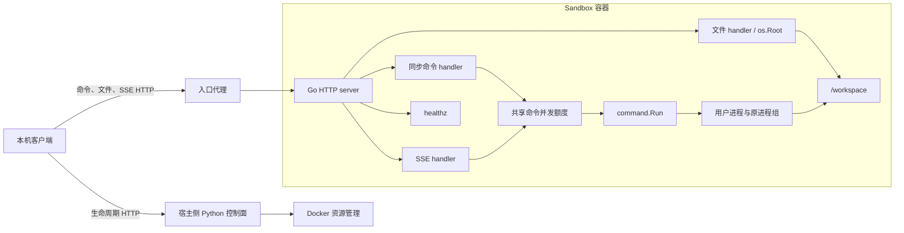

# Sandbox Agent 设计

本文描述当前 [Go module](../../sandbox_agent/go.mod) 中已经实现的容器内数据面。HTTP 契约和可执行示例见 [API](API.md)；实例创建、状态、入口、续期和删除属于 [控制面 API](../control_plane/API.md)。本文不引入新的接口或隔离方案。

## 职责与边界

SandboxAgent 提供健康检查、一次前台命令执行、一次前台 SSE 命令流，以及 `/workspace` 内的单文件上传和下载。它没有命令 ID、后台任务、任务查询、交互式终端、生命周期存储或 Docker 操作。

Agent 与用户进程在同一个容器、同一个用户下运行。命令可以访问该用户有权访问的容器路径；文件 API 的 workspace 限制不会约束命令。容器和网络资源由部署配置或控制面创建，Agent 自身不设置 CPU、内存、PID、网络和磁盘配额。

代理与控制面都不是 Agent 的内部模块。固定 Compose 实例通过 `127.0.0.1:18081` 访问；动态实例应先向控制面查询 endpoint，再把命令和文件请求发到该 URL。两种入口后的 Agent 协议相同。

## 模块与启动

| 源文件                                                                    | 职责                                                         |
| ------------------------------------------------------------------------- | ------------------------------------------------------------ |
| [main.go](../../sandbox_agent/main.go)                                     | 解析参数，装配 handler，监听 TCP，接收退出信号               |
| [server/handler.go](../../sandbox_agent/server/handler.go)                 | 注册四个路由，注入命令 runner，创建共享额度                  |
| [server/command_handler.go](../../sandbox_agent/server/command_handler.go) | 校验命令请求、应用 HTTP 默认值、同步收集输出、映射错误       |
| [server/command_limiter.go](../../sandbox_agent/server/command_limiter.go) | 非阻塞命令并发控制                                           |
| [server/command_stream.go](../../sandbox_agent/server/command_stream.go)   | 输出背压、SSE 编码和 flush、终止及取消收尾                   |
| [command/runner.go](../../sandbox_agent/command/runner.go)                 | 直接执行 argv，连接标准流，应用 cwd、env、timeout 和输出上限 |
| [command/process_linux.go](../../sandbox_agent/command/process_linux.go)   | 创建 Linux 进程组，取消时向原进程组发送 SIGKILL              |
| [command/output_limit.go](../../sandbox_agent/command/output_limit.go)     | 每流计数、截断越界块并触发一次取消                           |
| [server/file_handler.go](../../sandbox_agent/server/file_handler.go)       | workspace 根约束、文件请求额度、上传发布和下载               |
| [server/server.go](../../sandbox_agent/server/server.go)                   | HTTP 超时和服务关闭                                          |

命令包接受 `context.Context`、`command.Request` 和显式的 stdin/stdout/stderr，不依赖 HTTP。HTTP 层通过 `CommandRunner` 函数注入真实 runner 或测试替身。

`-listen` 默认 `127.0.0.1:8080`；`-max-concurrent-commands` 默认 4，允许 1～1024，非法值使启动失败。镜像的 ENTRYPOINT 将监听地址设为 `0.0.0.0:8080`，由容器网络和本机入口约束可达范围。[Dockerfile](../../sandbox_agent/Dockerfile) 使用 Go 1.25 编译 Linux 静态程序，运行镜像为 Alpine 3.22，以 `sandbox` 用户、`/workspace` 工作目录启动。

## 命令执行数据流

1. HTTP handler 先检查 POST，最多解码 1 MiB 的单个 JSON 请求，拒绝未知字段和多份 JSON 值。
2. 校验 argv、环境变量名和值、timeout 和输出上限，再尝试获取共享命令额度。额度已满立即返回 429，不排队。
3. runner 以 `exec.CommandContext(argv[0], argv[1:]...)` 启动程序。它不会拼接命令行、拆分参数、展开变量、通配符或隐式添加 shell；需要 shell 时客户端必须显式提供 `["sh", "-c", ...]`。
4. 非空 cwd 设置子进程工作目录，空 cwd 继承 Agent 工作目录；容器配置下通常是 `/workspace`。相对文件路径按子进程 cwd 解析。
5. env 在继承环境上按大小写敏感的变量名覆盖或添加，仅影响该次命令，不修改 Agent 环境。stdin 是请求中解码后的字符串，读完即 EOF。
6. 同步 handler 分别收集 stdout/stderr；SSE handler 将输出块送往流写入循环。runner 等待直接子进程及标准流处理结束，然后 handler 释放额度。

用户程序的普通非零退出属于命令结果，同步接口仍为 HTTP 200，SSE 仍以 `complete` 结束。启动失败、deadline 和输出超限属于 runner 错误，经过统一错误映射；内部系统错误不会直接暴露给客户端。

### 时间、取消与进程组

HTTP 命令默认 context 期限为 5 秒，可配置 1～30000 毫秒。runner 将该期限与父 context 组合，较早的 deadline 或取消触发取消流程；这不是 HTTP handler 或全部后代的硬结束期限。HTTP 请求断开也会传播取消；同步 handler 不再写响应，SSE handler 取消并等待 runner 收尾后才释放共享额度。

Linux runner 通过 `Setpgid` 为命令创建独立进程组，并把 `exec.Cmd.Cancel` 改为向 `-PID` 发送 SIGKILL。该回调由执行 context 的取消触发时，会尝试终止仍留在原进程组的进程；没有 SIGTERM 宽限期。

进程组用于取消传播，不是安全隔离或完整的进程树跟踪。主动创建新会话或离开该进程组的后代不在这一清理保证内；Agent 没有每命令 cgroup、独立身份或独立文件系统。命令之间也没有 workspace 锁或额外权限边界。

当前 runner 未设置 `exec.Cmd.WaitDelay`，也没有独立的后代回收流程。结合 [Go 1.25 的 Cmd 实现](https://github.com/golang/go/blob/go1.25.0/src/os/exec/exec.go)，直接子进程先退出后，context watcher 可能已结束，而后代仍持有 stdout/stderr 管道。即使后代仍在原进程组，`cmd.Run()` 也可能继续等待 EOF、长期占用命令额度，且不保证返回超时错误。HTTP 写入期限和连接关闭不能替代这一进程清理边界。

### 输出上限

HTTP 默认 stdout、stderr 各 64 KiB，每流可配置 1～1048576 字节。两流独立计数，并共享一次性的超限状态；恰好达到上限允许继续，出现额外字节时只转发剩余允许部分并取消执行。SSE 的 Base64 编码和帧开销不计入原始输出字节上限。

同步执行失败只返回错误 JSON，不携带已缓存的部分输出。SSE 可能已发送部分输出，再发送 `failure`。底层 Go `command.Request` 的 timeout 或 output limit 为 0 表示不增加该项限制；HTTP 层始终应用有限默认值，并拒绝显式 0，不能用 HTTP 请求关闭限制。

## SSE 背压与终止

SSE 与同步接口共用校验、默认值、runner 和命令并发额度。参数合法且获得额度后，handler 设置 `text/event-stream`、`Cache-Control: no-cache` 和 `X-Accel-Buffering: no`，先 flush 响应头，再启动 runner。因此程序不存在也可能是在 HTTP 200 流内报告 `command_start_failed`。

stdout/stderr writer 复制每个输出块，并通过无缓冲 channel 交给 handler。只有 handler goroutine 写 HTTP 和 flush，避免两条流并发损坏 SSE 帧；慢客户端会使输出 writer 等待，背压可继续传到子进程管道，没有无限输出队列。输出块不对应文本行、一次程序写入或完整 UTF-8 字符，两流之间没有全局输出顺序保证。帧用 Base64 保留原始字节。

handler 另建带命令期限的 context，让等待 channel 的 writer 也能在 deadline 后退出。HTTP 写入还有 35 秒的绝对写入期限，流开始前重设一次，不会随每帧续期。客户端断开、写入或 flush 失败时结束处理，并取消、等待 runner；共享额度在收尾结束前保持占用。

传输正常时，命令以一个 `complete` 或 `failure` 事件终止。HTTP 响应开始后不能改状态码，故流内失败仍是 HTTP 200。连接中断时无法保证终止事件可达；客户端应把未收到终止事件的 EOF 视为结果未确认。当前没有 heartbeat、事件 ID、重放、重连续传、后台执行或断开后的状态查询。

## 文件操作数据流

文件 endpoint 只接受 GET/POST，并要求恰好一个有效 `path`，在命令额度之外另设上传/下载共享的 2 个请求额度。超出立即 429。每个请求通过 `os.OpenRoot("/workspace")` 打开根，文件操作使用 `os.Root` 完成。

路径必须是 workspace 相对路径，拒绝绝对路径、NUL、空段、`.`、`..` 和末尾斜杠。词法检查之外，`os.Root` 限制路径解析不能越出根，包括指向根外的符号链接；根内链接并非一概禁止。这是文件 API 的访问边界，不会限制用户命令对其他路径的直接操作，也不会把整个容器变成独立于宿主内核的安全边界。

### 上传

上传请求体为原始字节，单次最多 10 MiB（10485760 字节），不使用 multipart，不自动创建父目录。handler 在目标的同一目录以独占创建方式生成 `.upload-<random>` 临时文件，权限 `0600`，用 32 KiB 缓冲读写；读错误和磁盘写错误分别映射，超限或发布前取消不创建目标文件。

写完并关闭临时文件后，使用 `os.Root.Link` 发布目标，已有目标返回 409，不覆盖。两个并发上传同一路径时，只有一次发布可成功；这一规则也覆盖上传过程中其他写入者创建目标的情况。发布后删除临时名，并通过 defer 尝试清理失败路径的临时文件。

清理不是持久化事务：未执行 fsync，进程异常终止可能留下临时文件；发布成功后若临时名删除失败会返回 500，此时目标可能已经存在，客户端不能将错误等同于“未创建”。取消在发布前检查，但发布之后也可能出现客户端未确认结果。没有覆盖、重命名、删除、列表或目录创建 API。

### 下载

以 `O_NONBLOCK` 打开文件后先检查为普通文件，拒绝目录和其他特殊文件，避免 FIFO 等路径导致阻塞。先根据 stat 拒绝过大文件，再最多读取 `10 MiB + 1` 字节复查，防止检查后文件增长绕过上限。合格内容先缓存在内存，再以 `application/octet-stream`、精确 `Content-Length` 和 `Cache-Control: no-store` 返回。

下载保留原始字节，不提供 Range 或流式大文件传输。并发用户命令可以修改 workspace，下载不是一致性快照。10 MiB 是单次传输上限，不是 workspace 配额；命令仍可写出更大文件，持久卷也不会由 Agent 自动清理。

## 服务超时、健康与退出

| 设置              | 当前值 | 作用                                      |
| ----------------- | ------ | ----------------------------------------- |
| ReadHeaderTimeout | 5 秒   | 读取 HTTP 请求头                          |
| ReadTimeout       | 10 秒  | 读取请求，包括 body                       |
| WriteTimeout      | 35 秒  | HTTP 写入；SSE 在流开始前重设一次绝对期限 |
| IdleTimeout       | 60 秒  | keep-alive 空闲连接                       |
| shutdownTimeout   | 5 秒   | 收到退出信号后等待 HTTP 正常关闭          |

`GET /healthz` 只返回 `{"status":"ok"}`，表示 Agent HTTP handler 可响应，不检查 Docker、workspace、剩余命令额度或代理入口。镜像 HEALTHCHECK 从容器内部调用它；Compose 也分别检查 Agent 和代理可达性。

main 接收 SIGINT/SIGTERM 后调用 `http.Server.Shutdown`，最多等 5 秒；超时则调用 `Close` 强制关闭连接，并把关闭失败作为进程错误返回。关闭连接会取消相应请求 context，但 Agent 没有跨重启的任务记录，也没有独立的全局进程回收注册表，不能把 HTTP 关闭视为任意后代进程均已清理的证明。

## 部署约束与验证范围

[固定 Compose](../../deploy/local/compose.yml) 给 Agent 配置非 root、只读根文件系统、全部 capability 移除、`no-new-privileges`、1 CPU、256 MiB 内存及相同 swap 上限、64 个 PID、32 MiB `/tmp` tmpfs 和独立 workspace 命名卷。Agent 仅接入预先核验为 internal bridge 的网络；代理连接该网络和入口网络，仅发布 `127.0.0.1:18081`。[启动脚本](../../deploy/local/run-local.sh) 从自身位置定位 Compose，并检查已有固定网络的类型与 internal 属性。

[代理配置](../../deploy/local/proxy.conf) 对文件和 SSE 关闭响应缓冲，文件上传还关闭请求缓冲并设 2 个文件连接额度；代理 body 上限为 11 MiB、读写超时为 40 秒，Agent 仍执行自身更严格的请求/文件限制。代理自身拒绝的请求、网络失败和超时不一定具有 Agent JSON 错误格式。

这些约束由容器部署施加，不是直接运行 Agent 二进制就具备的能力。直接在宿主机运行命令 endpoint 会以宿主 Agent 用户权限执行请求。当前 HTTP 没有认证、授权或 TLS，不能向不可信网络开放；不要把 Docker socket、宿主凭证或任意宿主目录挂载给工作负载。现有配置尚未经过完整威胁模型和隔离实验验证，不应描述为生产级安全隔离；workspace 没有磁盘配额。

现有测试覆盖 argv 与标准流、cwd/env、timeout/取消与原进程组、独立输出上限、命令额度、SSE 帧/flush/断开，以及文件路径/符号链接、大小、并发冲突和失败清理。测试源码位于 [command](../../sandbox_agent/command/) 与 [server](../../sandbox_agent/server/)。Linux syscall、进程组和文件特殊类型检查依赖 Linux 环境，不能假定 Windows 原生环境支持。文档整理不代表本轮重新执行过这些测试；实际验证结果以 [开发进度](../PROJECT_PROGRESS.md) 的对应记录为准。
